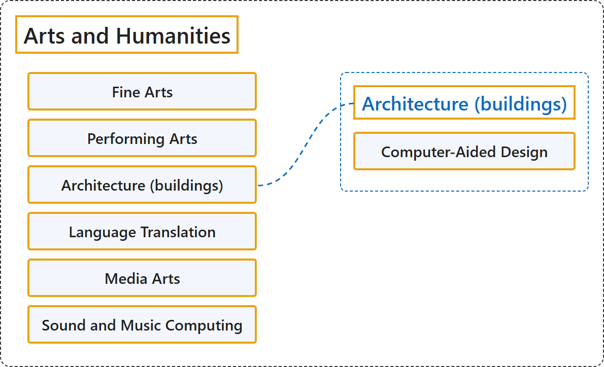

# 12.7 Arts and Humanities

## Classification

## Glossary

| Term | Definition | 中文翻译 | Source |
|---|---|---|---|
| **Arts and Humanities** 艺术与人文 | (No definition) | （无定义） | [Association for Computing Machinery, 2012](https://www.acm.org/publications/class-2012) |
| **Fine Arts** 美术 | (No definition) | （无定义） | [Association for Computing Machinery, 2012](https://www.acm.org/publications/class-2012) |
| **Performing Arts** 表演艺术 | (No definition) | （无定义） | [Association for Computing Machinery, 2012](https://www.acm.org/publications/class-2012) |
| **Architecture (buildings)** 建筑（建筑物） | (No definition) | （无定义） | [Association for Computing Machinery, 2012](https://www.acm.org/publications/class-2012) |
| **Computer-Aided Design** 计算机辅助设计 | (No definition) | （无定义） | [Association for Computing Machinery, 2012](https://www.acm.org/publications/class-2012) |
| **Language Translation** 语言翻译 | (No definition) | （无定义） | [Association for Computing Machinery, 2012](https://www.acm.org/publications/class-2012) |
| **Media Arts** 媒体艺术 | (No definition) | （无定义） | [Association for Computing Machinery, 2012](https://www.acm.org/publications/class-2012) |
| **Sound and Music Computing** 声音与音乐计算 | (No definition) | （无定义） | [Association for Computing Machinery, 2012](https://www.acm.org/publications/class-2012) |

## References

Association for Computing Machinery. (2012). *The 2012 ACM Computing Classification System*. Retrieved October 28, 2026, from <https://www.acm.org/publications/class-2012>
