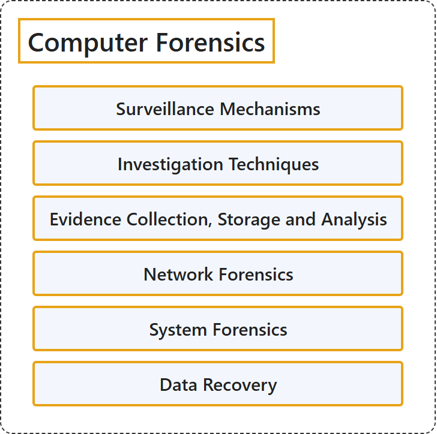

# 12.6 Computer Forensics

## Classification

## Glossary

| Term | Definition | 中文翻译 | Source |
|---|---|---|---|
| **Computer Forensics** 计算机取证 | (No definition) | （无定义） | [Association for Computing Machinery, 2012](https://www.acm.org/publications/class-2012) |
| **Surveillance Mechanisms** 监控机制 | (No definition) | （无定义） | [Association for Computing Machinery, 2012](https://www.acm.org/publications/class-2012) |
| **Investigation Techniques** 调查技术 | (No definition) | （无定义） | [Association for Computing Machinery, 2012](https://www.acm.org/publications/class-2012) |
| **Evidence Collection, Storage and Analysis** 证据收集、存储与分析 | (No definition) | （无定义） | [Association for Computing Machinery, 2012](https://www.acm.org/publications/class-2012) |
| **Network Forensics** 网络取证 | (No definition) | （无定义） | [Association for Computing Machinery, 2012](https://www.acm.org/publications/class-2012) |
| **System Forensics** 系统取证 | (No definition) | （无定义） | [Association for Computing Machinery, 2012](https://www.acm.org/publications/class-2012) |
| **Data Recovery** 数据恢复 | (No definition) | （无定义） | [Association for Computing Machinery, 2012](https://www.acm.org/publications/class-2012) |

## References

Association for Computing Machinery. (2012). *The 2012 ACM Computing Classification System*. Retrieved October 28, 2026, from <https://www.acm.org/publications/class-2012>
