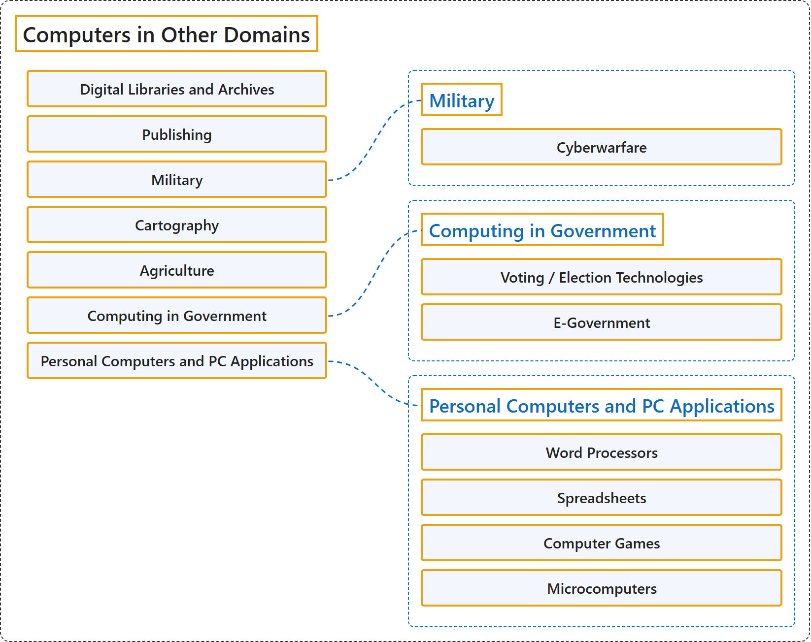

# 12.8 Computers in Other Domains

## Classification

## Glossary

| Term | Definition | 中文翻译 | Source |
|---|---|---|---|
| **Computers in Other Domains** 其他领域中的计算机 | (No definition) | （无定义） | [Association for Computing Machinery, 2012](https://www.acm.org/publications/class-2012) |
| **Digital Libraries and Archives** 数字图书馆与档案馆 | (No definition) | （无定义） | [Association for Computing Machinery, 2012](https://www.acm.org/publications/class-2012) |
| **Publishing** 出版 | (No definition) | （无定义） | [Association for Computing Machinery, 2012](https://www.acm.org/publications/class-2012) |
| **Military** 军事 | (No definition) | （无定义） | [Association for Computing Machinery, 2012](https://www.acm.org/publications/class-2012) |
| **Cyberwarfare** 网络战 | (No definition) | （无定义） | [Association for Computing Machinery, 2012](https://www.acm.org/publications/class-2012) |
| **Cartography** 制图学 | (No definition) | （无定义） | [Association for Computing Machinery, 2012](https://www.acm.org/publications/class-2012) |
| **Agriculture** 农业 | (No definition) | （无定义） | [Association for Computing Machinery, 2012](https://www.acm.org/publications/class-2012) |
| **Computing in Government** 政府中的计算 | (No definition) | （无定义） | [Association for Computing Machinery, 2012](https://www.acm.org/publications/class-2012) |
| **Voting / Election Technologies** 投票/选举技术 | (No definition) | （无定义） | [Association for Computing Machinery, 2012](https://www.acm.org/publications/class-2012) |
| **E-Government** 电子政务 | (No definition) | （无定义） | [Association for Computing Machinery, 2012](https://www.acm.org/publications/class-2012) |
| **Personal Computers and PC Applications** 个人计算机与 PC 应用 | (No definition) | （无定义） | [Association for Computing Machinery, 2012](https://www.acm.org/publications/class-2012) |
| **Word Processors** 文字处理器 | (No definition) | （无定义） | [Association for Computing Machinery, 2012](https://www.acm.org/publications/class-2012) |
| **Spreadsheets** 电子表格 | (No definition) | （无定义） | [Association for Computing Machinery, 2012](https://www.acm.org/publications/class-2012) |
| **Computer Games** 电脑游戏 | (No definition) | （无定义） | [Association for Computing Machinery, 2012](https://www.acm.org/publications/class-2012) |
| **Microcomputers** 微型计算机 | (No definition) | （无定义） | [Association for Computing Machinery, 2012](https://www.acm.org/publications/class-2012) |

## References

Association for Computing Machinery. (2012). *The 2012 ACM Computing Classification System*. Retrieved October 28, 2026, from <https://www.acm.org/publications/class-2012>
