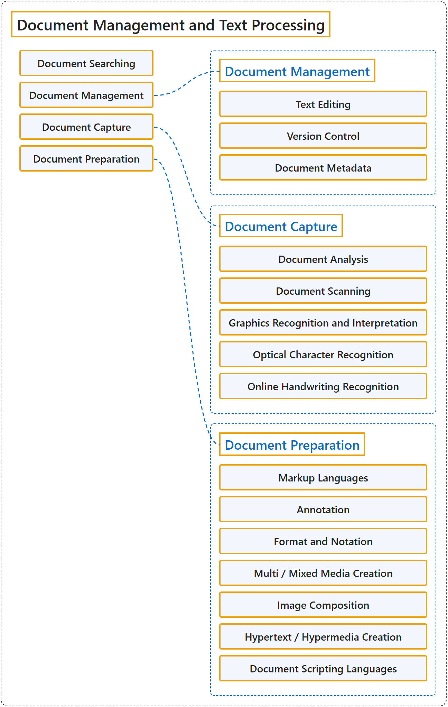

# 12.11 Document Management and Text Processing

## Classification

## Glossary

| Term | Definition | 中文翻译 | Source |
|---|---|---|---|
| **Document Management and Text Processing** 文档管理与文本处理 | (No definition) | （无定义） | [Association for Computing Machinery, 2012](https://www.acm.org/publications/class-2012) |
| **Document Searching** 文档搜索 | (No definition) | （无定义） | [Association for Computing Machinery, 2012](https://www.acm.org/publications/class-2012) |
| **Document Management** 文档管理 | (No definition) | （无定义） | [Association for Computing Machinery, 2012](https://www.acm.org/publications/class-2012) |
| **Text Editing** 文本编辑 | (No definition) | （无定义） | [Association for Computing Machinery, 2012](https://www.acm.org/publications/class-2012) |
| **Version Control** 版本控制 | (No definition) | （无定义） | [Association for Computing Machinery, 2012](https://www.acm.org/publications/class-2012) |
| **Document Metadata** 文档元数据 | (No definition) | （无定义） | [Association for Computing Machinery, 2012](https://www.acm.org/publications/class-2012) |
| **Document Capture** 文档采集 | (No definition) | （无定义） | [Association for Computing Machinery, 2012](https://www.acm.org/publications/class-2012) |
| **Document Analysis** 文档分析 | (No definition) | （无定义） | [Association for Computing Machinery, 2012](https://www.acm.org/publications/class-2012) |
| **Document Scanning** 文档扫描 | (No definition) | （无定义） | [Association for Computing Machinery, 2012](https://www.acm.org/publications/class-2012) |
| **Graphics Recognition and Interpretation** 图形识别与解释 | (No definition) | （无定义） | [Association for Computing Machinery, 2012](https://www.acm.org/publications/class-2012) |
| **Optical Character Recognition** 光学字符识别 | (No definition) | （无定义） | [Association for Computing Machinery, 2012](https://www.acm.org/publications/class-2012) |
| **Online Handwriting Recognition** 联机手写识别 | (No definition) | （无定义） | [Association for Computing Machinery, 2012](https://www.acm.org/publications/class-2012) |
| **Document Preparation** 文档准备 | (No definition) | （无定义） | [Association for Computing Machinery, 2012](https://www.acm.org/publications/class-2012) |
| **Markup Languages** 标记语言 | (No definition) | （无定义） | [Association for Computing Machinery, 2012](https://www.acm.org/publications/class-2012) |
| **Annotation** 标注 | (No definition) | （无定义） | [Association for Computing Machinery, 2012](https://www.acm.org/publications/class-2012) |
| **Format and Notation** 格式与记法 | (No definition) | （无定义） | [Association for Computing Machinery, 2012](https://www.acm.org/publications/class-2012) |
| **Multi / Mixed Media Creation** 多媒体/混合媒体创作 | (No definition) | （无定义） | [Association for Computing Machinery, 2012](https://www.acm.org/publications/class-2012) |
| **Image Composition** 图像合成 | (No definition) | （无定义） | [Association for Computing Machinery, 2012](https://www.acm.org/publications/class-2012) |
| **Hypertext / Hypermedia Creation** 超文本/超媒体创作 | (No definition) | （无定义） | [Association for Computing Machinery, 2012](https://www.acm.org/publications/class-2012) |
| **Document Scripting Languages** 文档脚本语言 | (No definition) | （无定义） | [Association for Computing Machinery, 2012](https://www.acm.org/publications/class-2012) |

## References

Association for Computing Machinery. (2012). *The 2012 ACM Computing Classification System*. Retrieved October 28, 2026, from <https://www.acm.org/publications/class-2012>
