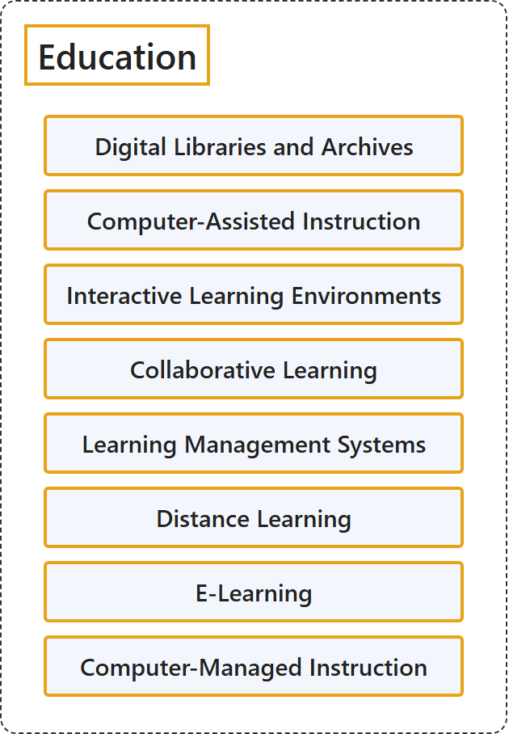

# 12.10 Education

## Classification

## Glossary

| Term | Definition | 中文翻译 | Source |
|---|---|---|---|
| **Education** 教育 | (No definition) | （无定义） | [Association for Computing Machinery, 2012](https://www.acm.org/publications/class-2012) |
| **Digital Libraries and Archives** 数字图书馆与档案馆 | (No definition) | （无定义） | [Association for Computing Machinery, 2012](https://www.acm.org/publications/class-2012) |
| **Computer-Assisted Instruction** 计算机辅助教学 | (No definition) | （无定义） | [Association for Computing Machinery, 2012](https://www.acm.org/publications/class-2012) |
| **Interactive Learning Environments** 交互式学习环境 | (No definition) | （无定义） | [Association for Computing Machinery, 2012](https://www.acm.org/publications/class-2012) |
| **Collaborative Learning** 协作学习 | (No definition) | （无定义） | [Association for Computing Machinery, 2012](https://www.acm.org/publications/class-2012) |
| **Learning Management Systems** 学习管理系统 | (No definition) | （无定义） | [Association for Computing Machinery, 2012](https://www.acm.org/publications/class-2012) |
| **Distance Learning** 远程学习 | (No definition) | （无定义） | [Association for Computing Machinery, 2012](https://www.acm.org/publications/class-2012) |
| **E-Learning** 电子学习 | (No definition) | （无定义） | [Association for Computing Machinery, 2012](https://www.acm.org/publications/class-2012) |
| **Computer-Managed Instruction** 计算机管理教学 | (No definition) | （无定义） | [Association for Computing Machinery, 2012](https://www.acm.org/publications/class-2012) |

## References

Association for Computing Machinery. (2012). *The 2012 ACM Computing Classification System*. Retrieved October 28, 2026, from <https://www.acm.org/publications/class-2012>
