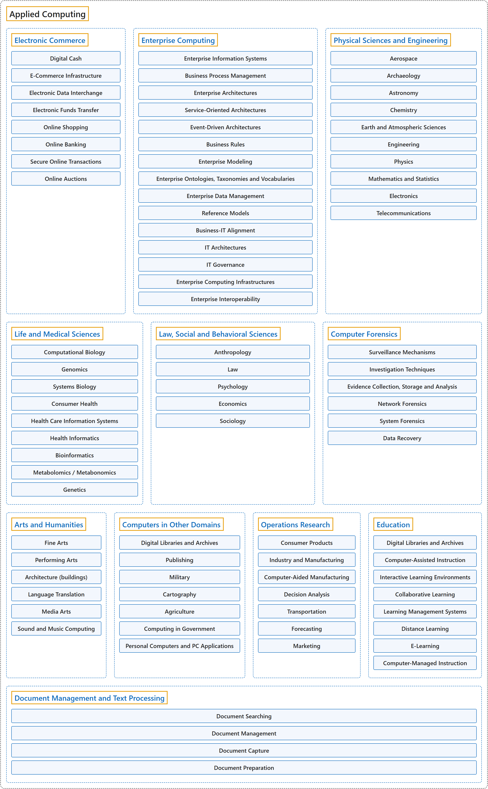

# 12. Applied Computing

## Classification

## Glossary

| Term | Definition | 中文翻译 | Source |
|---|---|---|---|
| **Applied Computing** 应用计算 | (No definition) | （无定义） | [Association for Computing Machinery, 2012](https://www.acm.org/publications/class-2012) |
| **[Electronic Commerce](electronic-commerce.md)** 电子商务 | (No definition) | （无定义） | [Association for Computing Machinery, 2012](https://www.acm.org/publications/class-2012) |
| **[Enterprise Computing](enterprise-computing.md)** 企业计算 | (No definition) | （无定义） | [Association for Computing Machinery, 2012](https://www.acm.org/publications/class-2012) |
| **[Physical Sciences and Engineering](physical-sciences-and-engineering.md)** 物理科学与工程 | (No definition) | （无定义） | [Association for Computing Machinery, 2012](https://www.acm.org/publications/class-2012) |
| **[Life and Medical Sciences](life-and-medical-sciences.md)** 生命与医学科学 | (No definition) | （无定义） | [Association for Computing Machinery, 2012](https://www.acm.org/publications/class-2012) |
| **[Law, Social and Behavioral Sciences](law-social-and-behavioral-sciences.md)** 法律、社会与行为科学 | (No definition) | （无定义） | [Association for Computing Machinery, 2012](https://www.acm.org/publications/class-2012) |
| **[Computer Forensics](computer-forensics.md)** 计算机取证 | (No definition) | （无定义） | [Association for Computing Machinery, 2012](https://www.acm.org/publications/class-2012) |
| **[Arts and Humanities](arts-and-humanities.md)** 艺术与人文 | (No definition) | （无定义） | [Association for Computing Machinery, 2012](https://www.acm.org/publications/class-2012) |
| **[Computers in Other Domains](computers-in-other-domains.md)** 其他领域中的计算机 | (No definition) | （无定义） | [Association for Computing Machinery, 2012](https://www.acm.org/publications/class-2012) |
| **[Operations Research](operations-research.md)** 运筹学 | (No definition) | （无定义） | [Association for Computing Machinery, 2012](https://www.acm.org/publications/class-2012) |
| **[Education](education.md)** 教育 | (No definition) | （无定义） | [Association for Computing Machinery, 2012](https://www.acm.org/publications/class-2012) |
| **[Document Management and Text Processing](document-management-and-text-processing.md)** 文档管理与文本处理 | (No definition) | （无定义） | [Association for Computing Machinery, 2012](https://www.acm.org/publications/class-2012) |

## References

Association for Computing Machinery. (2012). *The 2012 ACM Computing Classification System*. Retrieved October 27, 2026, from <https://www.acm.org/publications/class-2012>
