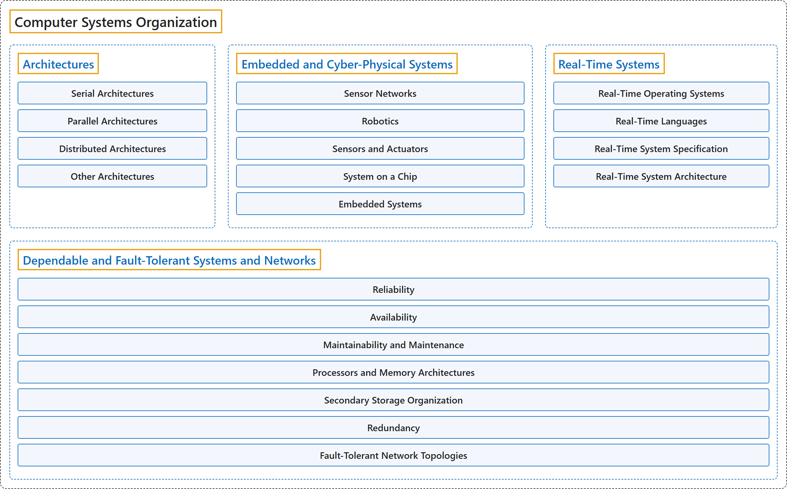

# 3. Computer Systems Organization

## Classification

## Glossary

| Term | Definition | 中文翻译 | Source |
|---|---|---|---|
| **Computer Systems Organization** 计算机系统组织 | (context) "A computer system is a **set of hardware and software infrastructures** upon which **applications are constructed**." | （语境）计算机系统是**一组硬件和软件基础设施**，**应用程序在其上构建**。 | [Joint Task Force on Computing Curricula, 2024, SF "Preamble" section, para. 1](https://csed.acm.org/wp-content/uploads/2024/04/3.1-Body-of-Knowledge-1.pdf#page=229) |
| **[Architectures](architectures.md)** 体系结构 | (No definition) | （无定义） | [Association for Computing Machinery, 2012](https://www.acm.org/publications/class-2012) |
| **[Embedded and Cyber-Physical Systems](embedded-and-cyber-physical-systems.md)** 嵌入式与信息物理系统 | (No definition) | （无定义） | [Association for Computing Machinery, 2012](https://www.acm.org/publications/class-2012) |
| **[Real-Time Systems](real-time-systems.md)** 实时系统 | (No definition) | （无定义） | [Association for Computing Machinery, 2012](https://www.acm.org/publications/class-2012) |
| **[Dependable and Fault-Tolerant Systems and Networks](dependable-and-fault-tolerant-systems-and-networks.md)** 可信与容错的系统和网络 | (No definition) | （无定义） | [Association for Computing Machinery, 2012](https://www.acm.org/publications/class-2012) |

## References

Association for Computing Machinery. (2012). *The 2012 ACM Computing Classification System*. Retrieved October 28, 2026, from <https://www.acm.org/publications/class-2012>

Joint Task Force on Computing Curricula. (2024). *Computer science curricula 2023*. Association for Computing Machinery. <https://doi.org/10.1145/3664191>
