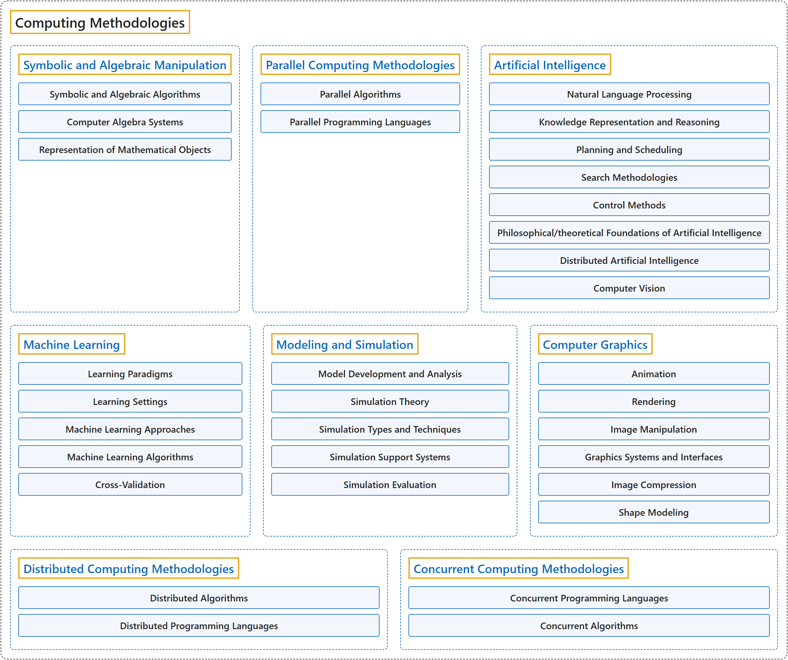

# 11. Computing Methodologies

## Classification

## Glossary

| Term | Definition | 中文翻译 | Source |
|---|---|---|---|
| **Computing Methodologies** 计算方法 | (No definition) | （无定义） | [Association for Computing Machinery, 2012](https://www.acm.org/publications/class-2012) |
| **[Symbolic and Algebraic Manipulation](symbolic-and-algebraic-manipulation.md)** 符号与代数运算 | (No definition) | （无定义） | [Association for Computing Machinery, 2012](https://www.acm.org/publications/class-2012) |
| **[Parallel Computing Methodologies](parallel-computing-methodologies.md)** 并行计算方法 | (No definition) | （无定义） | [Association for Computing Machinery, 2012](https://www.acm.org/publications/class-2012) |
| **[Artificial Intelligence](artificial-intelligence.md)** 人工智能 | (No definition) | （无定义） | [Association for Computing Machinery, 2012](https://www.acm.org/publications/class-2012) |
| **[Machine Learning](machine-learning.md)** 机器学习 | (No definition) | （无定义） | [Association for Computing Machinery, 2012](https://www.acm.org/publications/class-2012) |
| **[Modeling and Simulation](modeling-and-simulation.md)** 建模与仿真 | (No definition) | （无定义） | [Association for Computing Machinery, 2012](https://www.acm.org/publications/class-2012) |
| **[Computer Graphics](computer-graphics.md)** 计算机图形学 | (No definition) | （无定义） | [Association for Computing Machinery, 2012](https://www.acm.org/publications/class-2012) |
| **[Distributed Computing Methodologies](distributed-computing-methodologies.md)** 分布式计算方法 | (No definition) | （无定义） | [Association for Computing Machinery, 2012](https://www.acm.org/publications/class-2012) |
| **[Concurrent Computing Methodologies](concurrent-computing-methodologies.md)** 并发计算方法 | (No definition) | （无定义） | [Association for Computing Machinery, 2012](https://www.acm.org/publications/class-2012) |

## References

Association for Computing Machinery. (2012). *The 2012 ACM Computing Classification System*. Retrieved October 27, 2026, from <https://www.acm.org/publications/class-2012>
