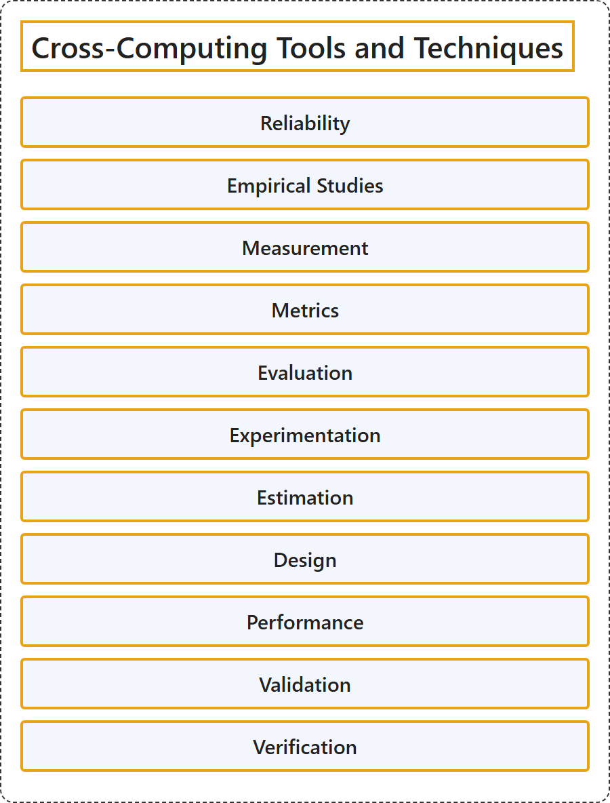

# 1.1 Cross-Computing Tools and Techniques

## Classification

## Glossary

| Term | Definition | 中文翻译 | Source |
|---|---|---|---|
| **Cross-Computing Tools and Techniques** 跨计算的工具与技术 | (No definition) | （无定义） | [Association for Computing Machinery, 2012](https://www.acm.org/publications/class-2012) |
| **Reliability** 可靠性 | "The **ability of a system or component to function** under stated conditions **for a specified period of time**." | 系统或组件在规定条件下、**在规定时间内**正常**发挥功能的能力**。 | [National Institute of Standards and Technology, n.d.-e, "reliability" entry, definition 1](https://csrc.nist.gov/glossary/term/reliability#:~:text=The%20ability%20of%20a%20system%20or%20component) |
| **Empirical Studies** 实证研究 | (context) "**based on what is experienced or seen** rather than on theory" | （语境）**基于经历或观察到的事实**，而不是基于理论 | [Cambridge University Press & Assessment, n.d.-a, "empirical" adjective](https://dictionary.cambridge.org/dictionary/english/empirical) |
| **Measurement** 测量 | "The process of **obtaining quantitative values** using quantitative methods." | 用定量方法**获得定量数值**的过程。 | [National Institute of Standards and Technology, n.d.-c, "measurement" entry](https://csrc.nist.gov/glossary/term/measurement#:~:text=The%20process%20of%20obtaining%20quantitative%20values) |
| **Metrics** 度量指标 | "**Measures and assessment results** designed to **track progress**, facilitate decision-making, and improve performance **with respect to a set target**." | 为**对照既定目标**来**跟踪进展**、辅助决策和提升绩效而设计的**度量和评估结果**。 | [National Institute of Standards and Technology, n.d.-d, "metrics" entry, definition 2](https://csrc.nist.gov/glossary/term/metrics#:~:text=Measures%20and%20assessment%20results%20designed) |
| **Evaluation** 评估 | "the process of **judging or calculating** the quality, importance, amount, or **value of something**" | **判断或计算**某事物的质量、重要性、数量或**价值**的过程 | [Cambridge University Press & Assessment, n.d.-c, "evaluation" noun](https://dictionary.cambridge.org/dictionary/english/evaluation) |
| **Experimentation** 实验 | "A **systematic approach** to the process of **testing new ideas, methods, or activities** that applies principles and techniques at the data collection stage to ensure the generation of **valid, defensible, and supportable conclusions**." | 一种**系统化的方法**，用于**测试新的想法、方法或活动**；它在数据收集阶段运用原则和技术，以确保得出**有效、站得住脚且有依据的结论**。 | [National Institute of Standards and Technology, n.d.-b, "experimentation" entry](https://csrc.nist.gov/glossary/term/experimentation#:~:text=A%20systematic%20approach%20to%20the%20process) |
| **Estimation** 估算 | "a **guess or calculation** about the cost, size, value, etc. of something" | 对某事物的成本、规模、价值等所做的**猜测或计算** | [Cambridge University Press & Assessment, n.d.-b, "estimation" noun, sense 2](https://dictionary.cambridge.org/dictionary/english/estimation) |
| **Design** 设计 | "Process to **define the architecture, system elements, interfaces, and other characteristics** of a system or system element." | **定义**系统或系统元素的**架构、系统元素、接口和其他特性**的过程。 | [National Institute of Standards and Technology, n.d.-a, "design" entry, definition 1](https://csrc.nist.gov/glossary/term/design#:~:text=Process%20to%20define%20the%20architecture) |
| **Performance** 性能 | "**how well** a person, **machine**, etc. **does a piece of work** or an activity" | 一个人、**一台机器**等**完成一项工作**或一项活动**的好坏程度** | [Cambridge University Press & Assessment, n.d.-d, "performance" noun](https://dictionary.cambridge.org/dictionary/english/performance) |
| **Validation** 确认 | "Confirmation, through the provision of objective evidence, that the **requirements for a specific intended use or application** have been fulfilled." | 通过提供客观证据来证实：**针对某一特定预期用途或应用的要求**已经得到满足。 | [National Institute of Standards and Technology, n.d.-f, "validation" entry, definition 2](https://csrc.nist.gov/glossary/term/validation#:~:text=that%20the%20requirements%20for%20a%20specific%20intended%20use) |
| **Verification** 验证 | "Confirmation, through the provision of objective evidence, that **specified requirements have been fulfilled**." | 通过提供客观证据来证实：**规定的要求已经得到满足**。 | [National Institute of Standards and Technology, n.d.-g, "verification" entry, definition 4](https://csrc.nist.gov/glossary/term/verification#:~:text=that%20specified%20requirements%20have%20been%20fulfilled) |

## References

Association for Computing Machinery. (2012). *The 2012 ACM Computing Classification System*. Retrieved October 28, 2026, from <https://www.acm.org/publications/class-2012>

Cambridge University Press & Assessment. (n.d.-a). Empirical. In *Cambridge Dictionary*. Retrieved October 28, 2026, from <https://dictionary.cambridge.org/dictionary/english/empirical>

Cambridge University Press & Assessment. (n.d.-b). Estimation. In *Cambridge Dictionary*. Retrieved October 28, 2026, from <https://dictionary.cambridge.org/dictionary/english/estimation>

Cambridge University Press & Assessment. (n.d.-c). Evaluation. In *Cambridge Dictionary*. Retrieved October 28, 2026, from <https://dictionary.cambridge.org/dictionary/english/evaluation>

Cambridge University Press & Assessment. (n.d.-d). Performance. In *Cambridge Dictionary*. Retrieved October 28, 2026, from <https://dictionary.cambridge.org/dictionary/english/performance>

National Institute of Standards and Technology. (n.d.-a). Design. In *CSRC glossary*. Retrieved October 28, 2026, from <https://csrc.nist.gov/glossary/term/design>

National Institute of Standards and Technology. (n.d.-b). Experimentation. In *CSRC glossary*. Retrieved October 28, 2026, from <https://csrc.nist.gov/glossary/term/experimentation>

National Institute of Standards and Technology. (n.d.-c). Measurement. In *CSRC glossary*. Retrieved October 28, 2026, from <https://csrc.nist.gov/glossary/term/measurement>

National Institute of Standards and Technology. (n.d.-d). Metrics. In *CSRC glossary*. Retrieved October 28, 2026, from <https://csrc.nist.gov/glossary/term/metrics>

National Institute of Standards and Technology. (n.d.-e). Reliability. In *CSRC glossary*. Retrieved October 28, 2026, from <https://csrc.nist.gov/glossary/term/reliability>

National Institute of Standards and Technology. (n.d.-f). Validation. In *CSRC glossary*. Retrieved October 28, 2026, from <https://csrc.nist.gov/glossary/term/validation>

National Institute of Standards and Technology. (n.d.-g). Verification. In *CSRC glossary*. Retrieved October 28, 2026, from <https://csrc.nist.gov/glossary/term/verification>
