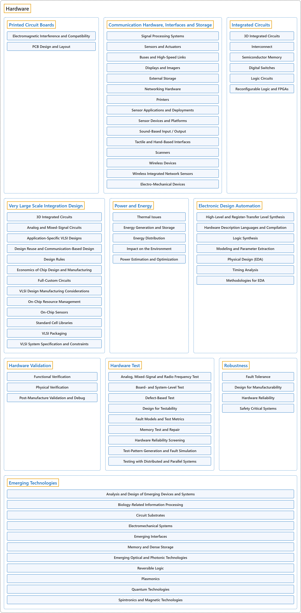

# 2. Hardware

## Classification

## Glossary

| Term | Definition | 中文翻译 | Source |
|---|---|---|---|
| **Hardware** 硬件 | (context) "The Architecture and Organization (AR) knowledge area aims to develop a **deeper understanding** of the **hardware environments** upon which almost all computing is based, and the relevant **interfaces** provided to higher software layers." | （语境）计算机体系结构与组成（AR）知识领域旨在**加深理解**两方面：几乎所有计算赖以进行的**硬件环境**，以及为更高软件层提供的相关**接口**。 | [Joint Task Force on Computing Curricula, 2024, AR "Preamble" section, para. 2](https://csed.acm.org/wp-content/uploads/2024/04/3.1-Body-of-Knowledge-1.pdf#page=39) |
| **[Printed Circuit Boards](printed-circuit-boards.md)** 印制电路板 | (No definition) | （无定义） | [Association for Computing Machinery, 2012](https://www.acm.org/publications/class-2012) |
| **[Communication Hardware, Interfaces and Storage](communication-hardware-interfaces-and-storage.md)** 通信硬件、接口和存储 | (No definition) | （无定义） | [Association for Computing Machinery, 2012](https://www.acm.org/publications/class-2012) |
| **[Integrated Circuits](integrated-circuits.md)** 集成电路 | (No definition) | （无定义） | [Association for Computing Machinery, 2012](https://www.acm.org/publications/class-2012) |
| **[Very Large Scale Integration Design](very-large-scale-integration-design.md)** 超大规模集成电路设计 | (No definition) | （无定义） | [Association for Computing Machinery, 2012](https://www.acm.org/publications/class-2012) |
| **[Power and Energy](power-and-energy.md)** 功率与能源 | (No definition) | （无定义） | [Association for Computing Machinery, 2012](https://www.acm.org/publications/class-2012) |
| **[Electronic Design Automation](electronic-design-automation.md)** 电子设计自动化 | (No definition) | （无定义） | [Association for Computing Machinery, 2012](https://www.acm.org/publications/class-2012) |
| **[Hardware Validation](hardware-validation.md)** 硬件确认 | (No definition) | （无定义） | [Association for Computing Machinery, 2012](https://www.acm.org/publications/class-2012) |
| **[Hardware Test](hardware-test.md)** 硬件测试 | (No definition) | （无定义） | [Association for Computing Machinery, 2012](https://www.acm.org/publications/class-2012) |
| **[Robustness](robustness.md)** 鲁棒性 | (No definition) | （无定义） | [Association for Computing Machinery, 2012](https://www.acm.org/publications/class-2012) |
| **[Emerging Technologies](emerging-technologies.md)** 新兴技术 | (No definition) | （无定义） | [Association for Computing Machinery, 2012](https://www.acm.org/publications/class-2012) |

## References

Association for Computing Machinery. (2012). *The 2012 ACM Computing Classification System*. Retrieved October 28, 2026, from <https://www.acm.org/publications/class-2012>

Joint Task Force on Computing Curricula. (2024). *Computer science curricula 2023*. Association for Computing Machinery. <https://doi.org/10.1145/3664191>
