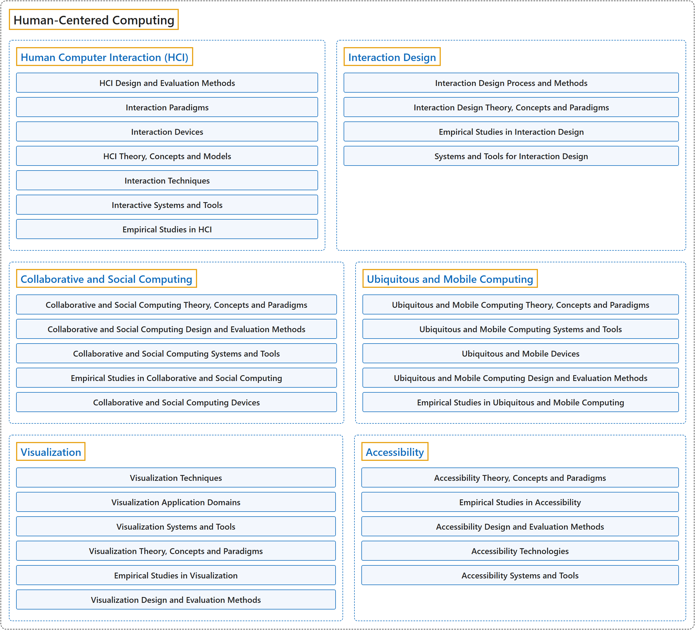

# 10. Human-Centered Computing

## Classification

## Glossary

| Term | Definition | 中文翻译 | Source |
|---|---|---|---|
| **Human-Centered Computing** 以人为本的计算 | (context) "Human-computer interaction (HCI) addresses those issues from an **interdisciplinary perspective** that includes **computer science, psychology, business strategy, and design principles**." | （语境）人机交互（HCI）从**跨学科的视角**处理这些问题，这一视角包括**计算机科学、心理学、商业战略和设计原则**。 | [Joint Task Force on Computing Curricula, 2024, HCI "Preamble" section, para. 1](https://csed.acm.org/wp-content/uploads/2024/04/3.1-Body-of-Knowledge-1.pdf#page=111) |
| **[Human Computer Interaction (HCI)](human-computer-interaction-hci.md)** 人机交互（HCI） | (No definition) | （无定义） | [Association for Computing Machinery, 2012](https://www.acm.org/publications/class-2012) |
| **[Interaction Design](interaction-design.md)** 交互设计 | (No definition) | （无定义） | [Association for Computing Machinery, 2012](https://www.acm.org/publications/class-2012) |
| **[Collaborative and Social Computing](collaborative-and-social-computing.md)** 协作与社会计算 | (No definition) | （无定义） | [Association for Computing Machinery, 2012](https://www.acm.org/publications/class-2012) |
| **[Ubiquitous and Mobile Computing](ubiquitous-and-mobile-computing.md)** 普适与移动计算 | (No definition) | （无定义） | [Association for Computing Machinery, 2012](https://www.acm.org/publications/class-2012) |
| **[Visualization](visualization.md)** 可视化 | (No definition) | （无定义） | [Association for Computing Machinery, 2012](https://www.acm.org/publications/class-2012) |
| **[Accessibility](accessibility.md)** 无障碍 | (No definition) | （无定义） | [Association for Computing Machinery, 2012](https://www.acm.org/publications/class-2012) |

## References

Association for Computing Machinery. (2012). *The 2012 ACM Computing Classification System*. Retrieved October 28, 2026, from <https://www.acm.org/publications/class-2012>

Joint Task Force on Computing Curricula. (2024). *Computer science curricula 2023*. Association for Computing Machinery. <https://doi.org/10.1145/3664191>
