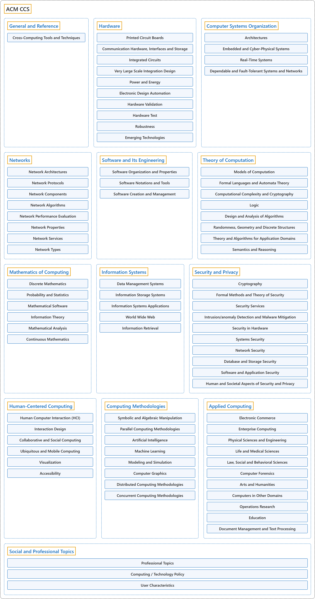

# ACM CCS

## Classification

## Glossary

| Term | Definition | 中文翻译 | Source |
|---|---|---|---|
| **ACM CCS** ACM 计算分类系统 | "The 2012 ACM Computing Classification System has been developed as a **poly-hierarchical ontology** that can be utilized in semantic web applications. It replaces the traditional 1998 version of the ACM Computing Classification System (CCS), which has served as **the de facto standard classification system for the computing field**." | 2012 ACM 计算分类系统被开发成一个**多层级的本体**，可以用于语义网应用。它取代了传统的 1998 版 ACM 计算分类系统（CCS），后者一直是**计算领域事实上的标准分类系统**。 | [Association for Computing Machinery, 2012, para. 1](https://www.acm.org/publications/class-2012#:~:text=The%202012%20ACM%20Computing%20Classification%20System%20has%20been%20developed) |
| **[General and Reference](general-and-reference/index.md)** 一般与参考 | (No definition) | （无定义） | [Association for Computing Machinery, 2012](https://www.acm.org/publications/class-2012) |
| **[Hardware](hardware/index.md)** 硬件 | (context) "The Architecture and Organization (AR) knowledge area aims to develop a **deeper understanding** of the **hardware environments** upon which almost all computing is based, and the relevant **interfaces** provided to higher software layers." | （语境）计算机体系结构与组成（AR）知识领域旨在**加深理解**两方面：几乎所有计算赖以进行的**硬件环境**，以及为更高软件层提供的相关**接口**。 | [Joint Task Force on Computing Curricula, 2024, AR "Preamble" section, para. 2](https://csed.acm.org/wp-content/uploads/2024/04/3.1-Body-of-Knowledge-1.pdf#page=39) |
| **[Computer Systems Organization](computer-systems-organization/index.md)** 计算机系统组织 | (context) "A computer system is a **set of hardware and software infrastructures** upon which **applications are constructed**." | （语境）计算机系统是**一组硬件和软件基础设施**，**应用程序在其上构建**。 | [Joint Task Force on Computing Curricula, 2024, SF "Preamble" section, para. 1](https://csed.acm.org/wp-content/uploads/2024/04/3.1-Body-of-Knowledge-1.pdf#page=229) |
| **[Networks](networks/index.md)** 网络 | (context) "This knowledge area deals with **key concepts in networking and communication**, as well as their **representative instantiations** in the **internet and other computer networks**." | （语境）这个知识领域涉及**网络与通信的关键概念**，以及它们的**代表性实现**，即在**互联网和其他计算机网络**中的实现。 | [Joint Task Force on Computing Curricula, 2024, NC "Preamble" section, para. 2](https://csed.acm.org/wp-content/uploads/2024/04/3.1-Body-of-Knowledge-1.pdf#page=135) |
| **[Software and Its Engineering](software-and-its-engineering/index.md)** 软件及其工程 | (context) "This is an essential insight: while programming is the skill that governs our ability to write a program, **software engineering** is distinct in **two dimensions: time and people**." | （语境）这是一个关键的洞见：编程是决定我们能否写出程序的技能，而**软件工程**的不同在于**两个维度：时间和人**。 | [Joint Task Force on Computing Curricula, 2024, SE "Preamble" section, para. 1](https://csed.acm.org/wp-content/uploads/2024/04/3.1-Body-of-Knowledge-1.pdf#page=175) |
| **[Theory of Computation](theory-of-computation/index.md)** 计算理论 | (context) "Algorithms and data structures are **fundamental to computer science**, since every theoretical computation and applied program consists of **algorithms** that operate on **data elements** possessing some **underlying structure**." | （语境）算法和数据结构**对计算机科学至关重要**，因为每一个理论计算和应用程序都由**算法**构成，这些算法操作的**数据元素**具有某种**底层结构**。 | [Joint Task Force on Computing Curricula, 2024, AL "Preamble" section, para. 1](https://csed.acm.org/wp-content/uploads/2024/04/3.1-Body-of-Knowledge-1.pdf#page=25) |
| **[Mathematics of Computing](mathematics-of-computing/index.md)** 计算数学 | (context) "This Mathematical and Statistical Foundations (MSF) knowledge area – the successor to the ACM CS2013 curriculum's 'Discrete Structures' area – seeks to identify the **mathematical and statistical material** that **undergirds modern computer science**." | （语境）数学与统计基础（MSF）这一知识领域是 ACM CS2013 课程体系中"离散结构"领域的继任者，旨在找出**数学和统计内容**，它们**支撑着现代计算机科学**。 | [Joint Task Force on Computing Curricula, 2024, MSF "Preamble" section, para. 1](https://csed.acm.org/wp-content/uploads/2024/04/3.1-Body-of-Knowledge-1.pdf#page=123) |
| **[Information Systems](information-systems/index.md)** 信息系统 | "Discrete set of **information resources** organized for the **collection, processing, maintenance, use, sharing, dissemination, or disposition of information**." | 为**收集、处理、维护、使用、共享、分发或处置信息**而组织起来的一组离散的**信息资源**。 | [National Institute of Standards and Technology, n.d., "information system" entry, definition 1](https://csrc.nist.gov/glossary/term/information_system#:~:text=Discrete%20set%20of%20information%20resources%20organized) |
| **[Security and Privacy](security-and-privacy/index.md)** 安全与隐私 | (context) "The Security (SEC) knowledge area focuses on developing a **security mindset** into the overall ethos of computer science graduates so that **security is embedded in all their work products**." | （语境）安全（SEC）知识领域着重把**安全思维**融入计算机科学毕业生的整体精神，使**安全嵌入他们所有的工作成果**。 | [Joint Task Force on Computing Curricula, 2024, SEC "Preamble" section, para. 2](https://csed.acm.org/wp-content/uploads/2024/04/3.1-Body-of-Knowledge-1.pdf#page=193) |
| **[Human-Centered Computing](human-centered-computing/index.md)** 以人为本的计算 | (context) "Human-computer interaction (HCI) addresses those issues from an **interdisciplinary perspective** that includes **computer science, psychology, business strategy, and design principles**." | （语境）人机交互（HCI）从**跨学科的视角**处理这些问题，这一视角包括**计算机科学、心理学、商业战略和设计原则**。 | [Joint Task Force on Computing Curricula, 2024, HCI "Preamble" section, para. 1](https://csed.acm.org/wp-content/uploads/2024/04/3.1-Body-of-Knowledge-1.pdf#page=111) |
| **[Computing Methodologies](computing-methodologies/index.md)** 计算方法 | (No definition) | （无定义） | [Association for Computing Machinery, 2012](https://www.acm.org/publications/class-2012) |
| **[Applied Computing](applied-computing/index.md)** 应用计算 | (No definition) | （无定义） | [Association for Computing Machinery, 2012](https://www.acm.org/publications/class-2012) |
| **[Social and Professional Topics](social-and-professional-topics/index.md)** 社会与职业主题 | (context) "It is more evident today than ever that students must also be exposed to the **larger societal context of computing** to develop an understanding of the critical and relevant **social, ethical, legal, and professional issues and responsibilities** at hand." | （语境）如今比以往任何时候都更明显：学生还必须接触**计算的更大社会背景**，从而理解当前关键且相关的**社会、伦理、法律和职业问题与责任**。 | [Joint Task Force on Computing Curricula, 2024, SEP "Preamble" section, para. 2](https://csed.acm.org/wp-content/uploads/2024/04/3.1-Body-of-Knowledge-1.pdf#page=207) |

## References

Association for Computing Machinery. (2012). *The 2012 ACM Computing Classification System*. Retrieved October 27, 2026, from <https://www.acm.org/publications/class-2012>

Joint Task Force on Computing Curricula. (2024). *Computer science curricula 2023*. Association for Computing Machinery. <https://doi.org/10.1145/3664191>

National Institute of Standards and Technology. (n.d.). Information system. In *CSRC glossary*. Retrieved October 27, 2026, from <https://csrc.nist.gov/glossary/term/information_system>
