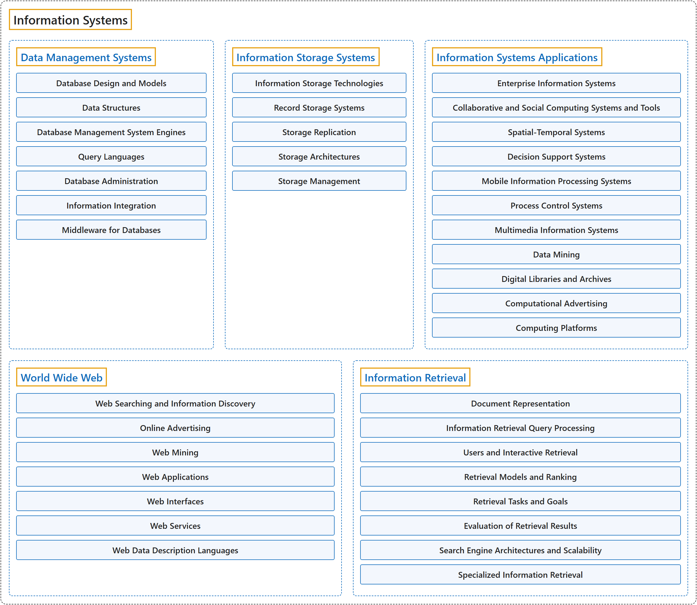

# 8. Information Systems

## Classification

## Glossary

| Term | Definition | 中文翻译 | Source |
|---|---|---|---|
| **Information Systems** 信息系统 | "Discrete set of **information resources** organized for the **collection, processing, maintenance, use, sharing, dissemination, or disposition of information**." | 为**收集、处理、维护、使用、共享、分发或处置信息**而组织起来的一组离散的**信息资源**。 | [National Institute of Standards and Technology, n.d., "information system" entry, definition 1](https://csrc.nist.gov/glossary/term/information_system#:~:text=Discrete%20set%20of%20information%20resources%20organized) |
| **[Data Management Systems](data-management-systems.md)** 数据管理系统 | (No definition) | （无定义） | [Association for Computing Machinery, 2012](https://www.acm.org/publications/class-2012) |
| **[Information Storage Systems](information-storage-systems.md)** 信息存储系统 | (No definition) | （无定义） | [Association for Computing Machinery, 2012](https://www.acm.org/publications/class-2012) |
| **[Information Systems Applications](information-systems-applications.md)** 信息系统应用 | (No definition) | （无定义） | [Association for Computing Machinery, 2012](https://www.acm.org/publications/class-2012) |
| **[World Wide Web](world-wide-web.md)** 万维网 | (No definition) | （无定义） | [Association for Computing Machinery, 2012](https://www.acm.org/publications/class-2012) |
| **[Information Retrieval](information-retrieval.md)** 信息检索 | (No definition) | （无定义） | [Association for Computing Machinery, 2012](https://www.acm.org/publications/class-2012) |

## References

Association for Computing Machinery. (2012). *The 2012 ACM Computing Classification System*. Retrieved October 28, 2026, from <https://www.acm.org/publications/class-2012>

National Institute of Standards and Technology. (n.d.). Information system. In *CSRC glossary*. Retrieved October 27, 2026, from <https://csrc.nist.gov/glossary/term/information_system>
