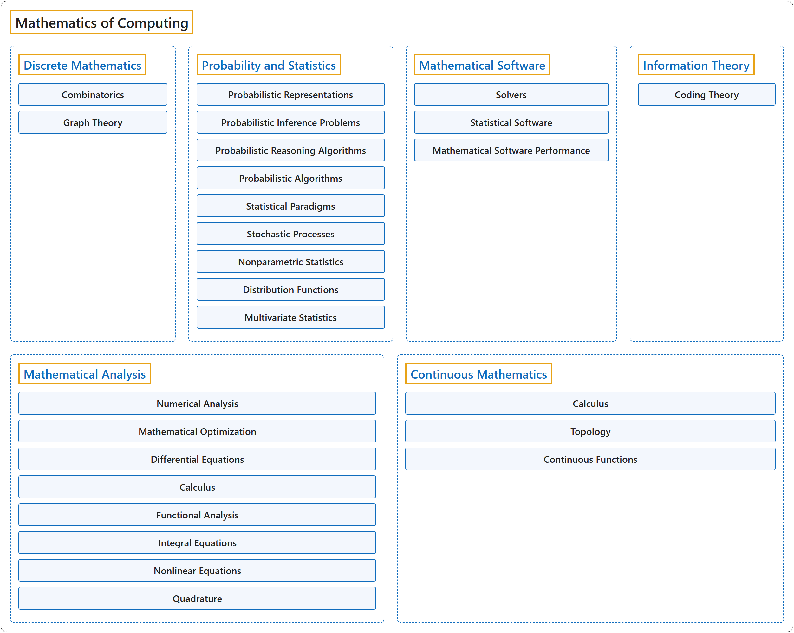

# 7. Mathematics of Computing

## Classification

## Glossary

| Term | Definition | 中文翻译 | Source |
|---|---|---|---|
| **Mathematics of Computing** 计算数学 | (context) "This Mathematical and Statistical Foundations (MSF) knowledge area – the successor to the ACM CS2013 curriculum's 'Discrete Structures' area – seeks to identify the **mathematical and statistical material** that **undergirds modern computer science**." | （语境）数学与统计基础（MSF）这一知识领域是 ACM CS2013 课程体系中"离散结构"领域的继任者，旨在找出**数学和统计内容**，它们**支撑着现代计算机科学**。 | [Joint Task Force on Computing Curricula, 2024, MSF "Preamble" section, para. 1](https://csed.acm.org/wp-content/uploads/2024/04/3.1-Body-of-Knowledge-1.pdf#page=123) |
| **[Discrete Mathematics](discrete-mathematics.md)** 离散数学 | (No definition) | （无定义） | [Association for Computing Machinery, 2012](https://www.acm.org/publications/class-2012) |
| **[Probability and Statistics](probability-and-statistics.md)** 概率与统计 | (No definition) | （无定义） | [Association for Computing Machinery, 2012](https://www.acm.org/publications/class-2012) |
| **[Mathematical Software](mathematical-software.md)** 数学软件 | (No definition) | （无定义） | [Association for Computing Machinery, 2012](https://www.acm.org/publications/class-2012) |
| **[Information Theory](information-theory.md)** 信息论 | (No definition) | （无定义） | [Association for Computing Machinery, 2012](https://www.acm.org/publications/class-2012) |
| **[Mathematical Analysis](mathematical-analysis.md)** 数学分析 | (No definition) | （无定义） | [Association for Computing Machinery, 2012](https://www.acm.org/publications/class-2012) |
| **[Continuous Mathematics](continuous-mathematics.md)** 连续数学 | (No definition) | （无定义） | [Association for Computing Machinery, 2012](https://www.acm.org/publications/class-2012) |

## References

Association for Computing Machinery. (2012). *The 2012 ACM Computing Classification System*. Retrieved October 28, 2026, from <https://www.acm.org/publications/class-2012>

Joint Task Force on Computing Curricula. (2024). *Computer science curricula 2023*. Association for Computing Machinery. <https://doi.org/10.1145/3664191>
