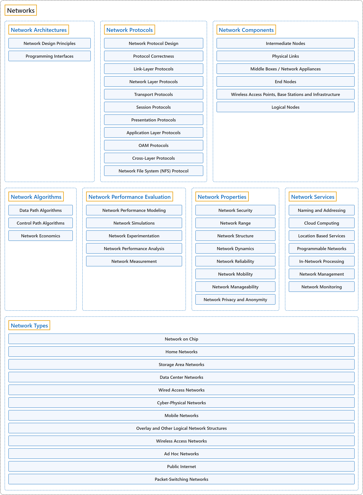

# 4. Networks

## Classification

## Glossary

| Term | Definition | 中文翻译 | Source |
|---|---|---|---|
| **Networks** 网络 | (context) "This knowledge area deals with **key concepts in networking and communication**, as well as their **representative instantiations** in the **internet and other computer networks**." | （语境）这个知识领域涉及**网络与通信的关键概念**，以及它们的**代表性实现**，即在**互联网和其他计算机网络**中的实现。 | [Joint Task Force on Computing Curricula, 2024, NC "Preamble" section, para. 2](https://csed.acm.org/wp-content/uploads/2024/04/3.1-Body-of-Knowledge-1.pdf#page=135) |
| **[Network Architectures](network-architectures.md)** 网络体系结构 | (No definition) | （无定义） | [Association for Computing Machinery, 2012](https://www.acm.org/publications/class-2012) |
| **[Network Protocols](network-protocols.md)** 网络协议 | (No definition) | （无定义） | [Association for Computing Machinery, 2012](https://www.acm.org/publications/class-2012) |
| **[Network Components](network-components.md)** 网络组件 | (No definition) | （无定义） | [Association for Computing Machinery, 2012](https://www.acm.org/publications/class-2012) |
| **[Network Algorithms](network-algorithms.md)** 网络算法 | (No definition) | （无定义） | [Association for Computing Machinery, 2012](https://www.acm.org/publications/class-2012) |
| **[Network Performance Evaluation](network-performance-evaluation.md)** 网络性能评估 | (No definition) | （无定义） | [Association for Computing Machinery, 2012](https://www.acm.org/publications/class-2012) |
| **[Network Properties](network-properties.md)** 网络特性 | (No definition) | （无定义） | [Association for Computing Machinery, 2012](https://www.acm.org/publications/class-2012) |
| **[Network Services](network-services.md)** 网络服务 | (No definition) | （无定义） | [Association for Computing Machinery, 2012](https://www.acm.org/publications/class-2012) |
| **[Network Types](network-types.md)** 网络类型 | (No definition) | （无定义） | [Association for Computing Machinery, 2012](https://www.acm.org/publications/class-2012) |

## References

Association for Computing Machinery. (2012). *The 2012 ACM Computing Classification System*. Retrieved October 28, 2026, from <https://www.acm.org/publications/class-2012>

Joint Task Force on Computing Curricula. (2024). *Computer science curricula 2023*. Association for Computing Machinery. <https://doi.org/10.1145/3664191>
