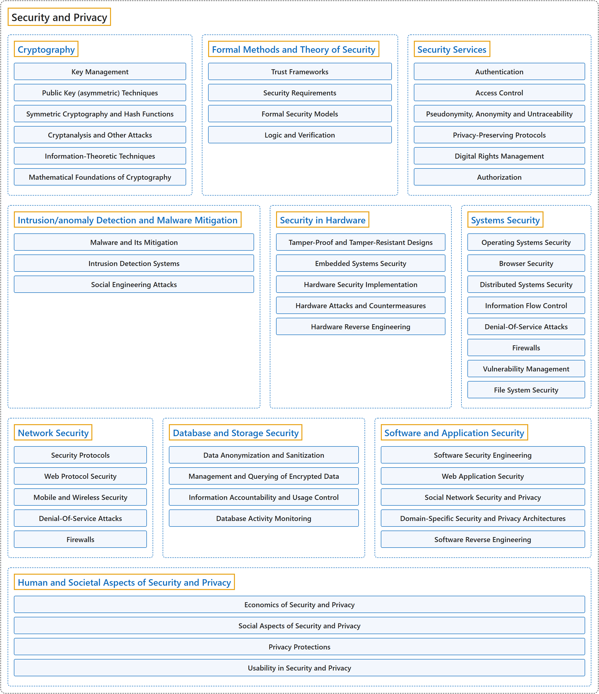

# 9. Security and Privacy

## Classification

## Glossary

| Term | Definition | 中文翻译 | Source |
|---|---|---|---|
| **Security and Privacy** 安全与隐私 | (context) "The Security (SEC) knowledge area focuses on developing a **security mindset** into the overall ethos of computer science graduates so that **security is embedded in all their work products**." | （语境）安全（SEC）知识领域着重把**安全思维**融入计算机科学毕业生的整体精神，使**安全嵌入他们所有的工作成果**。 | [Joint Task Force on Computing Curricula, 2024, SEC "Preamble" section, para. 2](https://csed.acm.org/wp-content/uploads/2024/04/3.1-Body-of-Knowledge-1.pdf#page=193) |
| **[Cryptography](cryptography.md)** 密码学 | (No definition) | （无定义） | [Association for Computing Machinery, 2012](https://www.acm.org/publications/class-2012) |
| **[Formal Methods and Theory of Security](formal-methods-and-theory-of-security.md)** 形式化方法与安全理论 | (No definition) | （无定义） | [Association for Computing Machinery, 2012](https://www.acm.org/publications/class-2012) |
| **[Security Services](security-services.md)** 安全服务 | (No definition) | （无定义） | [Association for Computing Machinery, 2012](https://www.acm.org/publications/class-2012) |
| **[Intrusion/anomaly Detection and Malware Mitigation](intrusion-anomaly-detection-and-malware-mitigation.md)** 入侵/异常检测与恶意软件缓解 | (No definition) | （无定义） | [Association for Computing Machinery, 2012](https://www.acm.org/publications/class-2012) |
| **[Security in Hardware](security-in-hardware.md)** 硬件安全 | (No definition) | （无定义） | [Association for Computing Machinery, 2012](https://www.acm.org/publications/class-2012) |
| **[Systems Security](systems-security.md)** 系统安全 | (No definition) | （无定义） | [Association for Computing Machinery, 2012](https://www.acm.org/publications/class-2012) |
| **[Network Security](network-security.md)** 网络安全 | (No definition) | （无定义） | [Association for Computing Machinery, 2012](https://www.acm.org/publications/class-2012) |
| **[Database and Storage Security](database-and-storage-security.md)** 数据库与存储安全 | (No definition) | （无定义） | [Association for Computing Machinery, 2012](https://www.acm.org/publications/class-2012) |
| **[Software and Application Security](software-and-application-security.md)** 软件与应用安全 | (No definition) | （无定义） | [Association for Computing Machinery, 2012](https://www.acm.org/publications/class-2012) |
| **[Human and Societal Aspects of Security and Privacy](human-and-societal-aspects-of-security-and-privacy.md)** 安全与隐私的人和社会层面 | (No definition) | （无定义） | [Association for Computing Machinery, 2012](https://www.acm.org/publications/class-2012) |

## References

Association for Computing Machinery. (2012). *The 2012 ACM Computing Classification System*. Retrieved October 28, 2026, from <https://www.acm.org/publications/class-2012>

Joint Task Force on Computing Curricula. (2024). *Computer science curricula 2023*. Association for Computing Machinery. <https://doi.org/10.1145/3664191>
