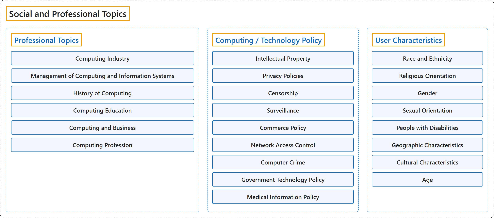

# 13. Social and Professional Topics

## Classification

## Glossary

| Term | Definition | 中文翻译 | Source |
|---|---|---|---|
| **Social and Professional Topics** 社会与职业主题 | (context) "It is more evident today than ever that students must also be exposed to the **larger societal context of computing** to develop an understanding of the critical and relevant **social, ethical, legal, and professional issues and responsibilities** at hand." | （语境）如今比以往任何时候都更明显：学生还必须接触**计算的更大社会背景**，从而理解当前关键且相关的**社会、伦理、法律和职业问题与责任**。 | [Joint Task Force on Computing Curricula, 2024, SEP "Preamble" section, para. 2](https://csed.acm.org/wp-content/uploads/2024/04/3.1-Body-of-Knowledge-1.pdf#page=207) |
| **[Professional Topics](professional-topics.md)** 职业主题 | (No definition) | （无定义） | [Association for Computing Machinery, 2012](https://www.acm.org/publications/class-2012) |
| **[Computing / Technology Policy](computing-technology-policy.md)** 计算/技术政策 | (No definition) | （无定义） | [Association for Computing Machinery, 2012](https://www.acm.org/publications/class-2012) |
| **[User Characteristics](user-characteristics.md)** 用户特征 | (No definition) | （无定义） | [Association for Computing Machinery, 2012](https://www.acm.org/publications/class-2012) |

## References

Association for Computing Machinery. (2012). *The 2012 ACM Computing Classification System*. Retrieved October 28, 2026, from <https://www.acm.org/publications/class-2012>

Joint Task Force on Computing Curricula. (2024). *Computer science curricula 2023*. Association for Computing Machinery. <https://doi.org/10.1145/3664191>
