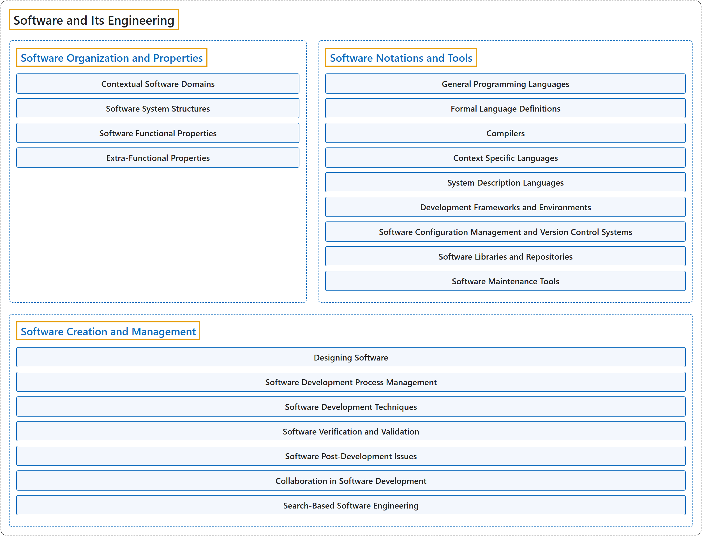

# 5. Software and Its Engineering

## Classification

## Glossary

| Term | Definition | 中文翻译 | Source |
|---|---|---|---|
| **Software and Its Engineering** 软件及其工程 | (context) "This is an essential insight: while programming is the skill that governs our ability to write a program, **software engineering** is distinct in **two dimensions: time and people**." | （语境）这是一个关键的洞见：编程是决定我们能否写出程序的技能，而**软件工程**的不同在于**两个维度：时间和人**。 | [Joint Task Force on Computing Curricula, 2024, SE "Preamble" section, para. 1](https://csed.acm.org/wp-content/uploads/2024/04/3.1-Body-of-Knowledge-1.pdf#page=175) |
| **[Software Organization and Properties](software-organization-and-properties.md)** 软件组织与特性 | (No definition) | （无定义） | [Association for Computing Machinery, 2012](https://www.acm.org/publications/class-2012) |
| **[Software Notations and Tools](software-notations-and-tools.md)** 软件表示法与工具 | (No definition) | （无定义） | [Association for Computing Machinery, 2012](https://www.acm.org/publications/class-2012) |
| **[Software Creation and Management](software-creation-and-management.md)** 软件创建与管理 | (No definition) | （无定义） | [Association for Computing Machinery, 2012](https://www.acm.org/publications/class-2012) |

## References

Association for Computing Machinery. (2012). *The 2012 ACM Computing Classification System*. Retrieved October 28, 2026, from <https://www.acm.org/publications/class-2012>

Joint Task Force on Computing Curricula. (2024). *Computer science curricula 2023*. Association for Computing Machinery. <https://doi.org/10.1145/3664191>
