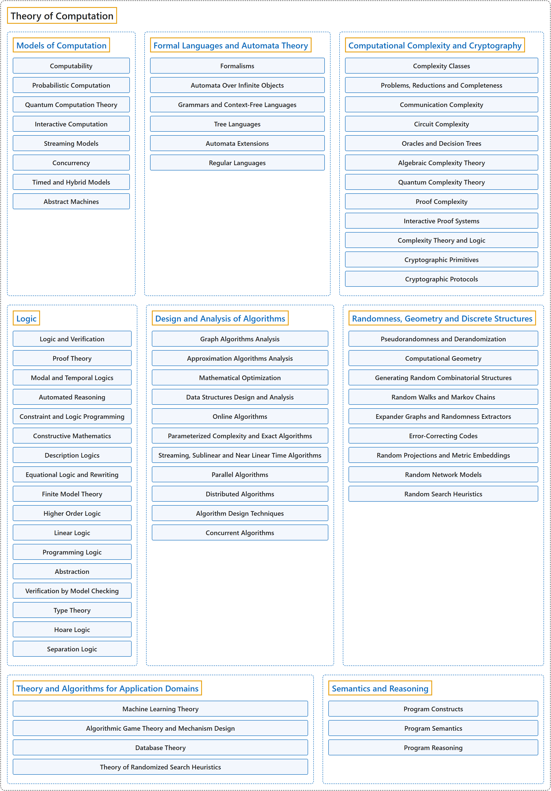

# 6. Theory of Computation

## Classification

## Glossary

| Term | Definition | 中文翻译 | Source |
|---|---|---|---|
| **Theory of Computation** 计算理论 | (context) "Algorithms and data structures are **fundamental to computer science**, since every theoretical computation and applied program consists of **algorithms** that operate on **data elements** possessing some **underlying structure**." | （语境）算法和数据结构**对计算机科学至关重要**，因为每一个理论计算和应用程序都由**算法**构成，这些算法操作的**数据元素**具有某种**底层结构**。 | [Joint Task Force on Computing Curricula, 2024, AL "Preamble" section, para. 1](https://csed.acm.org/wp-content/uploads/2024/04/3.1-Body-of-Knowledge-1.pdf#page=25) |
| **[Models of Computation](models-of-computation.md)** 计算模型 | (No definition) | （无定义） | [Association for Computing Machinery, 2012](https://www.acm.org/publications/class-2012) |
| **[Formal Languages and Automata Theory](formal-languages-and-automata-theory.md)** 形式语言与自动机理论 | (No definition) | （无定义） | [Association for Computing Machinery, 2012](https://www.acm.org/publications/class-2012) |
| **[Computational Complexity and Cryptography](computational-complexity-and-cryptography.md)** 计算复杂性与密码学 | (No definition) | （无定义） | [Association for Computing Machinery, 2012](https://www.acm.org/publications/class-2012) |
| **[Logic](logic.md)** 逻辑 | (No definition) | （无定义） | [Association for Computing Machinery, 2012](https://www.acm.org/publications/class-2012) |
| **[Design and Analysis of Algorithms](design-and-analysis-of-algorithms.md)** 算法设计与分析 | (No definition) | （无定义） | [Association for Computing Machinery, 2012](https://www.acm.org/publications/class-2012) |
| **[Randomness, Geometry and Discrete Structures](randomness-geometry-and-discrete-structures.md)** 随机性、几何与离散结构 | (No definition) | （无定义） | [Association for Computing Machinery, 2012](https://www.acm.org/publications/class-2012) |
| **[Theory and Algorithms for Application Domains](theory-and-algorithms-for-application-domains.md)** 应用领域的理论与算法 | (No definition) | （无定义） | [Association for Computing Machinery, 2012](https://www.acm.org/publications/class-2012) |
| **[Semantics and Reasoning](semantics-and-reasoning.md)** 语义与推理 | (No definition) | （无定义） | [Association for Computing Machinery, 2012](https://www.acm.org/publications/class-2012) |

## References

Association for Computing Machinery. (2012). *The 2012 ACM Computing Classification System*. Retrieved October 28, 2026, from <https://www.acm.org/publications/class-2012>

Joint Task Force on Computing Curricula. (2024). *Computer science curricula 2023*. Association for Computing Machinery. <https://doi.org/10.1145/3664191>
