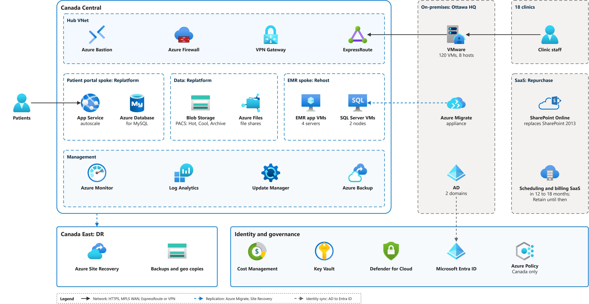
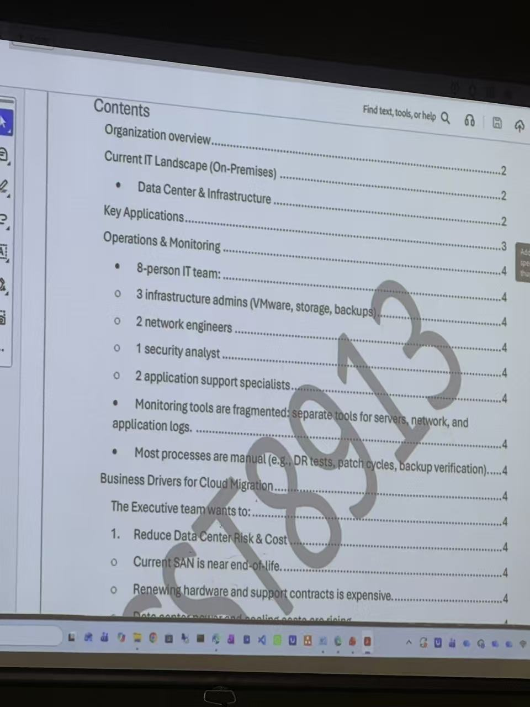
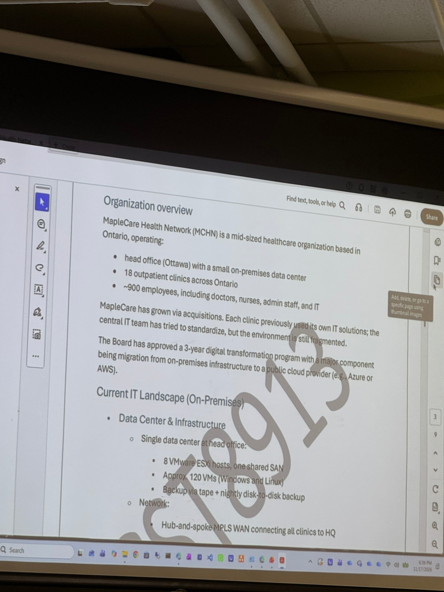

# CST8913 Oral Exam: MapleCare Case

## 1. Case Study – MapleCare Health Network

### 1.1 Organization overview

```text
Organization overview
├─ Organization
│   ├─ Company
│   └─ Acquisitions
├─ Locations
│   ├─ Head office
│   └─ Clinics
├─ Staff
└─ Program
```

| Category | Keyword | Description | 中文翻译 | 缩写 |
|---|---|---|---|---|
| **Organization** | **Company** | MapleCare Health Network (MCHN) is a **mid-sized healthcare organization** based in **Ontario** | MapleCare 医疗网络（MCHN）是一家位于**安大略省**的**中型医疗机构**。 | MCHN 即 MapleCare Health Network，MapleCare 医疗网络。 |
|  | **Acquisitions** | MapleCare has grown via **acquisitions**. Each clinic previously used its own IT solutions; the central IT team has tried to standardize, but the environment is **still fragmented**. | MapleCare 靠**收购**扩张。每家诊所以前各用各的 IT 方案；中央 IT 团队试过统一，但环境**仍然碎片化**。 | IT 即 information technology，信息技术。 |
| **Locations** | **Head office** | head office (**Ottawa**) with a **small on-premises data center** | 总部在**渥太华**，有一个**小型本地数据中心**。 |  |
|  | **Clinics** | **18 outpatient clinics** across **Ontario** | **18 家门诊诊所**，分布在**安大略省**各地。 |  |
| **Staff** |  | ~**900 employees**, including **doctors, nurses**, admin staff, and IT | 约 **900 名员工**，包括**医生、护士**、行政人员和 IT 人员。 | IT 即 information technology，信息技术。 |
| **Program** |  | The Board has approved a **3-year digital transformation program** with a major component being **migration from on-premises infrastructure to a public cloud provider** (e.g., Azure or AWS). | 董事会批准了一个 **3 年的数字化转型计划**，主要组成部分是**从本地基础设施迁到公有云服务商**（例如 Azure 或 AWS）。 | AWS 即 Amazon Web Services，亚马逊云服务。 |

### 1.2 Current IT Landscape (On-Premises)

```text
Current IT Landscape (On-Premises)
└─ Data Center & Infrastructure
    ├─ Compute
    │   ├─ Single data center
    │   └─ VMs
    ├─ Backup and DR
    │   ├─ Backup
    │   └─ No secondary site
    ├─ Network
    └─ Identity
```

#### 1.2.1 Data Center & Infrastructure

| Category | Keyword | Description | 中文翻译 | 缩写 |
|---|---|---|---|---|
| **Compute** | **Single data center** | **Single data center at head office**: **8 VMware ESXi hosts**, one shared SAN | **总部只有一个数据中心**：**8 台 VMware ESXi 主机**，一个共享 SAN。 | ESXi 是 VMware 的虚拟化主机系统。<br>SAN 即 Storage Area Network，存储区域网络。 |
|  | **VMs** | Approx. **120 VMs** (**Windows and Linux**) | 约 **120 台虚拟机**，有 **Windows 也有 Linux**。 | VM 即 virtual machine，虚拟机。 |
| **Backup and DR** | **Backup** | Backup via **tape** + **nightly disk-to-disk backup** | 备份用**磁带**，加上**每晚磁盘到磁盘的备份**。 | DR 即 disaster recovery，灾难恢复。 |
|  | **No secondary site** | Tape backup + nightly disk-to-disk. **NO secondary site** | 磁带备份加每晚磁盘到磁盘备份。**没有备用站点**。 | DR 即 disaster recovery，灾难恢复。 |
| **Network** |  | Network: **Hub-and-spoke MPLS WAN** connecting **all clinics to HQ** | 网络：**中心辐射型 MPLS 广域网**把**所有诊所连到总部**。 | MPLS 即 Multiprotocol Label Switching，多协议标签交换。<br>WAN 即 wide area network，广域网。<br>HQ 即 headquarters，总部。 |
| **Identity** |  | **2 AD domains**: **corp.maplecare.local** + legacy.clinic.local | **两个 AD 域**：**corp.maplecare.local** 和 legacy.clinic.local。 | AD 即 Active Directory，活动目录。 |

### 1.3 Key Applications

```text
Key Applications
├─ EMR
│   └─ EMR
│       ├─ Servers
│       ├─ Usage
│       ├─ RPO and RTO
│       └─ Vendor
├─ PACS
│   └─ PACS
├─ Intranet & File Shares
│   └─ Intranet and file shares
├─ Patient Portal
│   └─ Patient portal
├─ Scheduling & Billing
│   └─ Scheduling and billing
├─ Security, Compliance & Regulations
│   └─ Compliance
├─ Current issues
│   ├─ Infrastructure
│   │   ├─ Ageing SAN
│   │   └─ No DR site
│   ├─ Rising cost
│   ├─ Applications
│   │   ├─ Slow portal
│   │   └─ Legacy intranet
│   ├─ Operations
│   │   ├─ Fragmented IT
│   │   └─ Manual work
│   └─ Compliance
├─ Operations & Monitoring
│   ├─ IT team
│   │   ├─ Size
│   │   ├─ Infrastructure admins
│   │   ├─ Network engineers
│   │   ├─ Security analyst
│   │   └─ Application support
│   └─ Operations
│       ├─ Monitoring
│       └─ Manual processes
├─ Business Drivers for Cloud Migration
│   ├─ Executive team
│   └─ Reduce Data Center Risk & Cost
│       ├─ SAN end-of-life
│       ├─ Contracts
│       └─ Power and cooling
└─ Migration Goals & Scope
    ├─ Timeline
    └─ Motivations and outcomes
        ├─ Reduce data center risk
        ├─ Reduce cost
        ├─ Business continuity
        ├─ Compliance
        ├─ Patient experience
        └─ Simpler operations
```

#### 1.3.1 EMR

| Category | Keyword | Description | 中文翻译 | 缩写 |
|---|---|---|---|---|
| **EMR** | **Servers** | **4 Windows app servers** + **2 SQL Server nodes** | **4 台 Windows 应用服务器**加 **2 个 SQL Server 节点**。 | EMR 即 Electronic Medical Record，电子病历。<br>SQL 即 Structured Query Language，结构化查询语言。 |
|  | **Usage** | used by **all 18 clinics**, **24x7** | **18 家诊所全部**在用，**全天候运行**。 | EMR 即 Electronic Medical Record，电子病历。 |
|  | **RPO and RTO** | **RPO < 1 hour**, **RTO < 2 hours**, max 2 hours planned downtime for cutover | **RPO 小于 1 小时**，**RTO 小于 2 小时**，切换时计划停机最多 2 小时。 | EMR 即 Electronic Medical Record，电子病历。<br>RPO 即 recovery point objective，恢复点目标。<br>RTO 即 recovery time objective，恢复时间目标。 |
|  | **Vendor** | vendor **only supports IaaS VMs**; third-party vendor **must be involved** and charges consulting fees | 厂商**只支持 IaaS 虚拟机**；第三方厂商**必须参与**迁移，并且收咨询费。 | EMR 即 Electronic Medical Record，电子病历。<br>IaaS 即 Infrastructure as a Service，基础设施即服务。<br>VM 即 virtual machine，虚拟机。 |

#### 1.3.2 PACS

| Category | Keyword | Description | 中文翻译 | 缩写 |
|---|---|---|---|---|
| **PACS** |  | Stores **X-rays, ultrasounds**; **120 TB and growing**; old images rarely accessed | 存放 **X 光和超声影像**；**120 TB，还在增长**；旧影像很少被访问。 | PACS 即 Picture Archiving and Communication System，医学影像存储与传输系统。<br>TB 即 terabyte，太字节。 |

#### 1.3.3 Intranet & File Shares

| Category | Keyword | Description | 中文翻译 | 缩写 |
|---|---|---|---|---|
| **Intranet and file shares** |  | Legacy **SharePoint 2013** + **file servers** | 老旧的 **SharePoint 2013** 加**文件服务器**。 |  |

#### 1.3.4 Patient Portal

| Category | Keyword | Description | 中文翻译 | 缩写 |
|---|---|---|---|---|
| **Patient portal** |  | **PHP + MySQL on a single VM**, hosted externally, 8 years old; **performance issues evenings and weekends** | **PHP 加 MySQL，跑在一台虚拟机上**，托管在外部，已用 8 年；**晚上和周末有性能问题**。 | PHP 即 PHP: Hypertext Preprocessor，一种网页编程语言。<br>VM 即 virtual machine，虚拟机。 |

#### 1.3.5 Scheduling & Billing

| Category | Keyword | Description | 中文翻译 | 缩写 |
|---|---|---|---|---|
| **Scheduling and billing** |  | **Thick client** on PCs, talks to on-prem app server + SQL DB; vendor releasing **SaaS version in 12 to 18 months** | 电脑上装**胖客户端**，连本地应用服务器和 SQL 数据库；厂商 **12 到 18 个月后推出 SaaS 版**。 | PC 即 personal computer，个人电脑。<br>SQL 即 Structured Query Language，结构化查询语言。<br>DB 即 database，数据库。<br>SaaS 即 Software as a Service，软件即服务。 |

#### 1.3.6 Security, Compliance & Regulations

| Category | Keyword | Description | 中文翻译 | 缩写 |
|---|---|---|---|---|
| **Compliance** |  | **PHIPA** (Ontario health privacy law) — ALL patient data must **stay in CANADA** | **PHIPA**（安大略省的健康隐私法）：所有病人数据必须**留在加拿大**。 | PHIPA 即 Personal Health Information Protection Act，个人健康信息保护法。 |

#### 1.3.7 Current issues

| Category | Keyword | Description | 中文翻译 | 缩写 |
|---|---|---|---|---|
| **Infrastructure** | **Ageing SAN** | The **SAN is near end-of-life**, and all **8 ESXi hosts and 120 VMs** depend on it. | **SAN 快到寿命**，**8 台 ESXi 主机和 120 台虚拟机**全靠它。 | SAN 即 Storage Area Network，存储区域网络。<br>ESXi 是 VMware 的虚拟化主机系统。<br>VM 即 virtual machine，虚拟机。 |
|  | **No DR site** | Backup is **tape and nightly disk-to-disk** with **no secondary site**, so the **EMR RPO < 1 hour** cannot be met. | 备份只有**磁带和每晚的磁盘备份**，**没有备用站点**，达不到 **EMR 的 RPO 小于 1 小时**。 | DR 即 disaster recovery，灾难恢复。<br>EMR 即 Electronic Medical Record，电子病历。<br>RPO 即 recovery point objective，恢复点目标。 |
| **Rising cost** |  | **Contract renewals are expensive**, and **power and cooling** costs keep rising. | **续签合同很贵**，**电费和制冷费**还在涨。 |  |
| **Applications** | **Slow portal** | The patient portal runs on **one VM** and is **slow in evenings and weekends**. | 病人门户只跑在**一台虚拟机**上，**晚上和周末很慢**。 | VM 即 virtual machine，虚拟机。 |
|  | **Legacy intranet** | **SharePoint 2013** and **file servers** still need upkeep. | **SharePoint 2013** 和**文件服务器**还要一直维护。 |  |
| **Operations** | **Fragmented IT** | Acquisitions left **two AD domains** and **separate monitoring tools**. | 收购留下了**两个 AD 域**和**各自分开的监控工具**。 | IT 即 information technology，信息技术。<br>AD 即 Active Directory，活动目录。 |
|  | **Manual work** | An **8-person team** with **one security analyst** runs DR tests, patching and backup checks **by hand**. | **8 人团队**只有**一名安全分析员**，灾备演练、打补丁和备份检查都**靠手工**。 | DR 即 disaster recovery，灾难恢复。 |
| **Compliance** |  | Under **PHIPA**, all patient data must **stay in Canada**. | 按 **PHIPA**，所有病人数据必须**留在加拿大**。 | PHIPA 即 Personal Health Information Protection Act，个人健康信息保护法。 |

#### 1.3.8 Operations & Monitoring

| Category | Keyword | Description | 中文翻译 | 缩写 |
|---|---|---|---|---|
| **IT team** | **Size** | **8-person IT team**: | **IT 团队共 8 人**： | IT 即 information technology，信息技术。 |
|  | **Infrastructure admins** | **3 infrastructure admins** (**VMware, storage, backups**) | **3 名基础设施管理员**，负责 **VMware、存储和备份**。 | IT 即 information technology，信息技术。 |
|  | **Network engineers** | **2 network engineers** | **2 名网络工程师**。 | IT 即 information technology，信息技术。 |
|  | **Security analyst** | **1 security analyst** | **1 名安全分析员**。 | IT 即 information technology，信息技术。 |
|  | **Application support** | **2 application support specialists** | **2 名应用支持专员**。 | IT 即 information technology，信息技术。 |
| **Operations** | **Monitoring** | **Monitoring tools are fragmented**: separate tools for **servers, network, and application logs**. | **监控工具分散**：**服务器、网络和应用日志**各用各的工具。 |  |
|  | **Manual processes** | **Most processes are manual** (e.g., **DR tests**, patch cycles, backup verification). | **大部分流程靠手工**（例如**灾备演练**、打补丁、备份验证）。 | DR 即 disaster recovery，灾难恢复。 |

#### 1.3.9 Business Drivers for Cloud Migration

| Category | Keyword | Description | 中文翻译 | 缩写 |
|---|---|---|---|---|
| **Executive team** |  | The **Executive team** wants to: | **管理层**希望： |  |
| **Reduce Data Center Risk & Cost** |  | 1. **Reduce Data Center Risk & Cost** | 1. **降低数据中心的风险和成本**。 |  |
|  | **SAN end-of-life** | **Current SAN** is near **end-of-life**. | **现有的 SAN** 快到**使用寿命**了。 | SAN 即 Storage Area Network，存储区域网络。 |
|  | **Contracts** | Renewing **hardware and support contracts** is **expensive**. | 续签**硬件和支持合同**的费用**很高**。 |  |
|  | **Power and cooling** | Data center **power and cooling costs** are **rising** | 数据中心的**电费和制冷费**在**上涨**。 |  |

#### 1.3.10 Migration Goals & Scope

MapleCare has a three-year plan to close its data center, and six motivations. First, reduce data center risk: the SAN is near end-of-life, so success means all 120 VMs are moved and the data center is closed. Second, reduce cost: no more hardware renewals, power and cooling. Third, business continuity: the EMR must meet an RPO under one hour and an RTO under two hours, proven by a DR drill. Fourth, compliance: under PHIPA, all patient data stays in Canada. Fifth, patient experience: the portal stays fast in evenings and weekends. Last, simpler operations: one monitoring view, and automated patching and backups.

| Category | Keyword | Description | 中文翻译 | 缩写 |
|---|---|---|---|---|
| **Timeline** |  | **3-year digital transformation**, **decommission data center** by end | **3 年数字化转型**，到期时**关闭数据中心**。 |  |
| **Motivations and outcomes** | **Reduce data center risk** | Motivation: **datacenter modernization**.<br>Outcome: the **data center is closed** within the **3-year program**; VMs on premises go **from 120 to 0**. | 动机：**数据中心现代化**。<br>成果：**3 年计划内关闭数据中心**；本地虚拟机**从 120 台降到 0**。 | VM 即 virtual machine，虚拟机。 |
|  | **Reduce cost** | Motivation: stop paying for **hardware renewals, power and cooling**.<br>Outcome: the **monthly Azure cost** stays **below today's data center cost**. | 动机：不再为**硬件续约、电费和制冷**付钱。<br>成果：**每月 Azure 费用低于现在数据中心的费用**。 |  |
|  | **Business continuity** | Outcome: the EMR meets **RPO < 1 hour** and **RTO < 2 hours**, proven by a **DR drill**. | 成果：EMR 达到 **RPO 小于 1 小时**、**RTO 小于 2 小时**，用**灾备演练**证明。 | EMR 即 Electronic Medical Record，电子病历。<br>RPO 即 recovery point objective，恢复点目标。<br>RTO 即 recovery time objective，恢复时间目标。<br>DR 即 disaster recovery，灾难恢复。 |
|  | **Compliance** | Outcome: **all patient data stays in Canada**, enforced by **policy**. | 成果：**所有病人数据留在加拿大**，由**策略**强制执行。 |  |
|  | **Patient experience** | Outcome: the portal stays **fast at peak times**, in evenings and weekends. | 成果：门户在晚上和周末的**高峰时段也不慢**。 |  |
|  | **Simpler operations** | Outcome: **one monitoring view**, and **automated** patching and backups. | 成果：**一个地方看全部监控**，打补丁和备份**自动化**。 |  |

### 1.4 Migration Phases (Example Roadmap)

```text
Migration Phases (Example Roadmap)
├─ Phase 0 – Assessment & Readiness
│   ├─ Assessment
│   │   ├─ Azure Migrate
│   │   └─ Dependencies
│   ├─ Compliance
│   │   └─ PHIPA
│   ├─ Training
│   │   ├─ Azure skills
│   │   └─ 8-person IT team
│   └─ Communication
│       ├─ Clinics
│       └─ EMR vendor
├─ Phase 1 – Landing Zone & Connectivity
│   ├─ Landing zone
│   │   ├─ Governance
│   │   │   └─ Azure Policy
│   │   ├─ Identity
│   │   │   └─ Microsoft Entra ID
│   │   └─ Security
│   │       ├─ Azure Firewall
│   │       └─ Azure Bastion
│   ├─ Connectivity
│   │   ├─ VPN
│   │   │   └─ Azure VPN Gateway
│   │   └─ Azure ExpressRoute
│   └─ Central frameworks
│       ├─ Logging
│       ├─ Monitoring
│       └─ Backup
├─ Phase 2 – Non-Critical Workloads & Pilots
│   ├─ Internal apps
│   │   ├─ File shares
│   │   │   └─ Azure Files
│   │   └─ Intranet
│   │       └─ SharePoint Online
│   └─ Validation
│       ├─ Performance
│       ├─ Security
│       └─ Cost
├─ Phase 3 – Patient Portal & PACS
│   ├─ Patient portal
│   │   ├─ Azure App Service
│   │   └─ Azure Database for MySQL
│   ├─ Peak scaling
│   │   └─ Autoscale
│   └─ PACS
│       ├─ Azure Blob Storage
│       └─ Lifecycle tiers
│           ├─ Hot
│           ├─ Cool
│           └─ Archive
├─ Phase 4 – EMR Migration
│   ├─ Rehost
│   │   ├─ Azure Migrate
│   │   └─ Same wave
│   ├─ Testing
│   │   └─ EMR vendor
│   ├─ Cutover
│   │   ├─ Change freeze
│   │   └─ 2-hour window
│   └─ Rollback
│       └─ On-premises VMs
└─ Phase 5 – Optimization, DR, and Decommission
    ├─ DR
    │   └─ Azure Site Recovery
    │       ├─ Canada East
    │       └─ DR drill
    ├─ Tuning
    │   ├─ Right-sizing
    │   ├─ Reserved instances
    │   └─ Archive tier
    ├─ Scheduling and billing
    │   └─ SaaS version
    └─ Decommission
        ├─ SAN
        └─ Data center
```

#### 1.4.1 Phase 0 – Assessment & Readiness

Phase 0 is assessment and readiness. We use Azure Migrate to discover the 120 VMs and check readiness, size and cost, and we map dependencies, such as the EMR app servers and their SQL nodes. We review PHIPA to find where patient data lives. We train the eight-person IT team on Azure, and we agree the plan with the clinics and the EMR vendor.

| Category | Keyword | Description | 中文翻译 | 缩写 |
|---|---|---|---|---|
| **Assessment** | **Azure Migrate** | 120 VMs: readiness, size, cost | 120 台虚拟机：就绪度、规格、费用 | VM 即 virtual machine，虚拟机。 |
|  | **Dependencies** | EMR app servers + SQL nodes | EMR 应用服务器和 SQL 节点 | EMR 即 Electronic Medical Record，电子病历。<br>SQL 即 Structured Query Language，结构化查询语言。 |
| **Compliance** | **PHIPA** | Where patient data lives | 病人数据放在哪里 | PHIPA 即 Personal Health Information Protection Act，个人健康信息保护法。 |
| **Training** | **Azure skills** | Before the first migration | 第一次迁移之前 |  |
|  | **8-person IT team** | Small team | 团队很小 | IT 即 information technology，信息技术。 |
| **Communication** | **Clinics** | 18 clinics: when each system moves | 18 家诊所：各系统何时迁 |  |
|  | **EMR vendor** | Test and cutover window | 测试和切换窗口 | EMR 即 Electronic Medical Record，电子病历。 |

#### 1.4.2 Phase 1 – Landing Zone & Connectivity

Phase 1 builds the landing zone and connectivity. In the landing zone, Azure Policy allows Canadian regions only, Active Directory syncs to Microsoft Entra ID, and Azure Firewall and Azure Bastion protect the hub. For connectivity, Ottawa HQ connects with a site-to-site VPN first, and Azure ExpressRoute later. Before any workload moves, we set up central logging with Log Analytics, monitoring with Azure Monitor, and Azure Backup to replace tape.

| Category | Keyword | Description | 中文翻译 | 缩写 |
|---|---|---|---|---|
| **Landing zone** | **Governance** | Azure Policy: Canada only | 只允许加拿大区域 |  |
|  | **Identity** | AD → Microsoft Entra ID | AD 同步到 Entra ID | AD 即 Active Directory，活动目录。 |
|  | **Security** | Azure Firewall, Azure Bastion | 防火墙、跳板登录 |  |
| **Connectivity** | **VPN** | Azure VPN Gateway, HQ first | 总部先用 VPN | VPN 即 virtual private network，虚拟专用网络。<br>HQ 即 headquarters，总部。 |
|  | **Azure ExpressRoute** | HQ, later | 之后接专线 | HQ 即 headquarters，总部。 |
| **Central frameworks** | **Logging** | Log Analytics | 集中日志 |  |
|  | **Monitoring** | Azure Monitor | 统一监控 |  |
|  | **Backup** | Azure Backup, replaces tape | 取代磁带 |  |

#### 1.4.3 Phase 2 – Non-Critical Workloads & Pilots

Phase 2 moves non-critical workloads as pilots. The file servers move to Azure Files, and the intranet moves from SharePoint 2013 to SharePoint Online. Then we validate performance against the assessment, security in Defender for Cloud, and cost against the estimate.

| Category | Keyword | Description | 中文翻译 | 缩写 |
|---|---|---|---|---|
| **Internal apps** | **File shares** | Azure Files | 文件服务器迁到 Azure Files |  |
|  | **Intranet** | SharePoint 2013 → SharePoint Online | 内网换成 SharePoint Online |  |
| **Validation** | **Performance** | vs assessment | 对照评估结果 |  |
|  | **Security** | Defender for Cloud | 在 Defender for Cloud 里查 |  |
|  | **Cost** | vs estimate | 对照估算 |  |

#### 1.4.4 Phase 3 – Patient Portal & PACS

Phase 3 moves the patient portal and PACS. The PHP portal moves to Azure App Service and its database to Azure Database for MySQL, with autoscale for the evening and weekend peaks. The 120 terabytes of PACS images move to Azure Blob Storage: new images in Hot, older ones in Cool, and rarely accessed ones in Archive.

| Category | Keyword | Description | 中文翻译 | 缩写 |
|---|---|---|---|---|
| **Patient portal** | **Azure App Service** | PHP app | PHP 网站 | PACS 即 Picture Archiving and Communication System，医学影像存储与传输系统。<br>PHP 即 PHP: Hypertext Preprocessor，一种网页编程语言。 |
|  | **Azure Database for MySQL** | MySQL database | MySQL 数据库 |  |
| **Peak scaling** | **Autoscale** | Evenings, weekends | 晚上和周末高峰 |  |
| **PACS** | **Azure Blob Storage** | 120 TB of images | 120 TB 影像 | PACS 即 Picture Archiving and Communication System，医学影像存储与传输系统。<br>TB 即 terabyte，太字节。 |
|  | **Lifecycle tiers** | Hot → Cool → Archive | 新影像、旧影像、很少访问的影像 | PACS 即 Picture Archiving and Communication System，医学影像存储与传输系统。 |

#### 1.4.5 Phase 4 – EMR Migration

Phase 4 is the EMR migration. Azure Migrate replicates the EMR VMs, and the four app servers and two SQL nodes move together in the same wave. The EMR vendor tests the system before cutover. During cutover we freeze changes, do a final sync, and switch within the two-hour window. For rollback, we keep the on-premises VMs until sign-off.

| Category | Keyword | Description | 中文翻译 | 缩写 |
|---|---|---|---|---|
| **Rehost** | **Azure Migrate** | Replicate EMR VMs | 复制 EMR 虚拟机 | EMR 即 Electronic Medical Record，电子病历。<br>VM 即 virtual machine，虚拟机。 |
|  | **Same wave** | 4 app servers + 2 SQL nodes | 4 台应用服务器加 2 个 SQL 节点一起迁 | SQL 即 Structured Query Language，结构化查询语言。 |
| **Testing** | **EMR vendor** | Before cutover | 切换前测试 | EMR 即 Electronic Medical Record，电子病历。 |
| **Cutover** | **Change freeze** | No changes | 冻结变更 |  |
|  | **2-hour window** | Final sync, switch | 最后同步并切换 |  |
| **Rollback** | **On-premises VMs** | Kept until sign-off | 签字确认前保留 | VM 即 virtual machine，虚拟机。 |

#### 1.4.6 Phase 5 – Optimization, DR, and Decommission

Phase 5 is optimization, DR and decommission. Azure Site Recovery replicates the EMR VMs to Canada East, and a DR drill proves the RPO and RTO. We tune cost with right-sizing, reserved instances for the always-on EMR VMs, and the Archive tier for old images. When the scheduling and billing vendor releases its SaaS version, we switch to it. Finally, we retire the SAN and the eight ESXi hosts and close the data center.

| Category | Keyword | Description | 中文翻译 | 缩写 |
|---|---|---|---|---|
| **DR** | **Azure Site Recovery** | Canada East; DR drill: RPO < 1 hour, RTO < 2 hours | 复制到加拿大东部；演练证明 RPO 和 RTO | DR 即 disaster recovery，灾难恢复。<br>RPO 即 recovery point objective，恢复点目标。<br>RTO 即 recovery time objective，恢复时间目标。 |
| **Tuning** | **Right-sizing** | Real usage | 按实际用量调规格 |  |
|  | **Reserved instances** | Always-on EMR VMs | 一直运行的 EMR 虚拟机 | EMR 即 Electronic Medical Record，电子病历。<br>VM 即 virtual machine，虚拟机。 |
|  | **Archive tier** | Old PACS images | 旧 PACS 影像 | PACS 即 Picture Archiving and Communication System，医学影像存储与传输系统。 |
| **Scheduling and billing** | **SaaS version** | When released | 发布后切换 | SaaS 即 Software as a Service，软件即服务。 |
| **Decommission** | **SAN** | SAN + 8 ESXi hosts | SAN 和 8 台 ESXi 主机 | SAN 即 Storage Area Network，存储区域网络。<br>ESXi 是 VMware 的虚拟化主机系统。 |
|  | **Data center** | Ottawa HQ | 关闭总部数据中心 | HQ 即 headquarters，总部。 |

### 1.5 Target Cloud Architecture (High-Level Vision)

```text
Target Cloud Architecture (High-Level Vision)
├─ Landing Zone & Governance
│   ├─ Structure
│   │   ├─ Regions
│   │   └─ Subscriptions
│   ├─ Hub and spoke
│   └─ Azure Policy
├─ Identity & Access
│   ├─ Sign-in
│   │   ├─ Entra ID
│   │   └─ MFA
│   └─ Access
│       └─ RBAC
├─ Networking
│   ├─ Connectivity
│   │   ├─ VPN
│   │   └─ ExpressRoute
│   └─ Firewall and Bastion
├─ Application Migration & Modernization (6/7 Rs)
│   ├─ Rehost
│   │   └─ EMR
│   ├─ Replatform
│   │   ├─ Patient portal
│   │   ├─ PACS
│   │   └─ File shares
│   ├─ Repurchase
│   │   └─ SharePoint
│   └─ Retain
│       └─ Scheduling and billing
├─ Security & Compliance
│   ├─ PHIPA
│   └─ Tools
│       ├─ Defender for Cloud
│       └─ Key Vault
├─ Operations & Automation
│   ├─ Operations
│   │   ├─ Monitoring
│   │   └─ Patching
│   └─ Recovery
│       ├─ Backup
│       └─ DR
└─ Cost Management
    ├─ Budgets
    └─ Savings
        ├─ Right-sizing
        ├─ Licences
        └─ Reservations
```



#### 1.5.1 Landing Zone & Governance

Production runs in Canada Central and DR in Canada East, with separate production and non-production subscriptions. The network is hub and spoke: one hub VNet, and one spoke for each workload, the patient portal, data and EMR. Azure Policy allows Canadian regions only and requires tags that name each cost owner.

| Category | Keyword | Description | 中文翻译 | 缩写 |
|---|---|---|---|---|
| **Structure** | **Regions** | **Canada Central** for production, **Canada East** for DR. | **加拿大中部**跑生产，**加拿大东部**做灾备。 | DR 即 disaster recovery，灾难恢复。 |
|  | **Subscriptions** | Separate **production** and **non-production** subscriptions. | **生产**和**非生产**分开用不同订阅。 |  |
| **Hub and spoke** |  | One **hub VNet** and one **spoke** per workload: patient portal, data and EMR. | 一个**中心 VNet**，每个工作负载一个**辐射网络**：病人门户、数据、EMR。 | VNet 即 virtual network，虚拟网络。<br>EMR 即 Electronic Medical Record，电子病历。 |
| **Azure Policy** |  | Allow **Canadian regions only**, and require **tags** that name each cost owner. | **只允许加拿大区域**，并要求打上写明费用负责人的**标签**。 |  |

#### 1.5.2 Identity & Access

Both AD domains sync to Microsoft Entra ID. All staff and admins use MFA, and each team gets least-privilege roles through RBAC.

| Category | Keyword | Description | 中文翻译 | 缩写 |
|---|---|---|---|---|
| **Sign-in** | **Entra ID** | Sync **both AD domains** to **Microsoft Entra ID**. | 把**两个 AD 域**都同步到 **Microsoft Entra ID**。 | AD 即 Active Directory，活动目录。 |
|  | **MFA** | Require **MFA** for **all staff and admins**. | **所有员工和管理员**都必须用 **MFA**。 | MFA 即 multifactor authentication，多重身份验证。 |
| **Access** | **RBAC** | Give each team **least-privilege roles** through **RBAC**. | 通过 **RBAC** 给每个团队**最小权限的角色**。 | RBAC 即 role-based access control，基于角色的访问控制。 |

#### 1.5.3 Networking

Ottawa HQ connects with a site-to-site VPN first, which later becomes the backup link for Azure ExpressRoute. The clinics keep reaching HQ over the MPLS WAN. In the hub, Azure Firewall filters traffic, and Azure Bastion gives admin access, so the VMs need no public IP.

| Category | Keyword | Description | 中文翻译 | 缩写 |
|---|---|---|---|---|
| **Connectivity** | **VPN** | A **site-to-site VPN** from HQ first, later the **backup link**. | 先用总部的**站点到站点 VPN**，之后作为**备用链路**。 | VPN 即 virtual private network，虚拟专用网络。<br>HQ 即 headquarters，总部。 |
|  | **ExpressRoute** | **ExpressRoute** from **Ottawa HQ**; clinics keep reaching HQ over the **MPLS WAN**. | **渥太华总部**接 **ExpressRoute**；诊所继续经 **MPLS 广域网**连到总部。 | HQ 即 headquarters，总部。<br>MPLS 即 Multiprotocol Label Switching，多协议标签交换。<br>WAN 即 wide area network，广域网。 |
| **Firewall and Bastion** |  | **Azure Firewall** filters traffic; **Azure Bastion** gives admin access, so VMs need **no public IP**. | **Azure Firewall** 过滤流量；管理员经 **Azure Bastion** 登录，虚拟机**不需要公网 IP**。 | VM 即 virtual machine，虚拟机。<br>IP 即 Internet Protocol，网际协议。 |

#### 1.5.4 Application Migration & Modernization (6/7 Rs)

Each system gets its own strategy. The EMR is rehosted to Azure VMs, because the vendor only supports IaaS. The patient portal, PACS and file shares are replatformed to App Service, Blob Storage and Azure Files. SharePoint is repurchased as SharePoint Online. Scheduling and billing is retained until the vendor's SaaS version is ready.

| Category | Keyword | Description | 中文翻译 | 缩写 |
|---|---|---|---|---|
| **Rehost** | **EMR** | **Rehost** to **4 Azure VMs** and **2 SQL Server VMs**, because the vendor **only supports IaaS VMs**. | **重新托管**到 **4 台 Azure 虚拟机**和 **2 台 SQL Server 虚拟机**，因为厂商**只支持 IaaS 虚拟机**。 | EMR 即 Electronic Medical Record，电子病历。<br>VM 即 virtual machine，虚拟机。<br>SQL 即 Structured Query Language，结构化查询语言。<br>IaaS 即 Infrastructure as a Service，基础设施即服务。 |
| **Replatform** | **Patient portal** | **Replatform** to **App Service** with autoscale and **Azure Database for MySQL**, to fix the **peak-time slowness**. | **换平台**到能自动扩展的 **App Service** 和 **Azure Database for MySQL**，解决**高峰时慢**的问题。 |  |
|  | **PACS** | **Replatform** images to **Blob Storage**: **Hot** for new images, **Cool or Archive** for old ones. | 影像**换平台**到 **Blob Storage**：新影像放 **Hot**，旧影像放 **Cool 或 Archive**。 | PACS 即 Picture Archiving and Communication System，医学影像存储与传输系统。 |
|  | **File shares** | **Replatform** file servers to **Azure Files**. | 文件服务器**换平台**到 **Azure Files**。 |  |
| **Repurchase** | **SharePoint** | **Repurchase**: **SharePoint Online** replaces SharePoint 2013. | **重新购买**：用 **SharePoint Online** 替换 SharePoint 2013。 |  |
| **Retain** | **Scheduling and billing** | **Retain** until the vendor's **SaaS version** in 12 to 18 months, then **Repurchase**. | **先保留**，等厂商 12 到 18 个月后出 **SaaS 版**，再**重新购买**。 | SaaS 即 Software as a Service，软件即服务。 |

#### 1.5.5 Security & Compliance

To meet PHIPA, data stays in Canada Central and Canada East, and policy blocks every other region. Defender for Cloud gives the single security analyst one view of the security posture, and Key Vault keeps the keys and secrets for encrypted patient data.

| Category | Keyword | Description | 中文翻译 | 缩写 |
|---|---|---|---|---|
| **PHIPA** |  | Data stays in **Canada Central and Canada East**; **policy blocks** every other region. | 数据只放在**加拿大中部和东部**；**策略禁止**其他区域。 | PHIPA 即 Personal Health Information Protection Act，个人健康信息保护法。 |
| **Tools** | **Defender for Cloud** | One **security posture** view for the **single security analyst**. | 给**唯一的安全分析员**一个看全部**安全态势**的地方。 |  |
|  | **Key Vault** | Keep **keys and secrets** in **Key Vault** and **encrypt** patient data. | **密钥和机密**放进 **Key Vault**，病人数据**加密**。 |  |

#### 1.5.6 Operations & Automation

Azure Monitor and Log Analytics replace the separate monitoring tools. Update Manager runs patch cycles on a schedule. Azure Backup replaces tape and raises an alert when a backup fails. Azure Site Recovery replicates the EMR to Canada East, and test failovers serve as DR drills.

| Category | Keyword | Description | 中文翻译 | 缩写 |
|---|---|---|---|---|
| **Operations** | **Monitoring** | **Azure Monitor** and **Log Analytics** replace the **separate tools**. | **Azure Monitor** 和 **Log Analytics** 取代**各自分开的工具**。 |  |
|  | **Patching** | **Update Manager** runs **patch cycles** on a schedule. | **Update Manager** 按计划跑**补丁周期**。 |  |
| **Recovery** | **Backup** | **Azure Backup** replaces **tape**, and backup jobs raise **alerts** when they fail. | **Azure Backup** 取代**磁带**，备份失败会发**告警**。 |  |
|  | **DR** | **Azure Site Recovery** replicates the EMR VMs to **Canada East**, and **test failovers** serve as DR drills. | **Azure Site Recovery** 把 EMR 虚拟机复制到**加拿大东部**，用**测试故障转移**做灾备演练。 | DR 即 disaster recovery，灾难恢复。<br>EMR 即 Electronic Medical Record，电子病历。<br>VM 即 virtual machine，虚拟机。 |

#### 1.5.7 Cost Management

Each subscription has Cost Management budgets and alerts. We right-size VMs from Azure Migrate performance data, reuse Windows Server and SQL Server licences with Azure Hybrid Benefit, and buy reserved instances for the always-on EMR VMs.

| Category | Keyword | Description | 中文翻译 | 缩写 |
|---|---|---|---|---|
| **Budgets** |  | **Cost Management budgets** and **alerts** for each subscription. | 每个订阅设 **Cost Management 预算**和**告警**。 |  |
| **Savings** | **Right-sizing** | Size VMs from **Azure Migrate performance data**, not from today's hardware. | 按 **Azure Migrate 的性能数据**定虚拟机规格，**不照搬现在的硬件**。 | VM 即 virtual machine，虚拟机。 |
|  | **Licences** | Reuse Windows Server and SQL Server licences with **Azure Hybrid Benefit**. | 用 **Azure Hybrid Benefit** **复用** Windows Server 和 SQL Server 的许可证。 | SQL 即 Structured Query Language，结构化查询语言。 |
|  | **Reservations** | **Reserved instances** for the **always-on EMR VMs**. | 给**一直运行的 EMR 虚拟机**买**预留实例**。 | EMR 即 Electronic Medical Record，电子病历。<br>VM 即 virtual machine，虚拟机。 |

## 11/17 课上拍的照片




