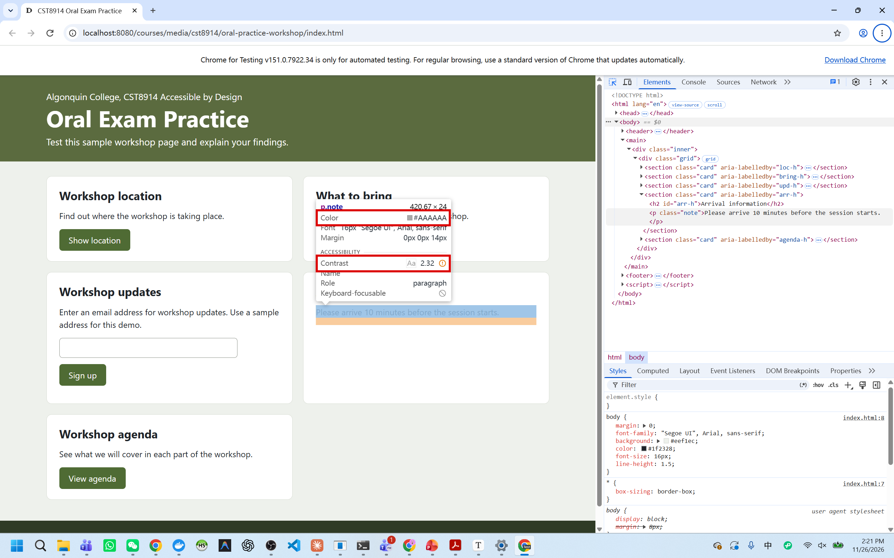
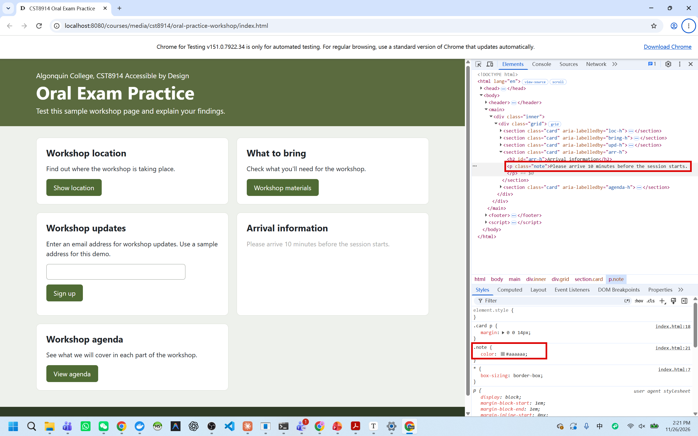
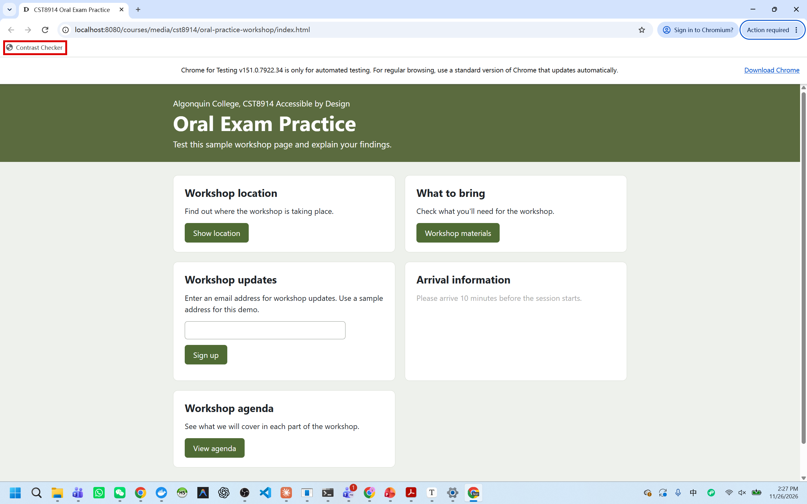
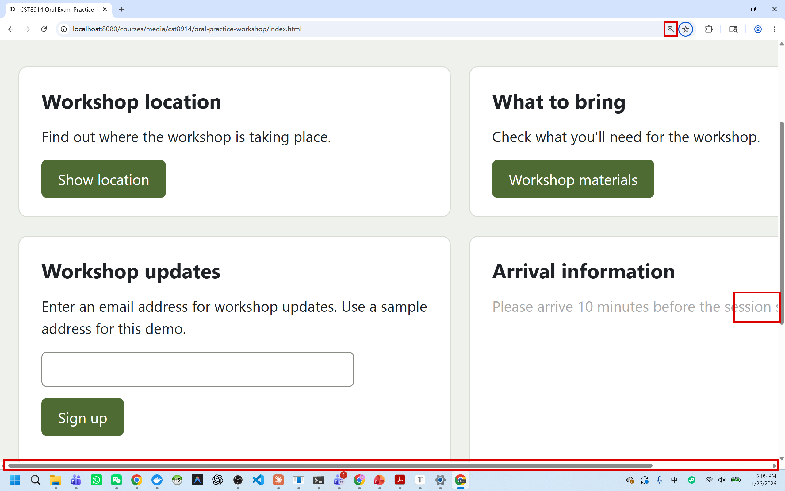

# CST8914 Oral Exam Practice

练习页面：[Workshop 练习页](media/cst8914/oral-practice-workshop/index.html)

## 1 Keyboard Accessibility（键盘）

| Step | Action | What you see |
|---|---|---|
| 1 | Press `Ctrl+L`, then `Enter`. | The page reloads and focus goes back to the top of the page. |
| 2 | Press `Tab`. | Focus jumps straight to **Sign up** and skips Show location: keyboard focus is **unpredictable**. |
| 3 | Press `Tab` four more times. | The **focus order** does not follow the page from top to bottom. |
| 4 | **Short answer** | "Keyboard focus is **unpredictable**: the first Tab goes to **Sign up**, so **keyboard-only users** lose their place." |

## 2 Screen Reader Testing（NVDA）

| Step | Action | What NVDA says |
|---|---|---|
| 1 | Press `Ctrl+Alt+N` to start NVDA; press `Insert+N`, then Tools, then Speech Viewer. | The Speech Viewer opens. |
| 2 | Press `Ctrl+L`, `Enter`, then `Tab` three times. | **"Workshop materials button collapsed"** |
| 3 | Press `Space`. | Still **"button collapsed"**: the expanded state **is not conveyed to the screen reader**. |
| 4 | Press `Tab` once more. | **"edit required blank"**: the instructions are **not conveyed to the screen reader**. |
| 5 | Press `Insert+Q`, then `Enter`. | NVDA exits. |
| 6 | **Short answer** | "The **expanded state** is **not conveyed to the screen reader**: NVDA still says **collapsed** after it opens, so **screen reader users** don't know it expanded." |
| 7 | **Short answer** | "The **email instructions** are **not conveyed to the screen reader**: NVDA only says **edit required blank**, so **screen reader users** don't know what to type." |

## 3 Automated Testing（自动工具）

| Step | Action | What you see |
|---|---|---|
| 1 | Click the WAVE icon in the extensions bar (or press `Ctrl+Shift+U`). | The WAVE panel opens on the left. |
| 2 | Look at Details. | **One error: Missing form label**; one contrast error: **Very low contrast**; one alert: Tabindex. |
| 3 | Click the red icon under Missing form label. | The page scrolls to the icon next to the **email field**. |
| 4 | **Short answer** | "WAVE shows **one error**, a **missing form label** on the email field, which affects **screen reader users**." |

## 4 Colour Contrast（对比度）

| Step | Action | What you see |
|---|---|---|
| 1 | Press `F12` to open DevTools, press `Ctrl+Shift+C`, and hover over the grey text "Please arrive 10 minutes…". | The tooltip shows **Color #AAAAAA** and **Contrast 2.32**. |
| 2 | Click the grey text. | Styles show **`color: #aaaaaa`**; the card background is **#ffffff**. |
| 3 | Press `F12` to close DevTools, then click **Contrast Checker** in the bookmarks bar. | The Contrast Checker opens with 0000FF on FFFFFF. |
| 4 | Click the Foreground Hex Value box and press `Ctrl+A`. | The foreground value is selected. |
| 5 | Type `AAAAAA` and press `Enter` (the background is already FFFFFF). | **2.32:1**, Normal Text **Fail**: **it's a fail**. |
| 6 | **Short answer** | "The arrival text is #AAAAAA on #FFFFFF, **2.32 to 1**. **It's a fail** for **low-vision users**." |

## 5 Zoom and Reflow（缩放和重排）

每一档只看老师问的两件事：内容有没有**被截断（truncated）**，内容会不会**跑出屏幕（flow off of the screen）**。

| Step | Action | What you see |
|---|---|---|
| 1 | Press `Ctrl+0`, then `Ctrl` + `+` five times (110, 125, 150, 175, 200). | At 200%, the arrival text **is truncated**. |
| 2 | Press `Ctrl` + `+` three more times (250, 300, 400). | At 400%, the content **is truncated** and **flows off the screen**. |
| 3 | Press `Ctrl+0`, `F12`, `Ctrl+Shift+M`; choose Responsive, type **320** in the width box, then press `Enter`. | At 320 px, **the text is too small and I can't see what's going on**. |
| 4 | Press `Ctrl+Shift+M` to close the device toolbar and `F12` to close DevTools. | Back to normal. |
| 5 | **Short answer** | "At 200%, the arrival text is **truncated**, so it fails for **low-vision users** who zoom." |
| 6 | **Short answer** | "At 400%, the content is **truncated** and **flows off the screen**, so it fails for **low-vision users** who zoom." |
| 7 | **Short answer** | "At 320 px, **the text is too small** and **I can't see what's going on**, so it fails for **users on small screens**." |

