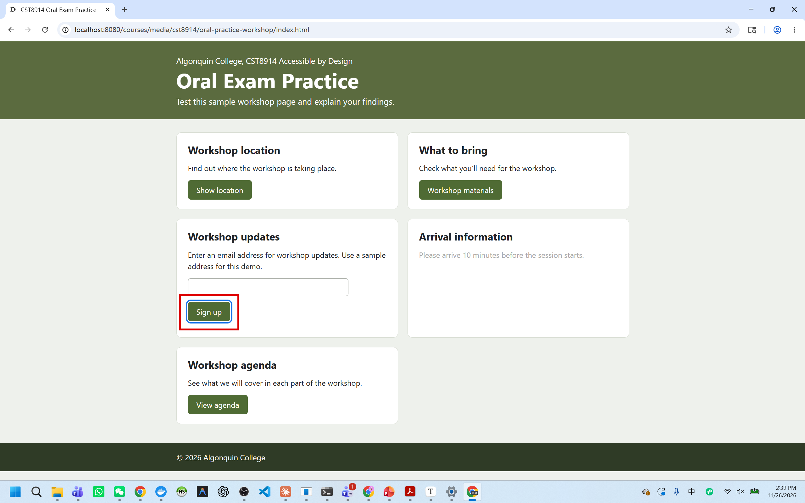
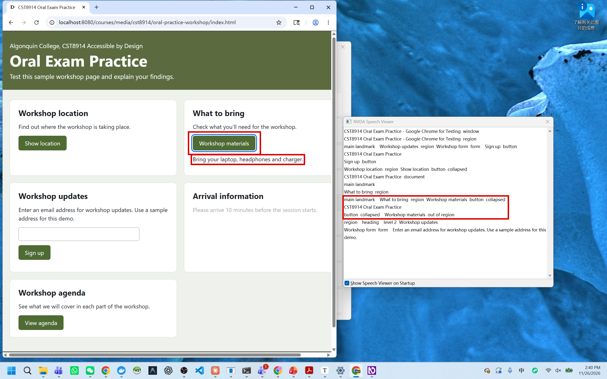
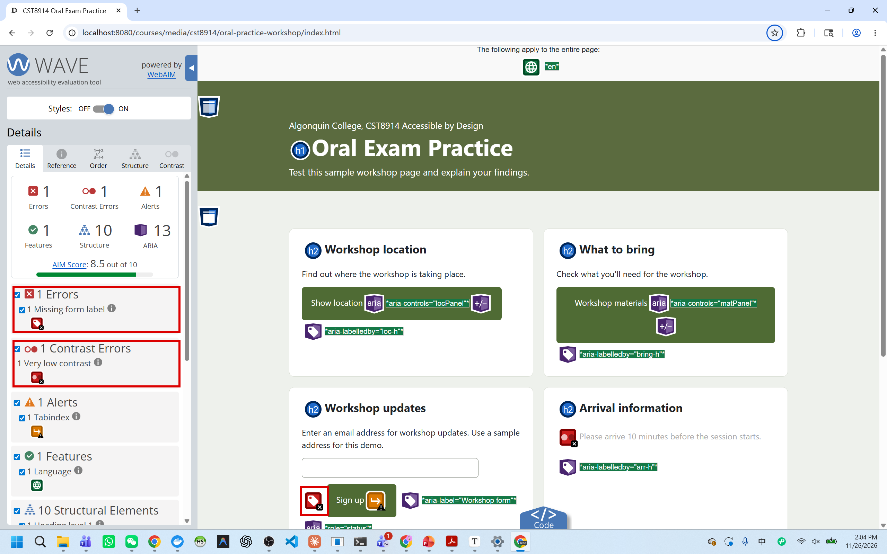
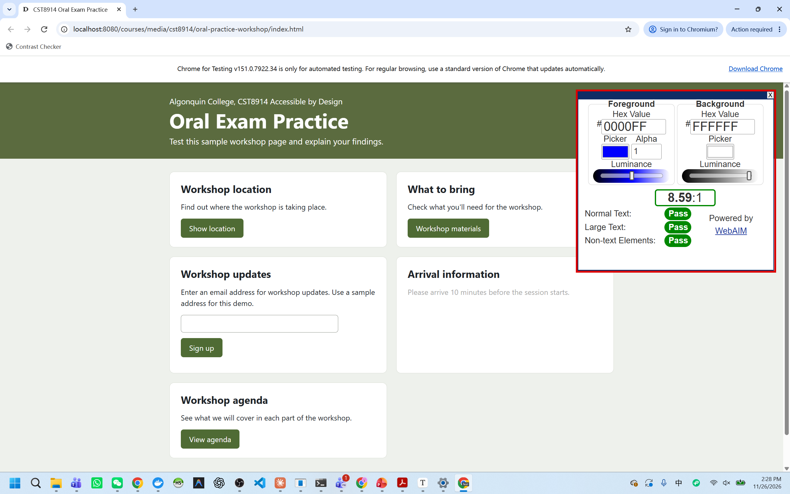
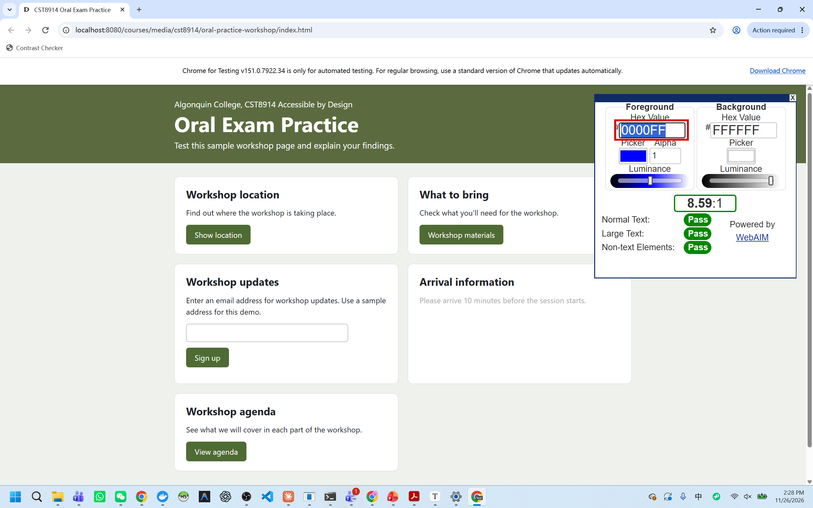
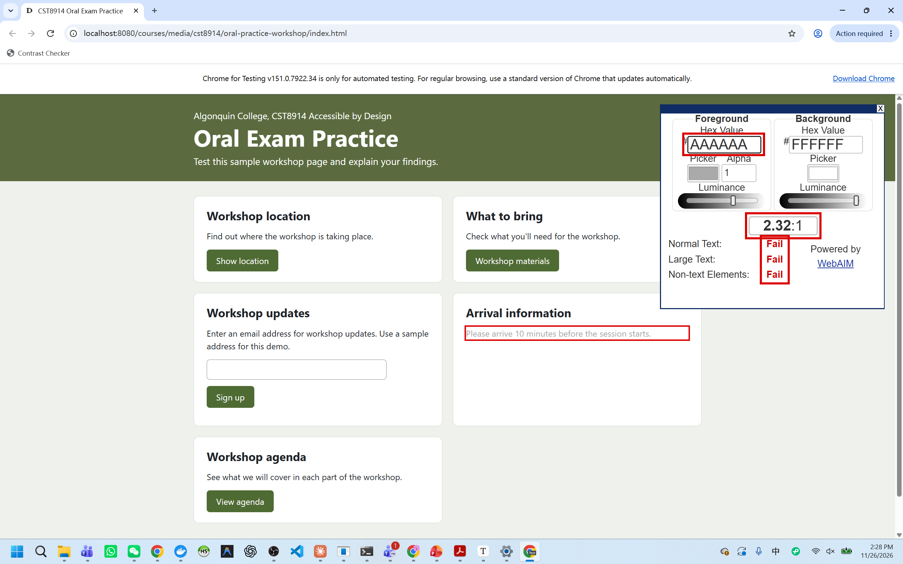
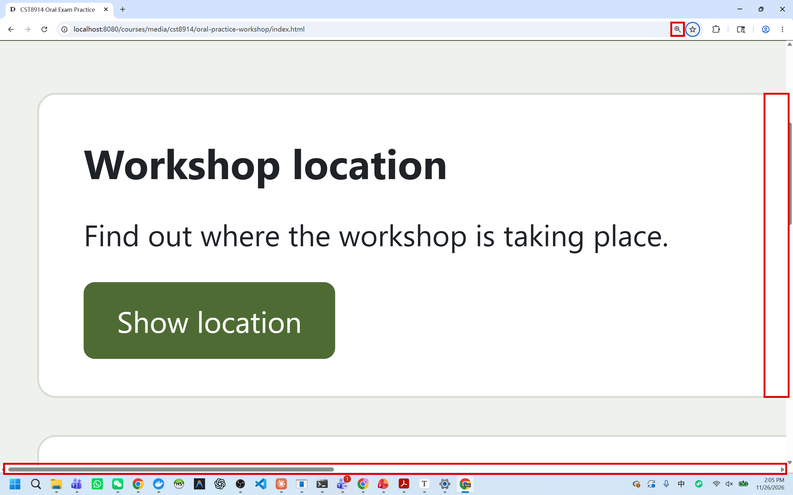
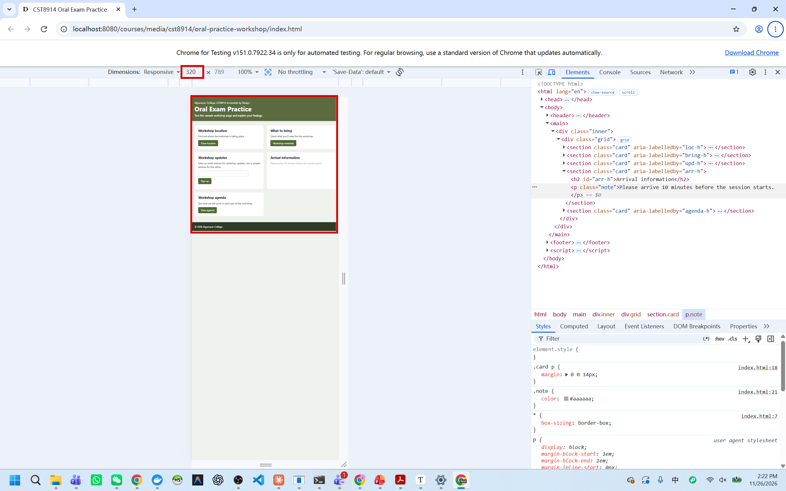

# CST8914 Oral Exam Practice

练习页面：[Workshop 练习页](media/cst8914/oral-practice-workshop/index.html)

## 1 Keyboard Accessibility（键盘）

| Step | Action | What you see | 中文翻译 |
|---|---|---|---|
| 1 | Press `Ctrl+L`, then `Enter`. | The page reloads and focus goes back to the top of the page. | 按 `Ctrl+L`，再按 `Enter`。页面重新加载，焦点回到页面顶部。 |
| 2 | Press `Tab`. | Focus jumps straight to **Sign up** and skips Show location: keyboard focus is **unpredictable**. | 按 `Tab`。焦点直接跳到 Sign up，跳过了 Show location：键盘焦点不可预测。 |
| 3 | Press `Tab` four more times. | The **focus order** does not follow the page from top to bottom. | 再按四次 `Tab`。焦点顺序没有按页面从上到下走。 |
| 4 | **Short answer** | "Keyboard focus is **unpredictable**: the first Tab goes to **Sign up**, so **keyboard-only users** lose their place." | 简短回答：键盘焦点不可预测：第一次按 Tab 就到了 Sign up，所以只用键盘的用户会找不到自己的位置。 |

## 2 Screen Reader Testing（NVDA）

| Step | Action | What NVDA says | 中文翻译 |
|---|---|---|---|
| 1 | Press `Ctrl+Alt+N` to start NVDA; press `Insert+N`, then Tools, then Speech Viewer. | The Speech Viewer opens. | 按 `Ctrl+Alt+N` 启动 NVDA；按 `Insert+N`，再选 Tools，然后选 Speech Viewer。Speech Viewer 打开。 |
| 2 | Press `Ctrl+L`, `Enter`, then `Tab` three times. | **"Workshop materials button collapsed"** | 按 `Ctrl+L`、`Enter`，再按三次 `Tab`。NVDA 读出 "Workshop materials button collapsed"。 |
| 3 | Press `Space`. | Still **"button collapsed"**: the expanded state **is not conveyed to the screen reader**. | 按 `Space`。仍然是 "button collapsed"：展开状态没有传达给屏幕阅读器。 |
| 4 | Press `Tab` once more. | **"edit required blank"**: the instructions are **not conveyed to the screen reader**. | 再按一次 `Tab`。NVDA 读出 "edit required blank"：说明文字没有传达给屏幕阅读器。 |
| 5 | Press `Insert+Q`, then `Enter`. | NVDA exits. | 按 `Insert+Q`，再按 `Enter`。NVDA 退出。 |
| 6 | **Short answer** | "The **expanded state** is **not conveyed to the screen reader**: NVDA still says **collapsed** after it opens, so **screen reader users** don't know it expanded." | 简短回答：展开状态没有传达给屏幕阅读器：展开后 NVDA 仍然说 collapsed，所以屏幕阅读器用户不知道它已经展开。 |
| 7 | **Short answer** | "The **email instructions** are **not conveyed to the screen reader**: NVDA only says **edit required blank**, so **screen reader users** don't know what to type." | 简短回答：邮箱说明没有传达给屏幕阅读器：NVDA 只说 edit required blank，所以屏幕阅读器用户不知道该输入什么。 |

## 3 Automated Testing（自动工具）

| Step | Action | What you see | 中文翻译 |
|---|---|---|---|
| 1 | Click the WAVE icon in the extensions bar (or press `Ctrl+Shift+U`). | The WAVE panel opens on the left. | 点扩展栏里的 WAVE 图标（或按 `Ctrl+Shift+U`）。WAVE 面板在左边打开。 |
| 2 | Look at Details. | **One error: Missing form label**; one contrast error: **Very low contrast**; one alert: Tabindex. | 看 Details。一个错误：Missing form label，缺少表单标签；一个对比度错误：Very low contrast，对比度很低；一个提醒：Tabindex。 |
| 3 | Click the red icon under Missing form label. | The page scrolls to the icon next to the **email field**. | 点 Missing form label 下面的红色图标。页面滚动到邮箱输入框旁边的图标。 |
| 4 | **Short answer** | "WAVE shows **one error**, a **missing form label** on the email field, which affects **screen reader users**." | 简短回答：WAVE 显示一个错误：邮箱输入框缺少表单标签，影响屏幕阅读器用户。 |

## 4 Colour Contrast（对比度）

| Step | Action | What you see | 中文翻译 |
|---|---|---|---|
| 1 | Press `F12` to open DevTools, press `Ctrl+Shift+C`, and hover over the grey text "Please arrive 10 minutes…". | The tooltip shows **Color #AAAAAA** and **Contrast 2.32**. | 按 `F12` 打开开发者工具，按 `Ctrl+Shift+C`，鼠标停在灰色文字 "Please arrive 10 minutes…" 上。提示框显示 Color #AAAAAA 和 Contrast 2.32。 |
| 2 | Click the grey text. | Styles show **`color: #aaaaaa`**; the card background is **#ffffff**. | 点这段灰色文字。Styles 里显示 `color: #aaaaaa`；卡片背景是 #ffffff。 |
| 3 | Press `F12` to close DevTools, then click **Contrast Checker** in the bookmarks bar. | The Contrast Checker opens with 0000FF on FFFFFF. | 按 `F12` 关闭开发者工具，再点书签栏里的 Contrast Checker。Contrast Checker 打开，显示 0000FF 对 FFFFFF。 |
| 4 | Click the Foreground Hex Value box and press `Ctrl+A`. | The foreground value is selected. | 点前景色的 Hex Value 输入框，按 `Ctrl+A`。前景色的值被选中。 |
| 5 | Type `AAAAAA` and press `Enter` (the background is already FFFFFF). | **2.32:1**, Normal Text **Fail**: **it's a fail**. | 输入 `AAAAAA`，按 `Enter`（背景已经是 FFFFFF）。结果是 2.32:1，Normal Text 显示 Fail：不通过。 |
| 6 | **Short answer** | "The arrival text is #AAAAAA on #FFFFFF, **2.32 to 1**. **It's a fail** for **low-vision users**." | 简短回答：到达说明文字是 #AAAAAA 对 #FFFFFF，2.32 比 1。对低视力用户来说不通过。 |

## 5 Zoom and Reflow（缩放和重排）

每一档只看老师问的两件事：内容有没有**被截断（truncated）**，内容会不会**跑出屏幕（flow off of the screen）**。

| Step | Action | What you see | 中文翻译 |
|---|---|---|---|
| 1 | Press `Ctrl+0`, then `Ctrl` + `+` five times (110, 125, 150, 175, 200). | At 200%, the arrival text **is truncated**. | 按 `Ctrl+0`，再按五次 `Ctrl` + `+`（110、125、150、175、200）。在 200% 时，到达说明文字被截断。 |
| 2 | Press `Ctrl` + `+` three more times (250, 300, 400). | At 400%, the content **is truncated** and **flows off the screen**. | 再按三次 `Ctrl` + `+`（250、300、400）。在 400% 时，内容被截断，并且跑出屏幕。 |
| 3 | Press `Ctrl+0`, `F12`, `Ctrl+Shift+M`; choose Responsive, type **320** in the width box, then press `Enter`. | At 320 px, **the text is too small and I can't see what's going on**. | 按 `Ctrl+0`、`F12`、`Ctrl+Shift+M`；选 Responsive，在宽度框里输入 320，再按 `Enter`。在 320 像素时，文字太小，我看不清是怎么回事。 |
| 4 | Press `Ctrl+Shift+M` to close the device toolbar and `F12` to close DevTools. | Back to normal. | 按 `Ctrl+Shift+M` 关闭设备工具栏，按 `F12` 关闭开发者工具。恢复正常。 |
| 5 | **Short answer** | "At 200%, the arrival text is **truncated**, so it fails for **low-vision users** who zoom." | 简短回答：在 200% 时，到达说明文字被截断，所以对需要放大的低视力用户来说不通过。 |
| 6 | **Short answer** | "At 400%, the content is **truncated** and **flows off the screen**, so it fails for **low-vision users** who zoom." | 简短回答：在 400% 时，内容被截断并且跑出屏幕，所以对需要放大的低视力用户来说不通过。 |
| 7 | **Short answer** | "At 320 px, **the text is too small** and **I can't see what's going on**, so it fails for **users on small screens**." | 简短回答：在 320 像素时，文字太小，我看不清是怎么回事，所以对小屏幕用户来说不通过。 |

