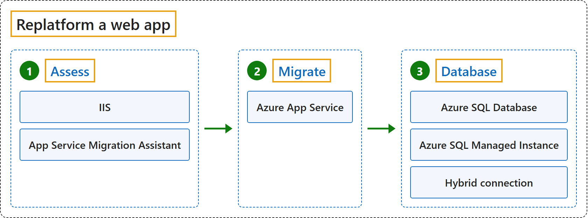

# Courses

## CST8913 Cloud Migration

### Course map

| Keyword | Description | 中文翻译 |
|---|---|---|
| **1 Strategy** | **Why** an organization adopts Azure. | 组织**为什么**采用 Azure。 |
| **1.1 Motivations, mission and objectives (W2, W3)** | W2 introduces the **cloud migration motivators** (Lab 2); W3 covers the **cloud adoption strategy**: **motivations**, **business outcomes**, **financial** and **technical considerations**, and the **adoption horizons**. | W2 讲**云迁移动机**（Lab 2）；W3 讲**云采用战略**：**动机**、**业务成果**、**财务**和**技术考量**，以及**采用阶段（horizons）**。 |
| **2 Plan** | Turns the strategy into an **actionable plan**. | 把战略变成**可执行的计划**。 |
| **2.1 Plan migration (W4)** | W4 covers **discovery and assessment** and the **migration plan**. | W4 讲**发现与评估**，以及**迁移计划**。 |
| **3 Ready** | Builds the **Azure landing zone**; not taught in W1 to W6. | 搭建 **Azure 着陆区**；W1 到 W6 没讲。 |
| **4 Adopt** | **Migrates, modernizes and builds** workloads. | **迁移、现代化和新建**工作负载。 |
| **4.1 Migration (W5)** | W5 moves workloads by **rehosting**. | W5 用**重新托管**迁移工作负载。 |
| **4.2 Modernization (W6)** | W6 improves workloads by **replatforming** them onto **PaaS**; the W6 slides say **refactoring**. | W6 通过**换平台**把工作负载改到 **PaaS** 上；W6 课件叫**重构（refactoring）**。 |
| **5 Govern** | Sets **guardrails**; not taught in W1 to W6. | 设置**护栏**；W1 到 W6 没讲。 |
| **6 Secure** | Protects the **Azure cloud estate**; not taught in W1 to W6. | 保护 **Azure 云资产**；W1 到 W6 没讲。 |
| **7 Manage** | Operates Azure with **RAMP**; not taught in W1 to W6. | 用 **RAMP** 运营 Azure；W1 到 W6 没讲。 |

### Lab 1: Git, GitHub and Markdown (W1)

**Scenario:** Set up a **private GitHub repository** for the course and submit Lab 1, written in **Markdown**, through a **branch** and a **pull request**. **Git** records every change as a **commit**; **GitHub** hosts the repository for **sharing and review**.

| Keyword | Description | 中文翻译 |
|---|---|---|
| **1 Private repository** | A **private repository** is visible only to invited **collaborators**, such as the instructor. | **私有仓库**只有受邀的**协作者**（比如老师）能看到。 |
| **2 Clone** | **Cloning** copies the repository, with its **full history**, to a **local copy** on the computer. | **克隆**把仓库连同**完整历史**复制到电脑上，成为**本地副本**。 |
| **3 Branch** | A **branch** such as **lab-01** keeps the work **off main** until it is reviewed. | 像 **lab-01** 这样的**分支**让作业在审阅之前**不进 main**。 |
| **4 Commit** | A **commit** records one stage of the work; Lab 1 was built in **five stages**. | 一次**提交**记录作业的一个阶段；Lab 1 分**五个阶段**完成。 |
| **5 Push** | A **push** sends the **branch to GitHub**. | **推送**把**分支发到 GitHub**。 |
| **6 Pull request** | A **pull request** asks to merge the branch, after a **review** of the changed files. | **拉取请求**在**审阅**改动的文件之后，请求合并这个分支。 |
| **7 Merge** | **Merging** brings the reviewed branch into **main**. | **合并**把审阅过的分支并入 **main**。 |

| Keyword | Description | 中文翻译 |
|---|---|---|
| **1 Heading** | A line starting with **#** signs; more signs make a **lower level**. | 以 **#** 开头的一行；# 越多，**级别越低**。 |
| **2 Text formatting** | **Two asterisks** around text make it **bold**; **one asterisk** makes it **italic**. | 文字两边加**两个星号**变**粗体**；加**一个星号**变**斜体**。 |
| **3 List** | Lines starting with a **dash** make a **bulleted list**; **numbers** make a **numbered list**. | 以**短横线**开头的行组成**无序列表**；以**数字**开头组成**有序列表**。 |
| **4 Link** | The **link text** in square brackets, then the **URL** in parentheses. | 方括号里写**链接文字**，后面圆括号里写 **URL**。 |
| **5 Image** | Like a link with an **exclamation mark** in front; the brackets hold the **alt text**. | 和链接一样，前面加一个**感叹号**；方括号里写**替代文字**。 |
| **6 Blockquote** | A line starting with **>** becomes a **quote**. | 以 **>** 开头的一行变成**引用**。 |
| **7 Inline code** | **Backticks** around a word show it as **code** inside a sentence. | 单词两边加**反引号**，在句子里显示成**代码**。 |
| **8 Fenced code block** | **Three backticks** above and below a block, with the **language** name, such as **bash**. | 代码块上下各加**三个反引号**，并写上**语言**名，比如 **bash**。 |
| **9 Table** | Cells separated by **vertical bars**, with a **dash row** under the header. | 单元格用**竖线**隔开，表头下面加一行**短横线**。 |
| **10 Task list** | A list item with **square brackets**; an **x** marks it **done**. | 带**方括号**的列表项；**x** 表示**已完成**。 |
| **11 Horizontal rule** | **Three dashes** on a line draw a **dividing line**. | 一行写**三个短横线**，画出一条**分隔线**。 |

### Lab 2: Levi Strauss migration case study (W2)

**Scenario:** **Levi Strauss & Co.** moves from several **datacenters**, about **160 applications** and **nine ERP systems** in **110 countries** to Azure, as it shifts to **direct-to-consumer** sales.

**CAF:** **Strategy > Motivations, mission and objectives** and **Plan > Plan migration**.

| Keyword | Description | 中文翻译 |
|---|---|---|
| **1 Migration motivators (Motivations)** | The **business reasons** Levi Strauss moves to the cloud; the Lab 2 rubric says **migration motivators**. | Levi Strauss 上云的**业务原因**；Lab 2 评分表叫 **migration motivators**。 |
| **1.1 Direct-to-consumer** | Becoming a **USD 10 billion DTC brand** needs **speed, automation and data**. | 要成为 **100 亿美元的直面消费者（DTC）品牌**，需要**速度、自动化和数据**。 |
| **1.2 Technical debt** | About **160 applications**, several datacenters, **nine ERP systems** and different processes in **110 countries**. | 大约 **160 个应用**、多个数据中心、**九套 ERP 系统**，**110 个国家**流程各不相同。 |
| **1.3 Datacenter cost** | Owning and operating datacenters became **too expensive**. | 自建和运营数据中心变得**太贵**。 |
| **1.4 Standardization** | **One global ERP** means **consistent processes and data**. | **一套全球 ERP** 意味着**统一的流程和数据**。 |
| **1.5 AI readiness** | **Unified data** on a standard platform is the foundation for **AI and agents**. | 标准平台上的**统一数据**是 **AI 和智能体**的基础。 |
| **2 Discovery questions (Discover your existing workload inventory)** | The questions that complete the picture **before planning**; the Lab 2 rubric says **infrastructure discovery questions**. | **做计划之前**要问清楚的问题；Lab 2 评分表叫 **infrastructure discovery questions**。 |
| **2.1 Applications** | Which applications are **business-critical**, and which could be **retired** or **replaced with SaaS**? | 哪些应用是**业务关键**的？哪些可以**下线**或**换成 SaaS**？ |
| **2.2 Servers** | How many servers, how **heavily used**, and which run an OS **near end of support**? | 有多少台服务器、**使用率多高**、哪些的操作系统**快到支持期结束**？ |
| **2.3 Data** | How much data the nine ERP systems hold, and how it **merges into one data model**. | 九套 ERP 系统有多少数据，怎样**合并成一个数据模型**。 |
| **2.4 Networking** | How stores, distribution centers and offices in 110 countries **connect**, and what **latency** they need. | 110 个国家的门店、配送中心和办公室怎样**连接**，需要多低的**延迟**。 |
| **2.5 Security** | How **identity** is managed, which **data-residency** laws apply, and the **RPO and RTO**. | **身份**怎样管理，适用哪些**数据驻留**法律，**RPO 和 RTO** 是多少。 |
| **2.6 Dependencies** | Which applications **depend on each other**, and so must move in the **same wave**. | 哪些应用**互相依赖**，因此必须在**同一批次**迁移。 |
| **2.7 Business requirements** | The acceptable **downtime**, the **retail peak periods** to avoid, and the **budget and deadline**. | 可接受的**停机时间**、要避开的**零售高峰期**，以及**预算和截止日期**。 |

**CAF:** **Plan > Define operating model**.

| Keyword | Description | 中文翻译 |
|---|---|---|
| **R Responsible** | **Does the work**; the **migration** team for most activities. | **干活的人**；大多数活动由**迁移**团队负责。 |
| **A Accountable** | The **single owner** of an activity; the **infrastructure director** for discovery, landing zone, migration, cutover and optimization. | 一项活动的**唯一负责人**；发现、着陆区、迁移、切换和优化都由**基础设施总监**负责。 |
| **C Consulted** | **Gives input** before decisions, such as **security** and **business** leaders. | 决策前**提供意见**，比如**安全**和**业务**负责人。 |
| **I Informed** | **Kept up to date**, such as the **sponsor** after approval. | **随时知情**，比如批准之后的**发起人**。 |

**CAF:** **Plan > Plan migration**.

| Keyword | Description | 中文翻译 |
|---|---|---|
| **1 Retire** | **Decommissions** a workload with no business value, so it **does not move**; used for **applications no longer needed**. | **停用**没有业务价值的工作负载，所以它**不迁移**；用于**不再需要的应用**。 |
| **2 Rehost** | Moves the workload **like for like** with **minimal changes**, such as a server to an **Azure VM**; used for **most servers**. | **原样**迁移工作负载，**改动最少**，比如把服务器搬到 **Azure 虚拟机**；**大多数服务器**用这种方式。 |
| **3 Replatform** | Changes the **hosting environment** to **PaaS** with **minimal code changes**, such as **SQL Server on a VM** to **Azure SQL**; fits the **databases** (Azure SQL Managed Instance) and **third-party apps** (AKS), which the W2 slides and Lab 2 call Refactor. | 把**托管环境**换成 **PaaS**，**代码改动很少**，比如把**虚拟机上的 SQL Server** 换成 **Azure SQL**；符合**数据库**（Azure SQL Managed Instance）和**第三方应用**（AKS），W2 课件和 Lab 2 把它们叫作 Refactor。 |
| **4 Refactor** | Improves the **internal structure of the code** without adding features, to reduce **technical debt**. | 改进**代码的内部结构**，不增加新功能，以减少**技术债**。 |
| **5 Rearchitect** | Redesigns the **architecture and code**, such as splitting a **monolith into microservices**; too slow for 160 applications before the datacenter exit. | 重新设计**架构和代码**，比如把**单体应用拆成微服务**；在退出数据中心之前对 160 个应用这样做太慢。 |
| **6 Replace** | Swaps the workload for a **SaaS** product, so **no custom code** remains to maintain; the **nine ERP systems** become **one global ERP**. | 把工作负载换成 **SaaS** 产品，**不再有自定义代码**要维护；**九套 ERP 系统**变成**一套全球 ERP**。 |
| **7 Rebuild** | Develops the workload **again from the start** with **cloud-native** solutions, when the old system is too outdated to modernize. | 用**云原生**方案**从头重新开发**工作负载，适用于旧系统过于陈旧、无法现代化的情况。 |
| **8 Retain** | **Keeps the workload where it is**, when it is stable or **cannot be migrated**, for example because of regulations. | **工作负载留在原地**，适用于它运行稳定或**无法迁移**的情况，比如受法规限制。 |

**CAF:** **Plan > Plan migration**.

| Keyword | Description | 中文翻译 |
|---|---|---|
| **1 Discovery and assessment** | **Months 1-2**: inventory with **Azure Migrate**, map **dependencies**, choose a strategy per workload. | **第 1 到 2 个月**：用 **Azure Migrate** 盘点，梳理**依赖关系**，为每个工作负载选迁移策略。 |
| **2 Azure landing zone** | **Months 2-3**: **subscriptions, networking, identity, security and backup**. | **第 2 到 3 个月**：**订阅、网络、身份、安全和备份**。 |
| **3 Migration waves** | **Month 3**: a **pilot** wave of **low-risk servers** tests **replication, cutover and rollback**. **Months 4-8**: **dependent applications move together**, avoiding **retail peak periods**. | **第 3 个月**：**试点**波次迁移**低风险服务器**，测试**复制、切换和回滚**。**第 4 到 8 个月**：**互相依赖的应用一起迁**，避开**零售高峰期**。 |
| **4 Execute** | **Month 8**: final **cutover** in approved **downtime windows**. | **第 8 个月**：在批准的**停机窗口**内完成最终**切换**。 |
| **5 Decommission** | **Month 8**: **the datacenters are decommissioned** after the cutover. | **第 8 个月**：切换之后**关停数据中心**。 |
| **6 Optimize** | **Month 9 onward**: **right-size**, track **cost**, test **disaster recovery**. | **第 9 个月起**：**调整规格**、跟踪**成本**、测试**灾难恢复**。 |

### Cloud Adoption Framework (W2, W3)

**CAF:** All seven phases.

| Keyword | Description | 中文翻译 |
|---|---|---|
| **Azure adoption phases** | The Cloud Adoption Framework has **seven Azure adoption phases**. | 云采用框架有**七个 Azure 采用阶段**。 |
| **1 Strategy** | **Strategy** sets **why** an organization adopts Azure: the **cloud adoption strategy**. | **战略**确定组织**为什么**采用 Azure：即**云采用战略**。 |
| **2 Plan** | **Plan** turns that strategy into an **actionable plan**: the **cloud adoption plan**. | **计划**把战略变成**可执行的计划**：即**云采用计划**。 |
| **3 Ready** | **Ready** builds the **Azure landing zone**. | **就绪**搭建 **Azure 着陆区**。 |
| **4 Adopt** | **Adopt** **migrates, modernizes and builds workloads**. | **采用**负责**迁移、现代化和新建工作负载**。 |
| **5 Govern** | **Govern** sets **guardrails**. | **治理**设置**护栏**。 |
| **6 Secure** | **Secure** protects the **Azure cloud estate**. | **安全**保护 **Azure 云资产**。 |
| **7 Manage** | **Manage** operates Azure with **RAMP**: **Ready, Administer, Monitor, Protect**. | **管理**用 **RAMP** 运营 Azure：**就绪、管理、监控、保护**。 |

### Lab 3: IaaS and PaaS architecture (W3)

**Scenario:** A web application with a **React** UI, a **Flask** web server and a **PostgreSQL** database is designed on Azure twice: once on **IaaS**, once on **PaaS**.

| Keyword | Description | 中文翻译 |
|---|---|---|
| **1 IaaS** | In **IaaS**, the provider supplies **VMs, disks and network**; the team builds and maintains everything on them. | 在 **IaaS** 里，云服务商提供**虚拟机、磁盘和网络**；上面的一切由团队自己搭建和维护。 |
| **2 N-tier, subnets, NSGs** | In an **N-tier** architecture, each tier has its own **subnet**, and its **NSG** allows only traffic from the **tier in front of it**. | 在 **N 层**架构里，每一层有自己的**子网**，它的 **NSG**（网络安全组）只允许**前一层**的流量进来。 |
| **3 Availability zones** | **Availability zones** are separate datacenters in one region, so **one zone can fail**. | **可用区**是同一区域里相互独立的数据中心，所以**一个区坏了也没关系**。 |
| **4 Load balancer** | A **load balancer** spreads requests across servers and removes failed ones. | **负载均衡器**把请求分给多台服务器，并把坏掉的服务器移出去。 |
| **5 Replication** | Database **replication** keeps a **standby** in sync with the **primary**. | 数据库**复制**让**备用库**和**主库**保持同步。 |
| **6 Management VMs** | IaaS needs its own **jumpbox, monitoring, NAT and backup** servers. | IaaS 需要自己的**跳板机、监控、NAT 和备份**服务器。 |
| **7 PaaS** | In **PaaS**, each tier becomes a **managed service**, and the provider runs the servers, patching, scaling and backups. | 在 **PaaS** 里，每一层变成一个**托管服务**，服务器、打补丁、扩缩容和备份都由云服务商负责。 |
| **8 App Service** | **App Service** runs web apps on several **instances** behind a **built-in load balancer**, with **autoscale**. | **App Service** 在**内置负载均衡器**后面用多个**实例**运行 Web 应用，并支持**自动扩缩**。 |
| **9 VNet integration** | **VNet integration** lets App Service reach resources that accept **private connections only**. | **VNet 集成**让 App Service 能访问**只接受私有连接**的资源。 |
| **10 Key Vault, Application Insights** | **Key Vault** stores **secrets**; **Application Insights** collects **telemetry**. | **Key Vault** 保存**机密**；**Application Insights** 收集**遥测数据**。 |
| **11 IaaS or PaaS** | **IaaS** gives **full control** but more **operations work**; **PaaS** gives less control and **no servers to manage**. | **IaaS** 给你**完全的控制权**，但**运维工作**更多；**PaaS** 控制权少一些，但**没有服务器要管**。 |

### Migration phases (W4)

**CAF:** **Plan > Plan migration** and **Adopt > Migration**.

| Keyword | Description | 中文翻译 |
|---|---|---|
| **1 Decide** | The first phase **identifies the workloads** and decides **whether to migrate**. | 第一阶段**识别工作负载**，并决定**是否迁移**。 |
| **1.1 Discovery** | **Discovery** identifies the workloads. | **发现**识别工作负载。 |
| **1.1.1 Azure Migrate appliance** | The **appliance** collects **configuration and performance data** and sends it to Azure Migrate. | **设备**（appliance）收集**配置和性能数据**，发送到 Azure Migrate。 |
| **1.1.2 Azure Migrate Collector** | The **Collector** takes a **snapshot** without continuous Azure connectivity. | **Collector** 在不需要持续连接 Azure 的情况下拍一张**快照**。 |
| **1.2 Business case** | A **business case** estimates the **costs and savings** of moving to Azure. | **业务案例**估算迁到 Azure 的**成本和节省**。 |
| **2 Plan** | The second phase **plans the migration in detail**. | 第二阶段**详细规划迁移**。 |
| **2.1 Assessment** | **Assessments** find the four results below. | **评估**得出下面四项结果。 |
| **2.1.1 Azure readiness** | Whether servers are **ready for migration** to Azure. | 服务器是否**可以迁移**到 Azure。 |
| **2.1.2 Right-sizing** | The **size** of the Azure VMs after migration. | 迁移后 Azure 虚拟机的**规格**。 |
| **2.1.3 Azure cost estimation** | The **cost** of running the servers in Azure. | 服务器在 Azure 上运行的**成本**。 |
| **2.1.4 Dependency analysis** | The **network dependencies** between servers. | 服务器之间的**网络依赖关系**。 |
| **2.2 Migration strategies** | The **strategy** chosen for **each workload**. | 为**每个工作负载**选定的**策略**。 |
| **3 Execute** | The third phase **performs the migration or modernization**. | 第三阶段**执行迁移或现代化**。 |
| **3.1 Replication** | **Replication** copies the VMs to Azure. | **复制**把虚拟机复制到 Azure。 |
| **3.2 Test migration** | A **test migration** **simulates the migration** in a **non-production network**. | **测试迁移**在**非生产网络**里**模拟迁移**。 |
| **3.3 Migrate VMs** | After the test works, the **source machines** are **migrated**. | 测试通过后，**迁移源机器**。 |
| **3.4 Complete migration** | Completing the migration **stops replication** and **cleans up** its state. | 完成迁移会**停止复制**，并**清理**复制状态。 |

### Lab 4: Discovery and assessment (W4)

**CAF:** **Plan > Plan migration**.

**Scenario:** Five on-premises **VMware** servers, **WEB-01, APP-01, DB-01, DC-01 and FILE-01**, move to **Azure VMs** with **minimal downtime**; a written simulation with **no CPU, memory or usage data**.

| Keyword | Description | 中文翻译 |
|---|---|---|
| **1 Digital estate** | **Everything IT runs today**; here the **five servers** and their applications and data. | **IT 现在运行的一切**；这里是**五台服务器**以及上面的应用和数据。 |
| **2 Discovery** | **Agentless**: the **Azure Migrate appliance** on **vCenter** reads each VM over **port 443** for about **30 days**. | **无代理**：装在 **vCenter** 上的 **Azure Migrate 设备**通过 **443 端口**读取每台虚拟机，持续大约 **30 天**。 |
| **3 Dependency analysis** | Shows each server's **TCP connections**; **WEB-01, APP-01 and DB-01** form one **migration group**. | 显示每台服务器的 **TCP 连接**；**WEB-01、APP-01 和 DB-01** 组成一个**迁移组**。 |
| **4 Readiness (Azure readiness)** | WEB-01, APP-01, DC-01 **conditionally ready**; DB-01 **insufficient information**; FILE-01 **not ready**, a **blocker** (Windows Server 2012 R2). | WEB-01、APP-01、DC-01 **有条件就绪**；DB-01 **信息不足**；FILE-01 **未就绪**，是一个**阻碍项**（Windows Server 2012 R2）。 |
| **5 Sizing (Right-sizing)** | **Performance-based** uses **real usage** and right-sizes; **as-is** **copies on-premises specs** and often oversizes. | **基于性能**按**实际使用量**调整规格；**按原样**照搬**本地配置**，常常配得过大。 |
| **6 Migration plan (Plan migration)** | A **test migration** runs in an **isolated network**; the **rollback plan** points **DNS back** to the **original servers**. | **测试迁移**在**隔离网络**里进行；**回滚计划**就是把 **DNS 指回原来的服务器**。 |

| Keyword | Description | 中文翻译 |
|---|---|---|
| **1 New DC in Azure** | Comes first, because every server needs **sign-in and DNS**. | 最先做，因为每台服务器都需要**登录和 DNS**。 |
| **2 FILE-01** | The **pilot**, with its **OS upgrade**, before the **October 13, 2026** security deadline. | **试点**，同时**升级操作系统**，赶在 **2026 年 10 月 13 日**安全支持截止之前。 |
| **3 Group 1** | **WEB-01, APP-01 and DB-01** move together in **one maintenance window**. | **WEB-01、APP-01 和 DB-01** 在**同一个维护窗口**里一起迁移。 |
| **4 Retire DC-01 (Decommission)** | Only after **nothing uses it**. | 要等到**没有任何东西再用它**之后。 |

### Lab 5: Rehosting to Azure VMware Solution (W5)

**CAF:** **Adopt > Migration**.

**Scenario:** **Washington State L&I** migrates **more than 300 VMs** to **Azure VMware Solution** in **phases**, in **under nine months**, without disrupting daily operations.

| Keyword | Description | 中文翻译 |
|---|---|---|
| **1 Rehost** | Moves VMs **without code changes**: the **fastest, lowest-risk** way to finish in **under nine months**. | **不改代码**迁移虚拟机：要在**九个月内**完成，这是**最快、风险最低**的方式。 |
| **2 Rehost vs replatform** | **Rehost** moves the VM **as is**; **replatform** makes **small changes** to use a **managed platform**. | **重新托管**把虚拟机**原样**搬过去；**重新平台化**做**少量修改**，用上**托管平台**。 |
| **3 Azure VMware Solution** | Runs **vCenter, NSX and vSAN** on **dedicated hosts** in Azure, so VMware VMs move **without conversion**. | 在 Azure 的**专用主机**上运行 **vCenter、NSX 和 vSAN**，所以 VMware 虚拟机**不用转换**就能迁过去。 |

| Keyword | Description | 中文翻译 |
|---|---|---|
| **1 Prepare** | Deploy the **private cloud**, **ExpressRoute** with Global Reach, and **VMware HCX**, which keeps the VMs' **IP addresses**. | 部署**私有云**、带 Global Reach 的 **ExpressRoute**，以及能保留虚拟机 **IP 地址**的 **VMware HCX**。 |
| **2 Discovery** | **Dependency analysis** puts each application and everything it calls in the **same wave**. | **依赖分析**把每个应用和它调用的所有东西放进**同一批次**。 |
| **3 Migration waves** | A **pilot** of **about 10 VMs** proves the tools, network and runbook; then **about 75 VMs each**, from **lowest to highest criticality**. | **试点**约 **10 台虚拟机**，验证工具、网络和操作手册；之后**每批大约 75 台**，按**重要性从低到高**。 |
| **4 Execute** | **Proceed or roll back**: proceed after tests and **48 hours** stable; otherwise roll back to the **intact on-premises VMs**. | **继续还是回滚**：测试通过并稳定 **48 小时**后继续；否则回滚到**完好的本地虚拟机**。 |
| **5 Decommission** | After each wave's **stabilization period**, the **on-premises copies** are retired. | 每一批的**稳定期**结束后，下线**本地副本**。 |

### Refactoring (Replatform)

**CAF:** **Adopt > Modernization**.

| Keyword | Description | 中文翻译 |
|---|---|---|
| **1 Assess** | The first step checks whether the app can move. | 第一步检查应用能不能迁。 |
| **1.1 IIS** | The **Windows web server** that hosts the **ASP.NET** app on premises. | 在本地托管 **ASP.NET** 应用的 **Windows Web 服务器**。 |
| **1.2 App Service Migration Assistant** | The tool that first **assesses** the app, then **migrates** it. | 先**评估**应用、再**迁移**它的工具。 |
| **2 Migrate** | The second step moves the app. | 第二步迁移应用。 |
| **2.1 Azure App Service** | Runs the app and handles **OS patching, scaling and load balancing**. | 运行应用，并负责**操作系统补丁、扩缩容和负载均衡**。 |
| **3 Database** | The third step moves or connects the database. | 第三步迁移或连接数据库。 |
| **3.1 Azure SQL Database** | A **managed** database in Azure. | Azure 上的**托管**数据库。 |
| **3.2 Azure SQL Managed Instance** | A managed SQL Server **instance**, closest to on-premises SQL Server. | 托管的 SQL Server **实例**，最接近本地的 SQL Server。 |
| **3.3 Hybrid connection** | Links the app to a database that **stays on premises**. | 把应用连到**留在本地**的数据库。 |

### Lab 6: AWS, Azure and Google Cloud services

**Scenario:** Name the equivalent **AWS**, **Azure** and **Google Cloud** service for **30 service descriptions**, then compare their **similarities**, **differences** and **naming**.

| Keyword | Description | 中文翻译 |
|---|---|---|
| **1 Similarities** | Most services **match one to one**, and all three offer **VMs, PaaS, serverless and Kubernetes**. | 大多数服务**一一对应**，三家都提供**虚拟机、PaaS、无服务器和 Kubernetes**。 |
| **2 Differences** | **RDS** and **Cloud SQL** cover **several database engines in one service**, while Azure has **one per engine**; Azure **splits** load balancing and protection into several services. | **RDS** 和 **Cloud SQL** 用**一个服务支持多种数据库引擎**，而 Azure **每种引擎一个服务**；Azure 把负载均衡和防护**拆成**好几个服务。 |
| **3 Unique features** | Some services add capabilities their counterparts lack. | 有些服务提供了对手没有的功能。 |
| **4 Naming** | AWS uses **brand names and acronyms**, Azure says **"Azure" plus the function**, and Google says **"Cloud" plus the function**. | AWS 用**品牌名和缩写**，Azure 用 **"Azure" 加功能名**，Google 用 **"Cloud" 加功能名**。 |

### Lab questions

#### Lab 2

**Q1: What motivated Levi Strauss & Co. to migrate to the cloud?**

为什么 Levi Strauss & Co. 要迁移上云？

| Keyword | Description | 中文翻译 |
|---|---|---|
| **1 Direct-to-consumer** | The **USD 10 billion DTC** goal needs **speed, automation and data**. | **100 亿美元 DTC** 目标需要**速度、自动化和数据**。 |
| **2 Technical debt** | About **160 applications**, **nine ERP systems**, **110 countries**. | 约 **160 个应用**、**九套 ERP**、**110 个国家**。 |
| **3 Datacenter cost** | Owning and operating datacenters became **too expensive**. | 自建和运营数据中心变得**太贵**。 |
| **4 Standardization** | **One global ERP** means consistent processes and data. | **一套全球 ERP** 带来统一的流程和数据。 |
| **5 AI readiness** | **Unified data** is the foundation for AI and agents. | **统一数据**是 AI 和智能体的基础。 |

**Q2: What additional questions would you ask to better understand the company's existing infrastructure, applications, data, security, and business requirements?**

为了更好地了解公司现有的基础设施、应用、数据、安全和业务要求，你还会问哪些问题？

| Keyword | Description | 中文翻译 |
|---|---|---|
| **1 Applications** | Which are **business-critical**, and which could be retired or replaced with SaaS? | 哪些是**业务关键**的，哪些可以下线或换成 SaaS？ |
| **2 Servers** | How many, how heavily used, and which OS is **near end of support**? | 有多少台、使用率多高、哪些操作系统**快到支持期结束**？ |
| **3 Data** | How do nine ERP systems merge into **one data model**? | 九套 ERP 怎样合并成**一个数据模型**？ |
| **4 Networking** | How do 110 countries **connect**, and what **latency** do they need? | 110 个国家怎样**连接**，需要多低的**延迟**？ |
| **5 Security** | **Identity**, **data-residency** laws, **RPO and RTO**. | **身份**、**数据驻留**法律、**RPO 和 RTO**。 |
| **6 Dependencies** | Which applications must move in the **same wave**? | 哪些应用必须在**同一波次**迁移？ |
| **7 Business requirements** | **Downtime**, retail **peak periods**, **budget and deadline**. | **停机时间**、零售**高峰期**、**预算和截止日期**。 |

**Q3: Who are the main migration stakeholders? Present their roles and responsibilities in a RACI matrix.**

主要的迁移干系人是谁？用 RACI 矩阵列出他们的角色和职责。

| Keyword | Description | 中文翻译 |
|---|---|---|
| **1 Stakeholders** | Sponsor, ERP, infrastructure, migration, security, business leaders, **Microsoft**. | 发起人、ERP、基础设施、迁移、安全、业务负责人、**Microsoft**。 |
| **2 Responsible** | The **migration team** for most activities. | 多数活动由**迁移团队**执行。 |
| **3 Accountable** | The **infrastructure director** for most; the **sponsor** for strategy and budget. | 多数由**基础设施总监**负责；战略和预算由**发起人**负责。 |
| **4 Consulted** | Gives input before decisions, such as security. | 决策前提供意见，比如安全团队。 |
| **5 Informed** | Kept up to date, such as the sponsor after approval. | 随时知情，比如批准后的发起人。 |

**Q4: Which cloud migration approach is most appropriate for Levi Strauss & Co.? Explain and justify your choice.**

哪种云迁移方式最适合 Levi Strauss & Co.？说明并论证你的选择。

| Keyword | Description | 中文翻译 |
|---|---|---|
| **1 Rehost** | **Most servers**: the fastest, lowest-risk way out of the datacenters. | **大多数服务器**：离开数据中心最快、风险最低的方式。 |
| **2 Refactor** | **Databases** to Azure SQL Managed Instance; **third-party apps** to AKS. | **数据库**到 Azure SQL Managed Instance；**第三方应用**到 AKS。 |
| **3 Replace** | **Nine ERP systems** become one global ERP. | **九套 ERP** 变成一套全球 ERP。 |
| **4 Retire** | **Applications no longer needed**: less to migrate, secure and pay for. | **不再需要的应用**：减少迁移、保护和付费的范围。 |

**Q5: What would a high-level schedule for the migration process look like?**

迁移过程的高层时间表是什么样的？

| Keyword | Description | 中文翻译 |
|---|---|---|
| **1 Discover and assess** | **Months 1-2**. | **第 1 到 2 个月**。 |
| **2 Prepare the landing zone** | **Months 2-3**. | **第 2 到 3 个月**。 |
| **3 Pilot** | **Month 3**: low-risk servers. | **第 3 个月**：低风险服务器。 |
| **4 Migrate in waves** | **Months 4-8**, avoiding retail peak periods. | **第 4 到 8 个月**，避开零售高峰期。 |
| **5 Cut over and exit** | **Month 8**: decommission the datacenters. | **第 8 个月**：关停数据中心。 |
| **6 Optimize** | **Month 9 onward**. | **第 9 个月起**。 |

**Q6: What are the main business and technical decision criteria that Levi Strauss & Co. should consider during the migration?**

Levi Strauss & Co. 在迁移期间应考虑哪些主要的业务和技术决策标准？

| Keyword | Description | 中文翻译 |
|---|---|---|
| **1 Business criteria** | **Cost, speed, continuity, strategic fit**. | **成本、速度、连续性、战略契合**。 |
| **2 Technical criteria** | **Compatibility, security and compliance, performance, resilience, operability**. | **兼容性、安全与合规、性能、韧性、可运维性**。 |

#### Lab 3

**Q1: Describe how this application can be deployed in the cloud using IaaS infrastructure.**

描述如何用 IaaS 基础设施把这个应用部署到云上。

| Keyword | Description | 中文翻译 |
|---|---|---|
| **1 Team-managed VMs** | Azure provides only **VMs, disks and network**. | Azure 只提供**虚拟机、磁盘和网络**。 |
| **2 Tiers** | Each tier has its own **subnet** and two VMs in different **availability zones**. | 每层有自己的**子网**，两台虚拟机放在不同**可用区**。 |
| **3 Software** | **HAProxy, Nginx, Flask, PostgreSQL** with a replicated standby. | **HAProxy、Nginx、Flask，以及带复制备库的 PostgreSQL**。 |
| **4 Management VMs** | **Jumpbox, monitoring, NAT, backup**; **14 VMs** in total. | **跳板机、监控、NAT、备份**；共 **14 台**虚拟机。 |

**Q2: Describe how this application can be deployed in the cloud using PaaS infrastructure.**

描述如何用 PaaS 基础设施把这个应用部署到云上。

| Keyword | Description | 中文翻译 |
|---|---|---|
| **1 Managed services** | Azure runs the **servers, patching, scaling and backups**. | Azure 负责**服务器、补丁、扩缩容和备份**。 |
| **2 React** | **Azure Static Web Apps**. | **Azure Static Web Apps**。 |
| **3 Flask** | **Azure App Service**, on at least two instances. | **Azure App Service**，至少两个实例。 |
| **4 PostgreSQL** | **Flexible Server**, reached through **VNet integration**. | **Flexible Server**，通过 **VNet 集成**访问。 |
| **5 Key Vault** | Keeps the **connection string** out of code. | 让**连接字符串**不留在代码里。 |

#### Lab 4

**Q1.1: Define digital estate in your own words.**

用自己的话定义数字资产。

| Keyword | Description | 中文翻译 |
|---|---|---|
| **1 Digital estate** | **Everything IT runs today**: servers, applications, data and their connections. | **IT 现在运行的一切**：服务器、应用、数据及其连接。 |

**Q1.2: Explain why understanding the digital estate is necessary before planning a cloud migration.**

解释为什么在规划云迁移之前必须了解数字资产。

| Keyword | Description | 中文翻译 |
|---|---|---|
| **1 Dependent decisions** | **Sizing, cost and migration order** depend on it. | **规格、成本和迁移顺序**都取决于它。 |
| **2 Inventory** | Lists only **roles and OS versions**, so it is only a starting point. | 只列了**角色和操作系统版本**，所以只是起点。 |

**Q1.3: Describe three risks of migrating without adequate discovery and assessment.**

描述没有充分发现和评估就迁移的三个风险。

| Keyword | Description | 中文翻译 |
|---|---|---|
| **1 Outages** | Missed dependencies, such as moving **APP-01 without DB-01**. | 遗漏依赖，比如迁了 **APP-01 没迁 DB-01**。 |
| **2 Blockers** | Found too late, such as **FILE-01** at cutover. | 发现太晚，比如切换时才发现 **FILE-01** 的问题。 |
| **3 Wrong size and cost** | Copying specs **oversizes most VMs**, and may undersize DB-01. | 照搬配置会让**多数虚拟机配得过大**，也可能让 DB-01 配得过小。 |

**Q2.1: The discovery approach and how it works at a high level.**

发现方式及其高层工作原理。

| Keyword | Description | 中文翻译 |
|---|---|---|
| **1 Agentless** | The **Azure Migrate appliance** on vCenter reads each VM. | vCenter 上的 **Azure Migrate 设备**读取每台虚拟机。 |
| **2 About 30 days** | Collect long enough to capture **peak usage**. | 收集足够长时间，捕捉**使用高峰**。 |
| **3 Assessments** | Created from the collected data. | 用收集到的数据创建。 |

**Q2.2: The role of the Azure Migrate appliance and its connection to vCenter.**

Azure Migrate 设备的作用及其与 vCenter 的连接。

| Keyword | Description | 中文翻译 |
|---|---|---|
| **1 Appliance** | A VM deployed on vCenter from an **OVA template**. | 由 **OVA 模板**部署在 vCenter 上的虚拟机。 |
| **2 Connection** | A **read-only account on port 443**, through the vSphere APIs. | **只读账号，走 443 端口**，经 vSphere API。 |
| **3 Agentless** | **Nothing is installed** on the five servers. | 五台服务器上**什么都不用装**。 |

**Q2.3: The configuration and performance information you would collect.**

你会收集哪些配置和性能信息。

| Keyword | Description | 中文翻译 |
|---|---|---|
| **1 Configuration** | **vCPU, RAM, disks, NICs, OS version**. | **vCPU、内存、磁盘、网卡、操作系统版本**。 |
| **2 Performance** | **CPU, memory, disk IOPS and throughput, network traffic**. | **CPU、内存、磁盘 IOPS 和吞吐量、网络流量**。 |
| **3 Software** | **Applications, SQL Server version, IIS sites**. | **应用、SQL Server 版本、IIS 站点**。 |
| **4 Dependencies** | **TCP connections** with process and port. | 带进程和端口的 **TCP 连接**。 |

**Q2.4: The servers and workloads you would investigate.**

你会调查哪些服务器和工作负载。

| Keyword | Description | 中文翻译 |
|---|---|---|
| **1 DB-01** | **SQL version**, database size, performance. | **SQL 版本**、数据库大小、性能。 |
| **2 FILE-01** | **Legacy OS**, share sizes, who uses the shares. | **旧操作系统**、共享大小、谁在用。 |
| **3 DC-01** | Whether it runs **DNS**, and which servers depend on it. | 是否运行 **DNS**，哪些服务器依赖它。 |

**Q2.5: Additional information needed from the organization to complete the assessment.**

完成评估还需要组织提供哪些信息。

| Keyword | Description | 中文翻译 |
|---|---|---|
| **1 Downtime** | **Downtime limits and RPO/RTO** for each application. | 每个应用的**停机限制和 RPO/RTO**。 |
| **2 Applications** | Versions and owners. | 版本和负责人。 |
| **3 Licenses** | **Windows Server and SQL Server**. | **Windows Server 和 SQL Server**。 |
| **4 WEB-01** | Public **DNS name and TLS certificate**. | 公网 **DNS 名称和 TLS 证书**。 |

**Q2.6: Distinguish discovering assets from assessing their suitability for migration.**

区分发现资产和评估其迁移适用性。

| Keyword | Description | 中文翻译 |
|---|---|---|
| **1 Discovery** | **Collects facts**: what exists and how it is configured, used and connected. | **收集事实**：有什么、怎样配置、使用和连接。 |
| **2 Assessment** | **Uses those facts** to judge readiness, VM size and monthly cost. | **用这些事实**判断就绪情况、虚拟机规格和每月成本。 |

**Q3.1: Identify dependencies between the servers.**

找出服务器之间的依赖。

| Keyword | Description | 中文翻译 |
|---|---|---|
| **1 Application chain** | Internet users → **WEB-01 → APP-01 → DB-01**. | 互联网用户 → **WEB-01 → APP-01 → DB-01**。 |
| **2 Identity** | All servers → **DC-01**. | 所有服务器 → **DC-01**。 |
| **3 File shares** | Users and APP-01 → **FILE-01**. | 用户和 APP-01 → **FILE-01**。 |

**Q3.2: Clearly distinguish confirmed dependencies from assumed dependencies.**

明确区分已确认的依赖和假设的依赖。

| Keyword | Description | 中文翻译 |
|---|---|---|
| **1 Confirmed** | **APP-01 → DB-01**, internet users → WEB-01; both from the inventory. | **APP-01 → DB-01**，互联网用户 → WEB-01；都来自清单。 |
| **2 Assumed** | WEB-01 → APP-01, all servers → DC-01, users and APP-01 → FILE-01. | WEB-01 → APP-01，所有服务器 → DC-01，用户和 APP-01 → FILE-01。 |

**Q3.3: Explain how you would validate assumed dependencies during discovery.**

解释你会怎样在发现阶段验证假设的依赖。

| Keyword | Description | 中文翻译 |
|---|---|---|
| **1 Dependency analysis** | **Agentless**: shows TCP connections with process and port. | **无代理**：显示带进程和端口的 TCP 连接。 |
| **2 Ports** | Connections to DC-01 on **88, 389 or 53** confirm it. | 连到 DC-01 的 **88、389 或 53** 端口即可确认。 |
| **3 Application owners** | Check the results with them. | 和他们核对结果。 |

**Q3.4: Explain how dependency analysis reduces the risk of outages.**

解释依赖分析如何降低中断风险。

| Keyword | Description | 中文翻译 |
|---|---|---|
| **1 Move together** | Dependent servers move together, so **nothing is left behind** or cut off. | 互相依赖的服务器一起迁移，所以**不会有东西被落下**或断开。 |

**Q3.5: Propose one logical migration group and justify which servers belong together.**

提出一个合理的迁移组，并说明哪些服务器应该放在一起。

| Keyword | Description | 中文翻译 |
|---|---|---|
| **1 Migration group** | **WEB-01, APP-01 and DB-01**: one application. | **WEB-01、APP-01 和 DB-01**：同一个应用。 |
| **2 Why not split** | Database traffic over the VPN adds **delay and a new point of failure**. | 数据库流量走 VPN 会增加**延迟和新的故障点**。 |

**Q3.6: Include a simple dependency diagram.**

画一张简单的依赖图。

| Keyword | Description | 中文翻译 |
|---|---|---|
| **1 Group 1** | **WEB-01 → APP-01 → DB-01**. | **WEB-01 → APP-01 → DB-01**。 |
| **2 Shared servers** | WEB-01, APP-01, DB-01 and FILE-01 → **DC-01**; APP-01 → **FILE-01**. | WEB-01、APP-01、DB-01 和 FILE-01 → **DC-01**；APP-01 → **FILE-01**。 |
| **3 Lines** | **Solid** is confirmed; **dotted** is assumed. | **实线**是已确认；**虚线**是假设。 |

**Q4.1: Complete the readiness table. For each server, justify the classification, identify the information needed to confirm it, and propose remediation or further assessment.**

填写就绪表。为每台服务器说明分类理由、确认所需的信息，并提出补救措施或进一步评估。

| Keyword | Description | 中文翻译 |
|---|---|---|
| **1 WEB-01** | **Conditionally Ready**: needs a secure endpoint, certificate and DNS change. | **有条件就绪**：需要安全入口、证书和 DNS 变更。 |
| **2 APP-01** | **Conditionally Ready**: confirm vendor support; moves with DB-01. | **有条件就绪**：确认厂商支持；和 DB-01 一起迁。 |
| **3 DB-01** | **Insufficient Information**: SQL version unknown; run the SQL assessment. | **信息不足**：SQL 版本未知；做 SQL 评估。 |
| **4 DC-01** | **Conditionally Ready**: build a new DC in Azure and let AD replicate. | **有条件就绪**：在 Azure 新建 DC，让 AD 复制。 |
| **5 FILE-01** | **Not Ready**: Windows Server 2012 R2 security updates end; upgrade the OS during migration. | **未就绪**：Windows Server 2012 R2 安全更新结束；迁移时升级操作系统。 |

**Q5.1: Explain how Azure Migrate supports Azure VM sizing and cost estimation.**

解释 Azure Migrate 如何支持 Azure 虚拟机规格和成本估算。

| Keyword | Description | 中文翻译 |
|---|---|---|
| **1 VM size and disk type** | Recommended from **configuration and performance data**. | 根据**配置和性能数据**推荐。 |
| **2 Monthly cost** | **Compute and storage** for the chosen region and pricing. | 所选区域和定价下的**计算和存储**费用。 |

**Q5.2: Explain the difference between performance-based sizing and as-is sizing.**

解释基于性能的规格和按原样的规格之间的区别。

| Keyword | Description | 中文翻译 |
|---|---|---|
| **1 Performance-based** | Uses **actual usage** over time, so VMs are right-sized. | 使用一段时间的**实际使用量**，所以规格合适。 |
| **2 As-is** | **Copies on-premises specs**, so VMs are often oversized. | **照搬本地配置**，所以常常配得过大。 |

**Q5.3: Identify the configuration and utilization data needed to recommend appropriate Azure VM sizes.**

指出推荐合适的 Azure 虚拟机规格需要哪些配置和使用数据。

| Keyword | Description | 中文翻译 |
|---|---|---|
| **1 Configuration** | **vCPU, RAM, disk sizes**. | **vCPU、内存、磁盘大小**。 |
| **2 Utilization** | **CPU and memory** (average and peak), **disk IOPS and throughput**. | **CPU 和内存**（平均和峰值）、**磁盘 IOPS 和吞吐量**。 |
| **3 DB-01** | Database sizes. | 数据库大小。 |

**Q5.4: Describe three factors that could affect the estimated Azure operating cost.**

描述可能影响预估 Azure 运行成本的三个因素。

| Keyword | Description | 中文翻译 |
|---|---|---|
| **1 VM size and disk type** | The **biggest part** of the bill. | 账单中**最大的部分**。 |
| **2 Licensing** | Pay-as-you-go or **Azure Hybrid Benefit**. | 即用即付或 **Azure Hybrid Benefit**。 |
| **3 Commitment** | **Reserved instances** cost less than pay-as-you-go. | **预留实例**比即用即付便宜。 |

**Q5.5: Explain why the provided inventory is insufficient to produce reliable estimates.**

解释为什么现有清单不足以得出可靠的估算。

| Keyword | Description | 中文翻译 |
|---|---|---|
| **1 Missing data** | **No CPU, memory, disk or usage data**, not even the SQL version, so any estimate is a guess. | **没有 CPU、内存、磁盘或使用数据**，连 SQL 版本都没有，所以任何估算都是猜测。 |

**Q6.1: Propose a high-level migration plan that considers business criticality, dependencies and migration groups, downtime constraints, migration risk, and readiness and required remediation.**

提出一个高层迁移计划，考虑业务重要性、依赖和迁移组、停机限制、迁移风险，以及就绪情况和所需补救措施。

| Keyword | Description | 中文翻译 |
|---|---|---|
| **1 Risk order** | From **lowest to highest risk**; mission-critical DB-01 goes last. | 按**风险从低到高**；关键任务的 DB-01 最后迁。 |
| **2 Dependencies** | The **new DC first**; group 1 moves together. | **先建新 DC**；组 1 一起迁。 |
| **3 Downtime** | **One maintenance window**; only the final sync and cutover. | **一个维护窗口**；只有最终同步和切换时停机。 |
| **4 Remediation** | FILE-01 with its **OS upgrade**; group 1 after the **SQL assessment**. | FILE-01 同时**升级操作系统**；组 1 在 **SQL 评估**之后。 |

**Q6.2: Preparation: Identify prerequisites needed before migrating production workloads.**

准备：指出迁移生产工作负载前需要的先决条件。

| Keyword | Description | 中文翻译 |
|---|---|---|
| **1 Network** | Build the **Azure network** and set up the **VPN**. | 搭建 **Azure 网络**并配置 **VPN**。 |
| **2 Assessment** | Finish discovery and assessment; confirm **RPO/RTO**. | 完成发现和评估；确认 **RPO/RTO**。 |
| **3 Safety** | **Back up** all servers and agree on **maintenance windows**. | **备份**所有服务器，商定**维护窗口**。 |

**Q6.3: First workload or pilot: Explain what you would migrate or test first and why.**

第一个工作负载或试点：解释你会先迁移或测试什么，为什么。

| Keyword | Description | 中文翻译 |
|---|---|---|
| **1 FILE-01** | A **test migration** with the OS upgrade. | 做**测试迁移**并升级操作系统。 |
| **2 Why first** | Outside the application group, with an **October 13** deadline. | 不在应用组内，且有 **10 月 13 日**的截止日期。 |

**Q6.4: Migration order: Propose and justify the order of the remaining workloads or groups.**

迁移顺序：提出其余工作负载或组的顺序并说明理由。

| Keyword | Description | 中文翻译 |
|---|---|---|
| **1 New DC** | Every server needs **sign-in and DNS**. | 每台服务器都需要**登录和 DNS**。 |
| **2 FILE-01** | **Few dependencies** and a security deadline. | **依赖少**，且有安全截止日期。 |
| **3 Group 1** | Last, because **DB-01 is mission-critical**. | 最后迁，因为 **DB-01 是关键任务**。 |
| **4 Retire DC-01** | Only after **nothing uses it**. | 要等到**没有东西再用它**。 |

**Q6.5: Validation: Describe how you would confirm that migrated services work correctly.**

验证：描述你会怎样确认迁移后的服务工作正常。

| Keyword | Description | 中文翻译 |
|---|---|---|
| **1 Servers** | Boot, join the **domain** and resolve **DNS**. | 能启动、加入**域**并解析 **DNS**。 |
| **2 Application** | The website loads over **HTTPS**; APP-01 reads and writes DB-01. | 网站能通过 **HTTPS** 打开；APP-01 能读写 DB-01。 |
| **3 Data and files** | DB-01 **data matches the source**; users open their shares. | DB-01 **数据与源一致**；用户能打开共享。 |

**Q6.6: Rollback: Identify a condition that would trigger rollback and describe the high-level recovery approach.**

回滚：指出触发回滚的条件，并描述高层恢复方法。

| Keyword | Description | 中文翻译 |
|---|---|---|
| **1 Trigger** | A failed check that **cannot be fixed within the window**, such as APP-01 unable to reach DB-01. | 检查失败且**无法在窗口内修复**，比如 APP-01 连不上 DB-01。 |
| **2 Recovery** | Point **DNS back**, restart the originals, stop the Azure VMs. | 把 **DNS 指回**，重启原服务器，停掉 Azure 虚拟机。 |

**Q6.7: If you propose a pilot, explain how it can be tested without disrupting dependent production systems.**

如果你提出试点，解释如何在不影响依赖它的生产系统的情况下测试。

| Keyword | Description | 中文翻译 |
|---|---|---|
| **1 Test migration** | A copy in an **isolated Azure network**; the original keeps running. | 在**隔离的 Azure 网络**里创建副本；原服务器继续运行。 |
| **2 Clean up** | The copy is removed after testing. | 测试后清理副本。 |

#### Lab 5

**Q1.1: Identify two reasons the organization migrated to the cloud.**

指出该组织迁移上云的两个原因。

| Keyword | Description | 中文翻译 |
|---|---|---|
| **1 Aging infrastructure** | Over **400 servers and 200 applications** built over **45 years**. | 45 年积累的 **400 多台服务器和 200 多个应用**。 |
| **2 State legislation** | A **2021 law** encouraged agencies to use the cloud. | **2021 年的法律**鼓励机构使用云。 |

**Q1.2: Explain why rehosting was appropriate.**

解释为什么适合重新托管。

| Keyword | Description | 中文翻译 |
|---|---|---|
| **1 Speed** | Moves VMs **without code changes**, within **nine months**. | **不改代码**迁移虚拟机，在**九个月**内完成。 |
| **2 No disruption** | Azure VMware Solution runs the **same VMware stack**. | Azure VMware Solution 运行**相同的 VMware 技术栈**。 |
| **3 Safe partial progress** | **Waves** mean a half-finished migration still works. | **波次**让迁到一半时系统仍能工作。 |
| **4 Modernize later** | Applications improve one at a time afterwards. | 之后逐个改进应用。 |

**Q1.3: Explain how rehosting differs from replatforming.**

解释重新托管和换平台的区别。

| Keyword | Description | 中文翻译 |
|---|---|---|
| **1 Rehosting** | Moves the VM **as is**; only where it runs changes. | 把虚拟机**原样**迁走；只改变运行位置。 |
| **2 Replatforming** | **Small changes** to use a managed platform; less operations work, more testing. | 做**少量修改**以使用托管平台；运维更省，测试更多。 |

**Q2: Draw a high-level diagram showing the migration from an on-premises VMware environment to Azure VMware Solution.**

画一张高层图，展示从本地 VMware 环境迁移到 Azure VMware Solution。

| Keyword | Description | 中文翻译 |
|---|---|---|
| **1 On-premises** | **vSphere datacenter** with application, database and AD DS/DNS VMs. | **vSphere 数据中心**，含应用、数据库和 AD DS/DNS 虚拟机。 |
| **2 ExpressRoute with Global Reach** | The **private link** between the two sides. | 两边之间的**私有连接**。 |
| **3 Private cloud** | **vCenter, NSX and vSAN** on dedicated hosts. | 专用主机上的 **vCenter、NSX 和 vSAN**。 |
| **4 VMware HCX** | Moves VMs in waves and **keeps their IP addresses**. | 分波次迁移虚拟机并**保留 IP 地址**。 |

**Q3.1: Propose a phased migration plan.**

提出分阶段的迁移计划。

| Keyword | Description | 中文翻译 |
|---|---|---|
| **1 Prepare** | Private cloud, ExpressRoute, HCX, and a **baseline**. | 私有云、ExpressRoute、HCX 和**基线**。 |
| **2 Discover and group** | Map **dependencies** and build waves. | 梳理**依赖**并建立波次。 |
| **3 Pilot wave** | About **10 low-risk VMs**. | 约 **10 台低风险虚拟机**。 |
| **4 Main waves** | About **75 VMs each**, most critical last. | 每批约 **75 台**，最关键的最后迁。 |
| **5 Stabilize and decommission** | Retire on-premises copies, then modernize. | 下线本地副本，然后现代化。 |

**Q3.2: Explain how you would group dependent workloads.**

解释你会怎样给互相依赖的工作负载分组。

| Keyword | Description | 中文翻译 |
|---|---|---|
| **1 Find dependencies** | **Dependency analysis** and owner interviews. | **依赖分析**和访谈负责人。 |
| **2 Same wave** | An application and **everything it calls**. | 应用和**它调用的一切**。 |
| **3 Shared services** | **AD DS and DNS** stay reachable from both sides, and move last. | **AD DS 和 DNS** 两边都能访问，最后迁。 |
| **4 Order** | From **lowest to highest criticality**. | 按**重要性从低到高**。 |

**Q3.3: Explain how you would test a migration wave.**

解释你会怎样测试一个迁移波次。

| Keyword | Description | 中文翻译 |
|---|---|---|
| **1 Before cutover** | A **test migration** in an isolated network segment. | 在隔离网段做**测试迁移**。 |
| **2 At cutover** | VMs keep their **IPs**, smoke tests pass, **owners sign off**. | 虚拟机保留 **IP**，冒烟测试通过，**负责人签字**。 |
| **3 After cutover** | Compare with the **baseline**; confirm monitoring and backup. | 与**基线**比较；确认监控和备份。 |

**Q3.4: Explain how you would decide whether to proceed or roll back.**

解释你会怎样决定继续还是回滚。

| Keyword | Description | 中文翻译 |
|---|---|---|
| **1 Proceed** | Tests pass, within about **10% of baseline**, **48 hours** with no critical incidents, backups complete. | 测试通过、在基线约 **10%** 以内、**48 小时**无严重事故、备份完成。 |
| **2 Roll back** | A critical application cannot be fixed in the window, **data is lost**, or performance is far below baseline. | 关键应用无法在窗口内修复、**数据丢失**或性能远低于基线。 |
| **3 How** | Keep on-premises VMs **intact**; move back with HCX or restart the originals, then reconcile data. | 保持本地虚拟机**完好**；用 HCX 迁回或重启原虚拟机，然后核对数据。 |

#### Lab 6

**Q1: Key similarities and differences between equivalent services from the three cloud providers.**

三家云厂商对应服务的主要相同点和不同点。

| Keyword | Description | 中文翻译 |
|---|---|---|
| **1 Similarities** | Most services **match one to one**; all offer VMs, PaaS, serverless and Kubernetes. | 多数服务**一一对应**；都有虚拟机、PaaS、无服务器和 Kubernetes。 |
| **2 Differences** | **RDS and Cloud SQL** cover several engines in one service; Azure has one per engine. | **RDS 和 Cloud SQL** 一个服务支持多种引擎；Azure 每种引擎一个服务。 |
| **3 No match** | Google has no desktop as a service (**row 25**); Azure has no media transcoding (**row 29**). | Google 没有桌面即服务（**第 25 行**）；Azure 没有媒体转码（**第 29 行**）。 |

**Q2: Unique features or capabilities that certain services may offer compared to their counterparts.**

某些服务相比对应服务可能提供的独特功能或能力。

| Keyword | Description | 中文翻译 |
|---|---|---|
| **1 Azure Event Hubs** | **Apache Kafka** compatible without code changes. | 不改代码就兼容 **Apache Kafka**。 |
| **2 AWS Step Functions** | Calls over **9,000 API actions**. | 能调用 **9000 多个 API 操作**。 |
| **3 Amazon WorkSpaces** | **Personal and Pools** modes. | **Personal 和 Pools** 两种模式。 |

**Q3: How the naming conventions between cloud providers differ for similar services.**

相似服务在各云厂商之间的命名规则有何不同。

| Keyword | Description | 中文翻译 |
|---|---|---|
| **1 AWS** | **Brand names and acronyms**, such as EC2 and S3. | **品牌名和缩写**，比如 EC2 和 S3。 |
| **2 Azure** | **"Azure" plus the function**. | **"Azure" 加功能名**。 |
| **3 Google Cloud** | Often **"Cloud" plus the function**. | 常用 **"Cloud" 加功能名**。 |
| **4 Names change** | Azure Purview became **Microsoft Purview**. | Azure Purview 变成 **Microsoft Purview**。 |

**Comparison table: For each description, identify the corresponding service name in AWS, Azure, and Google Cloud.**

对照表：按每条描述，写出 AWS、Azure 和 Google Cloud 对应的服务名。

| # | Description | AWS | Azure | Google Cloud |
|---|---|---|---|---|
| 1 | A compute service that provides scalable virtual machines for running applications. | **Amazon EC2** | **Azure Virtual Machines** | **Compute Engine** |
| 2 | An object storage service used to store and retrieve data, commonly used for backups and static website content. | **Amazon S3** | **Azure Blob Storage** | **Cloud Storage** |
| 3 | A managed relational database service that supports multiple database engines like MySQL, PostgreSQL, and SQL Server. | **Amazon RDS** | **Azure SQL Database, Azure Database for MySQL, Azure Database for PostgreSQL** | **Cloud SQL** |
| 4 | A serverless compute service that allows you to run code in response to events without provisioning or managing servers. | **AWS Lambda** | **Azure Functions** | **Cloud Run functions** |
| 5 | A virtual private network service that allows you to create isolated networks within the cloud provider's infrastructure. | **Amazon VPC** | **Azure Virtual Network** | **Virtual Private Cloud (VPC)** |
| 6 | A content delivery network (CDN) service that delivers data, videos, applications, and APIs to customers around the world with low latency. | **Amazon CloudFront** | **Azure Front Door** | **Cloud CDN** |
| 7 | A managed NoSQL database service designed for low-latency, high-scale applications. | **Amazon DynamoDB** | **Azure Cosmos DB** | **Bigtable (Firestore for documents)** |
| 8 | A block storage service for use with virtual machines, offering persistent storage for data. | **Amazon EBS** | **Azure Managed Disks** | **Persistent Disk / Hyperdisk** |
| 9 | A managed container orchestration service based on Kubernetes. | **Amazon EKS** | **Azure Kubernetes Service (AKS)** | **Google Kubernetes Engine (GKE)** |
| 10 | A service for managing user access and encryption keys to secure cloud resources. | **AWS IAM + AWS KMS** | **Microsoft Entra ID + Azure RBAC + Azure Key Vault** | **Cloud IAM + Cloud KMS** |
| 11 | A platform that automates application deployment and scaling without needing to manage infrastructure. | **AWS Elastic Beanstalk** | **Azure App Service** | **App Engine** |
| 12 | A service that provides monitoring and logging of applications and infrastructure, offering insights into resource usage and performance. | **Amazon CloudWatch** | **Azure Monitor** | **Cloud Monitoring + Cloud Logging** |
| 13 | A domain name system (DNS) service that routes traffic globally and translates domain names to IP addresses. | **Amazon Route 53** | **Azure DNS** | **Cloud DNS** |
| 14 | A load balancing service that distributes incoming network traffic across multiple targets, improving application availability. | **Elastic Load Balancing** | **Azure Load Balancer (Layer 4), Azure Application Gateway (Layer 7)** | **Cloud Load Balancing** |
| 15 | A service that automatically scales your cloud infrastructure based on demand, ensuring resources are available as needed. | **Amazon EC2 Auto Scaling** | **Virtual Machine Scale Sets with Azure Autoscale** | **Compute Engine autoscaler (managed instance groups)** |
| 16 | A message queuing service that enables applications to send and receive messages between different components. | **Amazon SQS** | **Azure Queue Storage, Azure Service Bus** | **Cloud Tasks (Pub/Sub for publish/subscribe)** |
| 17 | A managed real-time data streaming service that collects and processes large amounts of data from various sources. | **Amazon Kinesis Data Streams** | **Azure Event Hubs** | **Pub/Sub** |
| 18 | A fully managed, highly scalable data warehouse service optimized for analytics and large-scale queries. | **Amazon Redshift** | **Azure Synapse Analytics** | **BigQuery** |
| 19 | A service that automates the execution of workflows and allows the integration of different cloud services in a sequence of steps. | **AWS Step Functions** | **Azure Logic Apps** | **Workflows** |
| 20 | A service that integrates multiple data sources and enables data migration, transformation, and movement across platforms. | **AWS Glue** | **Azure Data Factory** | **Cloud Data Fusion** |
| 21 | A data catalog and governance service that helps manage metadata across your data estate, supporting compliance and security. | **Amazon DataZone (AWS Glue Data Catalog)** | **Microsoft Purview** | **Knowledge Catalog** |
| 22 | A set of machine learning and AI services that provide pre-built models, APIs, and tools for developers to easily implement AI in their apps. | **AWS AI services (Rekognition, Comprehend, Translate) and Amazon SageMaker** | **Azure AI services (Vision, Language, Translator) and Azure Machine Learning** | **Vertex AI and Cloud AI APIs (Vision AI, Natural Language AI, Translation AI)** |
| 23 | A service that allows you to define and deploy infrastructure using code, automating the management of cloud resources. | **AWS CloudFormation** | **Azure Resource Manager templates / Bicep** | **Infrastructure Manager (Terraform)** |
| 24 | A fully managed CI/CD service that automates the building, testing, and deployment of applications to production environments. | **AWS CodePipeline (with CodeBuild, CodeDeploy)** | **Azure Pipelines (Azure DevOps)** | **Cloud Build (with Cloud Deploy)** |
| 25 | A desktop as a service (DaaS) offering that allows you to deploy virtual desktops in the cloud and access them remotely. | **Amazon WorkSpaces** | **Azure Virtual Desktop** | No first-party service (partner solutions) |
| 26 | A backup and disaster recovery service that helps to protect your data by creating backups and replicas of your cloud resources. | **AWS Backup, AWS Elastic Disaster Recovery** | **Azure Backup, Azure Site Recovery** | **Backup and DR Service** |
| 27 | A service designed for big data analytics, allowing organizations to store, process, and analyze large datasets in real time. | **Amazon EMR** | **Azure HDInsight, Azure Databricks** | **Managed Service for Apache Spark (formerly Dataproc)** |
| 28 | A file storage service for storing and sharing files with users, typically used in shared file systems across applications. | **Amazon EFS** | **Azure Files** | **Filestore** |
| 29 | A service that helps you transcode, process, and stream media content such as video and audio. | **AWS Elemental MediaConvert** | No first-party service (Azure Media Services retired in 2024; partner solutions) | **Transcoder API** |
| 30 | A real-time communication service used for sending notifications, emails, and text messages to users and devices. | **Amazon SNS (email: Amazon SES)** | **Azure Notification Hubs, Azure Communication Services** | **Firebase Cloud Messaging (push only)** |
