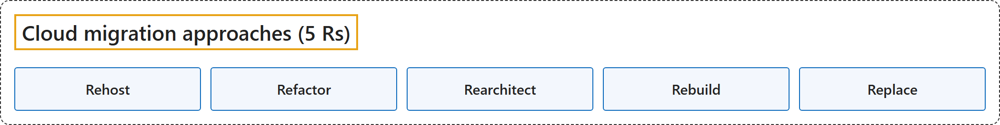

# Courses

## CST8913 Cloud Migration

### Course map

| Keyword | Description |
|---|---|
| **1 Strategy** | **Why** an organization adopts Azure. |
| **1.1 Motivations, mission and objectives (W2, W3)** | W2 introduces the **cloud migration motivators** (Lab 2); W3 covers the **cloud adoption strategy**: **motivations**, **business outcomes**, **financial** and **technical considerations**, and the **adoption horizons**. |
| **2 Plan** | Turns the strategy into an **actionable plan**. |
| **2.1 Plan migration (W4)** | W4 covers **discovery and assessment** and the **migration plan**. |
| **3 Ready** | Builds the **Azure landing zone**; not taught in W1 to W6. |
| **4 Adopt** | **Migrates, modernizes and builds** workloads. |
| **4.1 Migration (W5)** | W5 moves workloads by **rehosting**. |
| **4.2 Modernization (W6)** | W6 improves workloads by **refactoring** them onto **PaaS**. |
| **5 Govern** | Sets **guardrails**; not taught in W1 to W6. |
| **6 Secure** | Protects the **Azure cloud estate**; not taught in W1 to W6. |
| **7 Manage** | Operates Azure with **RAMP**; not taught in W1 to W6. |

### Lab 1: Git, GitHub and Markdown (W1)

**CAF:** None: course tools.

**Scenario:** Set up a **private GitHub repository** for the course and submit Lab 1, written in **Markdown**, through a **branch** and a **pull request**. **Git** records every change as a **commit**; **GitHub** hosts the repository for **sharing and review**.

| Keyword | Description |
|---|---|
| **1 Private repository** | A **private repository** is visible only to invited **collaborators**, such as the instructor. |
| **2 Clone** | **Cloning** copies the repository, with its **full history**, to a **local copy** on the computer. |
| **3 Branch** | A **branch** such as **lab-01** keeps the work **off main** until it is reviewed. |
| **4 Commit** | A **commit** records one stage of the work; Lab 1 was built in **five stages**. |
| **5 Push** | A **push** sends the **branch to GitHub**. |
| **6 Pull request** | A **pull request** asks to merge the branch, after a **review** of the changed files. |
| **7 Merge** | **Merging** brings the reviewed branch into **main**. |

| Keyword | Description |
|---|---|
| **1 Heading** | A line starting with **#** signs; more signs make a **lower level**. |
| **2 Text formatting** | **Two asterisks** around text make it **bold**; **one asterisk** makes it **italic**. |
| **3 List** | Lines starting with a **dash** make a **bulleted list**; **numbers** make a **numbered list**. |
| **4 Link** | The **link text** in square brackets, then the **URL** in parentheses. |
| **5 Image** | Like a link with an **exclamation mark** in front; the brackets hold the **alt text**. |
| **6 Blockquote** | A line starting with **>** becomes a **quote**. |
| **7 Inline code** | **Backticks** around a word show it as **code** inside a sentence. |
| **8 Fenced code block** | **Three backticks** above and below a block, with the **language** name, such as **bash**. |
| **9 Table** | Cells separated by **vertical bars**, with a **dash row** under the header. |
| **10 Task list** | A list item with **square brackets**; an **x** marks it **done**. |
| **11 Horizontal rule** | **Three dashes** on a line draw a **dividing line**. |

### Lab 2: Levi Strauss migration case study (W2)

**CAF:** **Strategy** (motivations) and **Plan** (migration strategy per workload, schedule).

**Scenario:** **Levi Strauss & Co.** moves from several **datacenters**, about **160 applications** and **nine ERP systems** in **110 countries** to Azure, as it shifts to **direct-to-consumer** sales.

| Keyword | Description |
|---|---|
| **1 Motivations** | The **business reasons** Levi Strauss moves to the cloud. |
| **1.1 Direct-to-consumer** | Becoming a **USD 10 billion DTC brand** needs **speed, automation and data**. |
| **1.2 Technical debt** | About **160 applications**, several datacenters, **nine ERP systems** and different processes in **110 countries**. |
| **1.3 Datacenter cost** | Owning and operating datacenters became **too expensive**. |
| **1.4 Standardization** | **One global ERP** means **consistent processes and data**. |
| **1.5 AI readiness** | **Unified data** on a standard platform is the foundation for **AI and agents**. |
| **2 Discovery questions** | The questions that complete the picture **before planning**. |
| **2.1 Applications** | Which applications are **business-critical**, and which could be **retired** or **replaced with SaaS**? |
| **2.2 Servers** | How many servers, how **heavily used**, and which run an OS **near end of support**? |
| **2.3 Data** | How much data the nine ERP systems hold, and how it **merges into one data model**. |
| **2.4 Networking** | How stores, distribution centers and offices in 110 countries **connect**, and what **latency** they need. |
| **2.5 Security** | How **identity** is managed, which **data-residency** laws apply, and the **RPO and RTO**. |
| **2.6 Dependencies** | Which applications **depend on each other**, and so must move in the **same wave**. |
| **2.7 Business requirements** | The acceptable **downtime**, the **retail peak periods** to avoid, and the **budget and deadline**. |

| Keyword | Description |
|---|---|
| **R Responsible** | **Does the work**; the **migration** team for most activities. |
| **A Accountable** | The **single owner** of an activity; the **infrastructure director** for discovery, landing zone, migration, cutover and optimization. |
| **C Consulted** | **Gives input** before decisions, such as **security** and **business** leaders. |
| **I Informed** | **Kept up to date**, such as the **sponsor** after approval. |

| Keyword | Description |
|---|---|
| **1 Rehost** | **Rehost**, also known as **lift and shift**, moves an asset to the cloud with **minimal change**; used for **most servers**. |
| **2 Refactor** | **Refactor** changes an application **slightly** to fit a **PaaS-based model**; used for **databases** (Azure SQL Managed Instance) and **third-party apps** (AKS). |
| **3 Rearchitect** | **Rearchitect** redesigns an aging application that **is not compatible** with the cloud provider. |
| **4 Rebuild** | **Rebuild** creates a **new code base** with a **cloud-native** approach. |
| **5 Replace** | **Replace** swaps the workload for a **SaaS** or packaged application; the **nine ERP systems** become **one global ERP**. |

| Keyword | Description |
|---|---|
| **1 Discover and assess** | **Months 1-2**: inventory with **Azure Migrate**, map **dependencies**, choose an approach per workload. |
| **2 Landing zone** | **Months 2-3**: **subscriptions, networking, identity, security and backup**. |
| **3 Pilot** | **Month 3**: migrate **low-risk servers** to test **replication, cutover and rollback**. |
| **4 Waves** | **Months 4-8**: move **dependent applications together**, avoiding **retail peak periods**. |
| **5 Cutover and exit** | **Month 8**: final cutover in approved **downtime windows**, then **decommission the datacenters**. |
| **6 Optimize** | **Month 9 onward**: **right-size**, track **cost**, test **disaster recovery**. |

### Cloud Adoption Framework (W2, W3)

**CAF:** All seven phases.

| Keyword | Description |
|---|---|
| **Azure adoption phases** | The Cloud Adoption Framework has **seven Azure adoption phases**. |
| **1 Strategy** | **Strategy** sets **why** an organization adopts Azure: the **cloud adoption strategy**. |
| **2 Plan** | **Plan** turns that strategy into an **actionable plan**: the **cloud adoption plan**. |
| **3 Ready** | **Ready** builds the **Azure landing zone**. |
| **4 Adopt** | **Adopt** **migrates, modernizes and builds workloads**. |
| **5 Govern** | **Govern** sets **guardrails**. |
| **6 Secure** | **Secure** protects the **Azure cloud estate**. |
| **7 Manage** | **Manage** operates Azure with **RAMP**: **Ready, Administer, Monitor, Protect**. |

### Lab 3: IaaS and PaaS architecture (W3)

**CAF:** None directly: the workload architecture follows the **Azure Architecture Center** N-tier reference architecture.

**Scenario:** A web application with a **React** UI, a **Flask** web server and a **PostgreSQL** database is designed on Azure twice: once on **IaaS**, once on **PaaS**.

| Keyword | Description |
|---|---|
| **1 IaaS** | In **IaaS**, the provider supplies **VMs, disks and network**; the team builds and maintains everything on them. |
| **2 N-tier, subnets, NSGs** | In an **N-tier** architecture, each tier has its own **subnet**, and its **NSG** allows only traffic from the **tier in front of it**. |
| **3 Availability zones** | **Availability zones** are separate datacenters in one region, so **one zone can fail**. |
| **4 Load balancer** | A **load balancer** spreads requests across servers and removes failed ones. |
| **5 Replication** | Database **replication** keeps a **standby** in sync with the **primary**. |
| **6 Management VMs** | IaaS needs its own **jumpbox, monitoring, NAT and backup** servers. |
| **7 PaaS** | In **PaaS**, each tier becomes a **managed service**, and the provider runs the servers, patching, scaling and backups. |
| **8 App Service** | **App Service** runs web apps on several **instances** behind a **built-in load balancer**, with **autoscale**. |
| **9 VNet integration** | **VNet integration** lets App Service reach resources that accept **private connections only**. |
| **10 Key Vault, Application Insights** | **Key Vault** stores **secrets**; **Application Insights** collects **telemetry**. |
| **11 IaaS or PaaS** | **IaaS** gives **full control** but more **operations work**; **PaaS** gives less control and **no servers to manage**. |

### Migration phases (W4)

**CAF:** **Plan > Plan migration** (decide, plan) and **Adopt > Migration** (execute).

| Keyword | Description |
|---|---|
| **1 Decide** | The first phase **identifies the workloads** and decides **whether to migrate**. |
| **1.1 Discovery** | **Discovery** identifies the workloads. |
| **1.1.1 Azure Migrate appliance** | The **appliance** collects **configuration and performance data** and sends it to Azure Migrate. |
| **1.1.2 Azure Migrate Collector** | The **Collector** takes a **snapshot** without continuous Azure connectivity. |
| **1.2 Business case** | A **business case** estimates the **costs and savings** of moving to Azure. |
| **2 Plan** | The second phase **plans the migration in detail**. |
| **2.1 Assessment** | **Assessments** find the four results below. |
| **2.1.1 Azure readiness** | Whether servers are **ready for migration** to Azure. |
| **2.1.2 Right-sizing** | The **size** of the Azure VMs after migration. |
| **2.1.3 Azure cost estimation** | The **cost** of running the servers in Azure. |
| **2.1.4 Dependency analysis** | The **network dependencies** between servers. |
| **2.2 Migration strategies** | The **strategy** chosen for **each workload**. |
| **3 Execute** | The third phase **performs the migration or modernization**. |
| **3.1 Replication** | **Replication** copies the VMs to Azure. |
| **3.2 Test migration** | A **test migration** **simulates the migration** in a **non-production network**. |
| **3.3 Migrate VMs** | After the test works, the **source machines** are **migrated**. |
| **3.4 Complete migration** | Completing the migration **stops replication** and **cleans up** its state. |

### Lab 4: Discovery and assessment (W4)

**CAF:** **Plan > Plan migration**.

**Scenario:** Five on-premises **VMware** servers, **WEB-01, APP-01, DB-01, DC-01 and FILE-01**, move to **Azure VMs** with **minimal downtime**; a written simulation with **no CPU, memory or usage data**.

| Keyword | Description |
|---|---|
| **1 Digital estate** | **Everything IT runs today**; here the **five servers** and their applications and data. |
| **2 Discovery** | **Agentless**: the **Azure Migrate appliance** on **vCenter** reads each VM over **port 443** for about **30 days**. |
| **3 Dependency analysis** | Shows each server's **TCP connections**; **WEB-01, APP-01 and DB-01** form one **migration group**. |
| **4 Readiness** | WEB-01, APP-01, DC-01 **conditionally ready**; DB-01 **insufficient information**; FILE-01 **not ready**, a **blocker** (Windows Server 2012 R2). |
| **5 Sizing** | **Performance-based** uses **real usage** and right-sizes; **as-is** **copies on-premises specs** and often oversizes. |
| **6 Migration plan** | A **test migration** runs in an **isolated network**; **rollback** points **DNS back** to the **original servers**. |

| Keyword | Description |
|---|---|
| **1 New DC in Azure** | Comes first, because every server needs **sign-in and DNS**. |
| **2 FILE-01** | The **pilot**, with its **OS upgrade**, before the **October 13, 2026** security deadline. |
| **3 Group 1** | **WEB-01, APP-01 and DB-01** move together in **one maintenance window**. |
| **4 Retire DC-01** | Only after **nothing uses it**. |

### Lab 5: Rehosting to Azure VMware Solution (W5)

**CAF:** **Adopt > Migration**.

**Scenario:** **Washington State L&I** migrates **more than 300 VMs** to **Azure VMware Solution** in **phases**, in **under nine months**, without disrupting daily operations.

| Keyword | Description |
|---|---|
| **1 Rehost** | Moves VMs **without code changes**: the **fastest, lowest-risk** way to finish in **under nine months**. |
| **2 Rehost vs replatform** | **Rehost** moves the VM **as is**; **replatform** makes **small changes** to use a **managed platform**. |
| **3 Azure VMware Solution** | Runs **vCenter, NSX and vSAN** on **dedicated hosts** in Azure, so VMware VMs move **without conversion**. |

| Keyword | Description |
|---|---|
| **1 Prepare** | Deploy the **private cloud**, **ExpressRoute** with Global Reach, and **VMware HCX**, which keeps the VMs' **IP addresses**. |
| **2 Discover and group** | **Dependency analysis** puts each application and everything it calls in the **same wave**. |
| **3 Pilot wave** | **About 10 VMs** prove the tools, network and runbook. |
| **4 Main waves** | **About 75 VMs each**, from **lowest to highest criticality**. |
| **5 Stabilize and decommission** | **Proceed or roll back**: proceed after tests and **48 hours** stable; otherwise roll back to the **intact on-premises VMs**. |

### Refactoring (W6)

**CAF:** **Adopt > Modernization**.

| Keyword | Description |
|---|---|
| **1 Assess** | The first step checks whether the app can move. |
| **1.1 IIS** | The **Windows web server** that hosts the **ASP.NET** app on premises. |
| **1.2 App Service Migration Assistant** | The tool that first **assesses** the app, then **migrates** it. |
| **2 Migrate** | The second step moves the app. |
| **2.1 Azure App Service** | Runs the app and handles **OS patching, scaling and load balancing**. |
| **3 Database** | The third step moves or connects the database. |
| **3.1 Azure SQL Database** | A **managed** database in Azure. |
| **3.2 Azure SQL Managed Instance** | A managed SQL Server **instance**, closest to on-premises SQL Server. |
| **3.3 Hybrid connection** | Links the app to a database that **stays on premises**. |

### Lab 6: AWS, Azure and Google Cloud services

**CAF:** None: a comparison across cloud providers.

**Scenario:** Name the equivalent **AWS**, **Azure** and **Google Cloud** service for **30 service descriptions**, then compare their **similarities**, **differences** and **naming**.

| # | Description | AWS | Azure | Google Cloud |
|---|---|---|---|---|
| 1 | A compute service that provides scalable virtual machines for running applications. | **Amazon EC2** | **Azure Virtual Machines** | **Compute Engine** |
| 2 | An object storage service used to store and retrieve data, commonly used for backups and static website content. | **Amazon S3** | **Azure Blob Storage** | **Cloud Storage** |
| 3 | A managed relational database service that supports multiple database engines like MySQL, PostgreSQL, and SQL Server. | **Amazon RDS** | **Azure SQL Database, Azure Database for MySQL, Azure Database for PostgreSQL** | **Cloud SQL** |
| 4 | A serverless compute service that allows you to run code in response to events without provisioning or managing servers. | **AWS Lambda** | **Azure Functions** | **Cloud Run functions** |
| 5 | A virtual private network service that allows you to create isolated networks within the cloud provider's infrastructure. | **Amazon VPC** | **Azure Virtual Network** | **Virtual Private Cloud (VPC)** |
| 6 | A content delivery network (CDN) service that delivers data, videos, applications, and APIs to customers around the world with low latency. | **Amazon CloudFront** | **Azure Front Door** | **Cloud CDN** |
| 7 | A managed NoSQL database service designed for low-latency, high-scale applications. | **Amazon DynamoDB** | **Azure Cosmos DB** | **Bigtable (Firestore for documents)** |
| 8 | A block storage service for use with virtual machines, offering persistent storage for data. | **Amazon EBS** | **Azure Managed Disks** | **Persistent Disk / Hyperdisk** |
| 9 | A managed container orchestration service based on Kubernetes. | **Amazon EKS** | **Azure Kubernetes Service (AKS)** | **Google Kubernetes Engine (GKE)** |
| 10 | A service for managing user access and encryption keys to secure cloud resources. | **AWS IAM + AWS KMS** | **Microsoft Entra ID + Azure RBAC + Azure Key Vault** | **Cloud IAM + Cloud KMS** |
| 11 | A platform that automates application deployment and scaling without needing to manage infrastructure. | **AWS Elastic Beanstalk** | **Azure App Service** | **App Engine** |
| 12 | A service that provides monitoring and logging of applications and infrastructure, offering insights into resource usage and performance. | **Amazon CloudWatch** | **Azure Monitor** | **Cloud Monitoring + Cloud Logging** |
| 13 | A domain name system (DNS) service that routes traffic globally and translates domain names to IP addresses. | **Amazon Route 53** | **Azure DNS** | **Cloud DNS** |
| 14 | A load balancing service that distributes incoming network traffic across multiple targets, improving application availability. | **Elastic Load Balancing** | **Azure Load Balancer (Layer 4), Azure Application Gateway (Layer 7)** | **Cloud Load Balancing** |
| 15 | A service that automatically scales your cloud infrastructure based on demand, ensuring resources are available as needed. | **Amazon EC2 Auto Scaling** | **Virtual Machine Scale Sets with Azure Autoscale** | **Compute Engine autoscaler (managed instance groups)** |
| 16 | A message queuing service that enables applications to send and receive messages between different components. | **Amazon SQS** | **Azure Queue Storage, Azure Service Bus** | **Cloud Tasks (Pub/Sub for publish/subscribe)** |
| 17 | A managed real-time data streaming service that collects and processes large amounts of data from various sources. | **Amazon Kinesis Data Streams** | **Azure Event Hubs** | **Pub/Sub** |
| 18 | A fully managed, highly scalable data warehouse service optimized for analytics and large-scale queries. | **Amazon Redshift** | **Azure Synapse Analytics** | **BigQuery** |
| 19 | A service that automates the execution of workflows and allows the integration of different cloud services in a sequence of steps. | **AWS Step Functions** | **Azure Logic Apps** | **Workflows** |
| 20 | A service that integrates multiple data sources and enables data migration, transformation, and movement across platforms. | **AWS Glue** | **Azure Data Factory** | **Cloud Data Fusion** |
| 21 | A data catalog and governance service that helps manage metadata across your data estate, supporting compliance and security. | **Amazon DataZone (AWS Glue Data Catalog)** | **Microsoft Purview** | **Knowledge Catalog** |
| 22 | A set of machine learning and AI services that provide pre-built models, APIs, and tools for developers to easily implement AI in their apps. | **AWS AI services (Rekognition, Comprehend, Translate) and Amazon SageMaker** | **Azure AI services (Vision, Language, Translator) and Azure Machine Learning** | **Vertex AI and Cloud AI APIs (Vision AI, Natural Language AI, Translation AI)** |
| 23 | A service that allows you to define and deploy infrastructure using code, automating the management of cloud resources. | **AWS CloudFormation** | **Azure Resource Manager templates / Bicep** | **Infrastructure Manager (Terraform)** |
| 24 | A fully managed CI/CD service that automates the building, testing, and deployment of applications to production environments. | **AWS CodePipeline (with CodeBuild, CodeDeploy)** | **Azure Pipelines (Azure DevOps)** | **Cloud Build (with Cloud Deploy)** |
| 25 | A desktop as a service (DaaS) offering that allows you to deploy virtual desktops in the cloud and access them remotely. | **Amazon WorkSpaces** | **Azure Virtual Desktop** | No first-party service (partner solutions) |
| 26 | A backup and disaster recovery service that helps to protect your data by creating backups and replicas of your cloud resources. | **AWS Backup, AWS Elastic Disaster Recovery** | **Azure Backup, Azure Site Recovery** | **Backup and DR Service** |
| 27 | A service designed for big data analytics, allowing organizations to store, process, and analyze large datasets in real time. | **Amazon EMR** | **Azure HDInsight, Azure Databricks** | **Managed Service for Apache Spark (formerly Dataproc)** |
| 28 | A file storage service for storing and sharing files with users, typically used in shared file systems across applications. | **Amazon EFS** | **Azure Files** | **Filestore** |
| 29 | A service that helps you transcode, process, and stream media content such as video and audio. | **AWS Elemental MediaConvert** | No first-party service (Azure Media Services retired in 2024; partner solutions) | **Transcoder API** |
| 30 | A real-time communication service used for sending notifications, emails, and text messages to users and devices. | **Amazon SNS (email: Amazon SES)** | **Azure Notification Hubs, Azure Communication Services** | **Firebase Cloud Messaging (push only)** |

| Keyword | Description |
|---|---|
| **1 Similarities** | Most services **match one to one**, and all three offer **VMs, PaaS, serverless and Kubernetes**. |
| **2 Differences** | **RDS** and **Cloud SQL** cover **several database engines in one service**, while Azure has **one per engine**; Azure **splits** load balancing and protection into several services. |
| **3 Unique features** | Some services add capabilities their counterparts lack. |
| **4 Naming** | AWS uses **brand names and acronyms**, Azure says **"Azure" plus the function**, and Google says **"Cloud" plus the function**. |
