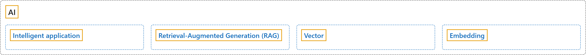

# 9. AI

## Classification

## Glossary

| Term | Definition | 中文翻译 | Source |
|---|---|---|---|
| **[Intelligent application](intelligent-application.md)** 智能应用程序 | "(context) This article provides an overview of using **artificial intelligence (AI)** options, such as OpenAI and vectors, to **build intelligent applications** with the SQL Database Engine in SQL Server and Azure SQL Managed Instance." | （语境）本文概述了如何使用**人工智能 (AI)** 选项（如 OpenAI 和向量），借助 SQL Server 和 Azure SQL 托管实例中的 SQL 数据库引擎来**构建智能应用程序**。 | [Microsoft, 2026a, para 1](https://learn.microsoft.com/en-us/sql/sql-server/ai/artificial-intelligence-intelligent-applications#:~:text=This%20article%20provides%20an%20overview%20of%20using%20artificial) |
| **[Retrieval-Augmented Generation (RAG)](retrieval-augmented-generation-rag.md)** 检索增强生成 (RAG) | "Using LLMs in applications brings greater value and an improved user experience when the models can access the right data, at the right time, from your application's database. This process is known as **Retrieval-Augmented Generation (RAG)** and the SQL Database Engine has many features that support this new pattern, making it a great database to build intelligent applications." | 当模型能在正确的时间从应用程序的数据库中访问正确的数据时，在应用程序中使用 LLM 会带来更大的价值和更好的用户体验。这一过程称为**检索增强生成 (RAG)**，SQL 数据库引擎有许多功能支持这种新模式，使其成为构建智能应用程序的优秀数据库。 | [Microsoft, 2026a, "Overview" section, para 2](https://learn.microsoft.com/en-us/sql/sql-server/ai/artificial-intelligence-intelligent-applications#:~:text=Using%20LLMs%20in%20applications%20brings%20greater%20value%20and) |
| **[Vector](vector.md)** 向量 | "**Vectors** are **ordered arrays of numbers** (typically floats) that can **represent information about some data**." | **向量**是**有序的数字数组**（通常为浮点数），可以**表示有关某些数据的信息**。 | [Microsoft, 2026b, "Vectors" section, para 1](https://learn.microsoft.com/en-us/sql/sql-server/ai/vectors#:~:text=Vectors%20are%20ordered%20arrays%20of%20numbers%20%28typically%20floats%29) |
| **[Embedding](embedding.md)** 嵌入 | "**Embeddings** are **vectors that represent important features of data**." | **嵌入**是**表示数据重要特征的向量**。 | [Microsoft, 2026b, "Embeddings" section, para 1](https://learn.microsoft.com/en-us/sql/sql-server/ai/vectors#:~:text=Embeddings%20are%20vectors%20that%20represent%20important%20features%20of) |

## References

- Microsoft. (2026a, April 2). *Intelligent applications and AI*. Microsoft Learn. https://learn.microsoft.com/en-us/sql/sql-server/ai/artificial-intelligence-intelligent-applications
- Microsoft. (2026b, September 15). *Vector search and vector indexes in the SQL Database Engine*. Microsoft Learn. https://learn.microsoft.com/en-us/sql/sql-server/ai/vectors
