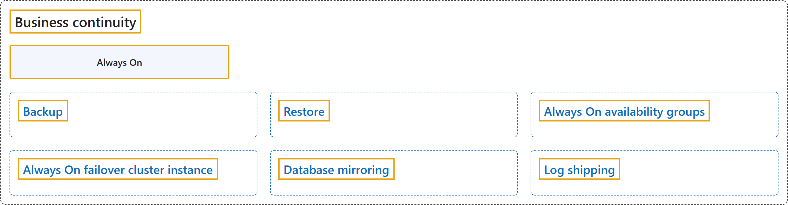

# 5. Business continuity

Sources: [SQL Server documentation, Business continuity](https://learn.microsoft.com/en-us/sql/sql-server/): [Business continuity and database recovery - SQL Server](https://learn.microsoft.com/en-us/sql/database-engine/sql-server-business-continuity-dr); [What is an Always On availability group?](https://learn.microsoft.com/en-us/sql/database-engine/availability-groups/windows/overview-of-always-on-availability-groups-sql-server); [Always On failover cluster instances (SQL Server)](https://learn.microsoft.com/en-us/sql/sql-server/failover-clusters/windows/always-on-failover-cluster-instances-sql-server).

## Classification

## Glossary

| Term | Definition | 中文解释 | Source |
|---|---|---|---|
| **Business continuity** 业务连续性 | "The goal is to **keep the business up and running with minimal or no interruption**. This concept is also known as *business continuity*." | 目标是让**业务在尽量少或没有中断的情况下持续运转**。这个概念也称为业务连续性。 | [Microsoft, 2025b, para. 2](https://learn.microsoft.com/en-us/sql/database-engine/sql-server-business-continuity-dr#:~:text=The%20goal%20is%20to%20keep%20the%20business%20up) |
| **Always On** Always On | "**Always On** is an **umbrella term for the availability features in SQL Server** and **covers both AGs and FCIs**. Always On **isn't the name of the AG feature**." | **Always On** 是 **SQL Server 可用性功能的总称**，**同时涵盖 AG 和 FCI**。Always On **不是 AG 功能的名称**。 | [Microsoft, 2025b, "Availability groups" subsection, Note](https://learn.microsoft.com/en-us/sql/database-engine/sql-server-business-continuity-dr#:~:text=Always%20On%20is%20an%20umbrella%20term%20for%20the) |
| **[Backup](backup.md)** 备份 | "A **copy of data** that you can **use to restore and recover the data after a failure**." | **数据的副本**，可用于**在故障后还原并恢复数据**。 | [Microsoft, 2026b, "Glossary of backup terms" section, row "backup (noun)"](https://learn.microsoft.com/en-us/sql/relational-databases/backup-restore/back-up-and-restore-of-sql-server-databases#:~:text=A%20copy%20of%20data%20that%20you%20can%20use) |
| **[Restore](restore.md)** 还原 | "A **multiphase process** that **copies all the data and log pages from a specified SQL Server backup to a specified database**, and then rolls forward all the transactions that are logged in the backup by applying logged changes to bring the data forward in time." | 一个**多阶段过程**，**将指定 SQL Server 备份中的所有数据页和日志页复制到指定的数据库**，然后通过应用已记录的更改来前滚备份中记录的所有事务，使数据向前推进到某个时间点。 | [Microsoft, 2026b, "Glossary of backup terms" section, row "restore"](https://learn.microsoft.com/en-us/sql/relational-databases/backup-restore/back-up-and-restore-of-sql-server-databases#:~:text=A%20multiphase%20process%20that%20copies%20all%20the%20data) |
| **[Always On availability groups](always-on-availability-groups.md)** Always On 可用性组 | "The **Always On availability groups** feature is a **high-availability and disaster-recovery solution** that provides an **enterprise-level alternative to database mirroring**." | **Always On 可用性组**功能是一种**高可用性和灾难恢复解决方案**，提供了**企业级的数据库镜像替代方案**。 | [Microsoft, 2026c, para. 2](https://learn.microsoft.com/en-us/sql/database-engine/availability-groups/windows/overview-of-always-on-availability-groups-sql-server#:~:text=The%20Always%20On%20availability%20groups%20feature%20is%20a) |
| **[Always On failover cluster instance](always-on-failover-cluster-instance.md)** Always On 故障转移群集实例 | "SQL Server **Always On failover cluster instances** use **Windows Server Failover Clustering (WSFC)** to provide **local high availability**. A failover cluster instance (FCI) is **redundant at the server-instance level**." | SQL Server **Always On 故障转移群集实例**使用 **Windows Server 故障转移群集（WSFC）**提供**本地高可用性**。故障转移群集实例（FCI）在**服务器实例级别是冗余的**。 | [Microsoft, 2025a, para. 1](https://learn.microsoft.com/en-us/sql/sql-server/failover-clusters/windows/always-on-failover-cluster-instances-sql-server#:~:text=SQL%20Server%20Always%20On%20failover%20cluster%20instances%20use) |
| **[Database mirroring](database-mirroring.md)** 数据库镜像 | "*Database mirroring* is **a solution for increasing the availability of a SQL Server database**." | 数据库镜像是**一种提高 SQL Server 数据库可用性的解决方案**。 | [Microsoft, 2025c, para. 1 after the Caution and Important notes](https://learn.microsoft.com/en-us/sql/database-engine/database-mirroring/database-mirroring-sql-server#:~:text=Database%20mirroring%20is%20a%20solution%20for%20increasing%20the) |
| **[Log shipping](log-shipping.md)** 日志传送 | "SQL Server **Log shipping** allows you to **automatically send transaction log backups from a *primary database* on a *primary server* instance to one or more *secondary databases* on separate *secondary server* instances**." | SQL Server **日志传送**让你能够**自动将事务日志备份从*主服务器*实例上的*主数据库*发送到位于不同*辅助服务器*实例上的一个或多个*辅助数据库***。 | [Microsoft, 2026a, para. 1](https://learn.microsoft.com/en-us/sql/database-engine/log-shipping/about-log-shipping-sql-server#:~:text=SQL%20Server%20Log%20shipping%20allows%20you%20to%20automatically) |

## References

- Microsoft. (2025a, August 25). *Always On failover cluster instances (SQL Server)*. Microsoft Learn. https://learn.microsoft.com/en-us/sql/sql-server/failover-clusters/windows/always-on-failover-cluster-instances-sql-server
- Microsoft. (2025b, December 11). *Business continuity and database recovery - SQL Server*. Microsoft Learn. https://learn.microsoft.com/en-us/sql/database-engine/sql-server-business-continuity-dr
- Microsoft. (2025c, September 2). *Database Mirroring (SQL Server)*. Microsoft Learn. https://learn.microsoft.com/en-us/sql/database-engine/database-mirroring/database-mirroring-sql-server
- Microsoft. (2026a, February 23). *About log shipping (SQL Server)*. Microsoft Learn. https://learn.microsoft.com/en-us/sql/database-engine/log-shipping/about-log-shipping-sql-server
- Microsoft. (2026b, August 27). *Back up and restore SQL Server databases*. Microsoft Learn. https://learn.microsoft.com/en-us/sql/relational-databases/backup-restore/back-up-and-restore-of-sql-server-databases
- Microsoft. (2026c, January 26). *What is an Always On availability group?* Microsoft Learn. https://learn.microsoft.com/en-us/sql/database-engine/availability-groups/windows/overview-of-always-on-availability-groups-sql-server
