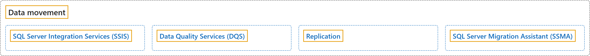

# 7. Data Movement

## Classification

## Glossary

| Term | Definition | 中文翻译 | Source |
|---|---|---|---|
| **[SQL Server Integration Services (SSIS)](sql-server-integration-services-ssis.md)** SQL Server Integration Services (SSIS) | "SQL Server Integration Services is a **platform for building enterprise-level data integration and data transformations solutions**." | SQL Server Integration Services 是一个**用于构建企业级数据集成和数据转换解决方案的平台**。 | [Microsoft, 2024a, para. 1](https://learn.microsoft.com/en-us/sql/integration-services/sql-server-integration-services#:~:text=SQL%20Server%20Integration%20Services%20is%20a%20platform%20for) |
| **[Data Quality Services (DQS)](data-quality-services-dqs.md)** Data Quality Services (DQS) | "SQL Server **Data Quality Services (DQS)** is a **knowledge-driven data quality product**. DQS enables you to **build a knowledge base and use it to perform a variety of critical data quality tasks**, including correction, enrichment, standardization, and de-duplication of your data." | SQL Server **Data Quality Services (DQS)** 是一款**以知识为驱动的数据质量产品**。DQS 使你能够**构建知识库，并用它执行各种关键的数据质量任务**，包括数据的更正、扩充、标准化和去重。 | [Microsoft, 2013, para. 2 (the Important note counts as para. 1)](https://learn.microsoft.com/en-us/sql/data-quality-services/data-quality-services#:~:text=SQL%20Server%20Data%20Quality%20Services%20%28DQS%29%20is%20a) |
| **[Replication](replication.md)** 复制 | "**Replication** is a **set of technologies for copying and distributing data and database objects from one database to another** and then **synchronizing between databases to maintain consistency**." | **复制**是**一组用于将数据和数据库对象从一个数据库复制并分发到另一个数据库的技术**，随后**在数据库之间进行同步以保持一致性**。 | [Microsoft, 2024b, para. 1](https://learn.microsoft.com/en-us/sql/relational-databases/replication/sql-server-replication#:~:text=Replication%20is%20a%20set%20of%20technologies%20for%20copying) |
| **[SQL Server Migration Assistant (SSMA)](sql-server-migration-assistant-ssma.md)** SQL Server Migration Assistant (SSMA) | "Microsoft SQL Server Migration Assistant (SSMA) is a **tool designed to automate database migration** to SQL Server, Azure SQL Database, and Azure SQL Managed Instance from Microsoft Access, Db2, MySQL, Oracle, and SAP ASE." | Microsoft SQL Server Migration Assistant (SSMA) 是一款**旨在自动化数据库迁移的工具**，可将 Microsoft Access、Db2、MySQL、Oracle 和 SAP ASE 的数据库迁移到 SQL Server、Azure SQL 数据库和 Azure SQL 托管实例。 | [Microsoft, 2026, para. 1](https://learn.microsoft.com/en-us/sql/ssma/sql-server-migration-assistant#:~:text=Microsoft%20SQL%20Server%20Migration%20Assistant%20%28SSMA%29%20is%20a) |

## References

- Microsoft. (2013, October 12). *Data Quality Services*. Microsoft Learn. https://learn.microsoft.com/en-us/sql/data-quality-services/data-quality-services
- Microsoft. (2024a, September 17). *SQL Server Integration Services*. Microsoft Learn. https://learn.microsoft.com/en-us/sql/integration-services/sql-server-integration-services
- Microsoft. (2024b, September 27). *SQL Server Replication*. Microsoft Learn. https://learn.microsoft.com/en-us/sql/relational-databases/replication/sql-server-replication
- Microsoft. (2026, April 20). *SQL Server Migration Assistant*. Microsoft Learn. https://learn.microsoft.com/en-us/sql/ssma/sql-server-migration-assistant
