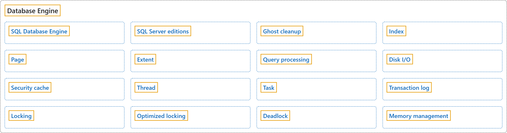

# 1. Database Engine

## Classification

## Glossary

| Term | Definition | 中文翻译 | Source |
|---|---|---|---|
| **[SQL Database Engine](sql-database-engine.md)** SQL 数据库引擎 | "The **Microsoft SQL Database Engine** is the **core service for storing, processing, and securing data**." | **Microsoft SQL 数据库引擎**是**存储、处理和保护数据的核心服务**。 | [Microsoft, 2026e, para. 1](https://learn.microsoft.com/en-us/sql/database-engine/sql-database-engine#:~:text=The%20Microsoft%20SQL%20Database%20Engine%20is%20the%20core) |
| **[SQL Server editions](sql-server-editions.md)** SQL Server 版本 | (context) "The **different editions of SQL Server** accommodate the **unique performance, runtime, and price requirements** of organizations and individuals." | （语境）**SQL Server 的不同版本**适应组织和个人**在性能、运行时和价格方面的不同需求**。 | [Microsoft, 2025b, para. 4](https://learn.microsoft.com/en-us/sql/sql-server/editions-and-components-of-sql-server-2025#:~:text=The%20different%20editions%20of%20SQL%20Server%20accommodate%20the) |
| **[Ghost cleanup](ghost-cleanup.md)** 幽灵清理 | "**Ghost cleanup** is a **background process** that **physically removes the rows** that were marked for deletion by DML statements." | **幽灵清理**是一个**后台进程**，用于**物理删除**被 DML 语句标记为删除的行。 | [Microsoft, 2025c, para. 1](https://learn.microsoft.com/en-us/sql/relational-databases/ghost-row-cleanup-process-guide#:~:text=Ghost%20cleanup%20is%20a%20background%20process%20that%20physically) |
| **[Index](indexes.md)** 索引 | "An **index** is an **on-disk or in-memory structure** associated with a table or view that **speeds retrieval of rows** from the table or view." | **索引**是与表或视图关联的**磁盘上或内存中的结构**，可以**加快从表或视图中检索行的速度**。 | [Microsoft, 2026a, "Index basics" section, para. 3](https://learn.microsoft.com/en-us/sql/relational-databases/sql-server-index-design-guide#:~:text=An%20index%20is%20an%20on-disk%20or%20in-memory%20structure) |
| **[Page](page.md)** 页 | "A ***page*** is a **fundamental unit of data storage** in the Database Engine." | **页**是数据库引擎中**数据存储的基本单位**。 | [Microsoft, 2025e, para. 2](https://learn.microsoft.com/en-us/sql/relational-databases/pages-and-extents-architecture-guide#:~:text=A%20page%20is%20a%20fundamental%20unit%20of%20data) |
| **[Extent](extent.md)** 区 | "An ***extent*** is a **collection of eight physically contiguous pages**, used to **manage pages efficiently**." | **区**是**由八个物理上连续的页组成的集合**，用于**高效管理页**。 | [Microsoft, 2025e, para. 3](https://learn.microsoft.com/en-us/sql/relational-databases/pages-and-extents-architecture-guide#:~:text=An%20extent%20is%20a%20collection%20of%20eight%20physically) |
| **[Query processing](query-processing.md)** 查询处理 | "(context) The SQL Server Database Engine **processes queries** on various **data storage architectures** such as local tables, partitioned tables, and tables distributed across multiple servers." | （语境）SQL Server 数据库引擎在各种**数据存储架构**（如本地表、分区表和分布在多台服务器上的表）上**处理查询**。 | [Microsoft, 2026c, para. 1](https://learn.microsoft.com/en-us/sql/relational-databases/query-processing-architecture-guide#:~:text=The%20SQL%20Server%20Database%20Engine%20processes%20queries%20on) |
| **[Disk I/O](disk-i-o.md)** 磁盘 I/O | "(context) The primary purpose of a SQL Server database is to **store and retrieve data**, so **intensive disk input/output (I/O)** is a **core characteristic of the Database Engine**." | （语境）SQL Server 数据库的主要用途是**存储和检索数据**，因此**密集的磁盘输入/输出（I/O）**是**数据库引擎的核心特征**。 | [Microsoft, 2026d, para. 1](https://learn.microsoft.com/en-us/sql/relational-databases/sql-server-storage-guide#:~:text=The%20primary%20purpose%20of%20a%20SQL%20Server%20database) |
| **[Security cache](security-cache.md)** 安全缓存 | "The **security cache** **stores permissions** for a user or a login for various securable objects in a database or server." | **安全缓存**为数据库或服务器中的各种可保护对象**存储**用户或登录名的**权限**。 | [Microsoft, 2025g, "Security cache definition" section, para. 1](https://learn.microsoft.com/en-us/sql/relational-databases/security-cache#:~:text=The%20security%20cache%20stores%20permissions%20for%20a%20user) |
| **[Thread](thread.md)** 线程 | "**Threads** are the **smallest units of processing** that are executed by an operating system, and allow the application logic to be **separated into several concurrent execution paths**." | **线程**是操作系统执行的**最小处理单元**，使应用程序逻辑可以**拆分为多个并发执行路径**。 | [Microsoft, 2025h, "Operating system task scheduling" section, para. 1](https://learn.microsoft.com/en-us/sql/relational-databases/thread-and-task-architecture-guide#:~:text=Threads%20are%20the%20smallest%20units%20of%20processing%20that) |
| **[Task](task.md)** 任务 | "A ***task*** represents the **unit of work** that needs to be completed to **fulfill the request**." | **任务**表示为**完成请求**而需要完成的**工作单元**。 | [Microsoft, 2025h, "Tasks" section, para. 1](https://learn.microsoft.com/en-us/sql/relational-databases/thread-and-task-architecture-guide#:~:text=A%20task%20represents%20the%20unit%20of%20work%20that) |
| **[Transaction log](transaction-log.md)** 事务日志 | "Every SQL Server database has a **transaction log** that **records all transactions** and the **database modifications** that are made by each transaction." | 每个 SQL Server 数据库都有一个**事务日志**，用于**记录所有事务**以及每个事务所做的**数据库修改**。 | [Microsoft, 2025f, para. 1](https://learn.microsoft.com/en-us/sql/relational-databases/sql-server-transaction-log-architecture-and-management-guide#:~:text=Every%20SQL%20Server%20database%20has%20a%20transaction%20log) |
| **[Locking](locking.md)** 锁定 | "**Locking** is a **mechanism** used by the Database Engine to **synchronize access** by multiple users to the same piece of data at the same time." | **锁定**是数据库引擎使用的一种**机制**，用于**同步**多个用户对同一数据的**同时访问**。 | [Microsoft, 2026f, "Locking in the Database Engine" section, para. 1](https://learn.microsoft.com/en-us/sql/relational-databases/sql-server-transaction-locking-and-row-versioning-guide#:~:text=Locking%20is%20a%20mechanism%20used%20by%20the%20Database) |
| **[Optimized locking](optimized-locking.md)** 优化锁定 | "**Optimized locking** offers an **improved transaction locking mechanism** to **reduce lock blocking and lock memory consumption** for concurrent transactions." | **优化锁定**提供了**改进的事务锁定机制**，可**减少并发事务的锁阻塞和锁内存消耗**。 | [Microsoft, 2026b, para. 1](https://learn.microsoft.com/en-us/sql/relational-databases/performance/optimized-locking#:~:text=Optimized%20locking%20offers%20an%20improved%20transaction%20locking%20mechanism) |
| **[Deadlock](deadlock.md)** 死锁 | "A **deadlock** occurs when **two or more tasks permanently block each other** by each task having a lock on a resource that the other tasks are trying to lock." | 当**两个或多个任务相互永久阻塞**时就会发生**死锁**，即每个任务都持有另一些任务正试图锁定的资源上的锁。 | [Microsoft, 2025a, "Understand deadlocks" section, para. 1](https://learn.microsoft.com/en-us/sql/relational-databases/sql-server-deadlocks-guide#:~:text=A%20deadlock%20occurs%20when%20two%20or%20more%20tasks) |
| **[Memory management](memory-management.md)** 内存管理 | "(context) SQL Server **dynamically acquires and frees memory** as required." | （语境）SQL Server 会根据需要**动态获取和释放内存**。 | [Microsoft, 2025d, "SQL Server memory architecture" section, para. 1](https://learn.microsoft.com/en-us/sql/relational-databases/memory-management-architecture-guide#:~:text=SQL%20Server%20dynamically%20acquires%20and%20frees%20memory%20as) |

## References

- Microsoft. (2025a, October 9). *Deadlocks guide*. Microsoft Learn. https://learn.microsoft.com/en-us/sql/relational-databases/sql-server-deadlocks-guide
- Microsoft. (2025b, November 19). *Editions and supported features of SQL Server 2025*. Microsoft Learn. https://learn.microsoft.com/en-us/sql/sql-server/editions-and-components-of-sql-server-2025
- Microsoft. (2025c, December 8). *Ghost cleanup process guide*. Microsoft Learn. https://learn.microsoft.com/en-us/sql/relational-databases/ghost-row-cleanup-process-guide
- Microsoft. (2025d, December 29). *Memory management architecture guide*. Microsoft Learn. https://learn.microsoft.com/en-us/sql/relational-databases/memory-management-architecture-guide
- Microsoft. (2025e, December 29). *Page and extent architecture guide*. Microsoft Learn. https://learn.microsoft.com/en-us/sql/relational-databases/pages-and-extents-architecture-guide
- Microsoft. (2025f, August 28). *SQL Server transaction log architecture and management guide*. Microsoft Learn. https://learn.microsoft.com/en-us/sql/relational-databases/sql-server-transaction-log-architecture-and-management-guide
- Microsoft. (2025g, April 29). *Security cache concepts*. Microsoft Learn. https://learn.microsoft.com/en-us/sql/relational-databases/security-cache
- Microsoft. (2025h, June 3). *Thread and task architecture guide*. Microsoft Learn. https://learn.microsoft.com/en-us/sql/relational-databases/thread-and-task-architecture-guide
- Microsoft. (2026a, September 14). *Index architecture and design guide*. Microsoft Learn. https://learn.microsoft.com/en-us/sql/relational-databases/sql-server-index-design-guide
- Microsoft. (2026b, October 20). *Optimized locking*. Microsoft Learn. https://learn.microsoft.com/en-us/sql/relational-databases/performance/optimized-locking
- Microsoft. (2026c, October 3). *Query processing architecture guide*. Microsoft Learn. https://learn.microsoft.com/en-us/sql/relational-databases/query-processing-architecture-guide
- Microsoft. (2026d, April 29). *SQL Server I/O fundamentals*. Microsoft Learn. https://learn.microsoft.com/en-us/sql/relational-databases/sql-server-storage-guide
- Microsoft. (2026e, March 10). *The Microsoft SQL Database Engine*. Microsoft Learn. https://learn.microsoft.com/en-us/sql/database-engine/sql-database-engine
- Microsoft. (2026f, April 22). *Transaction locking and row versioning guide*. Microsoft Learn. https://learn.microsoft.com/en-us/sql/relational-databases/sql-server-transaction-locking-and-row-versioning-guide
