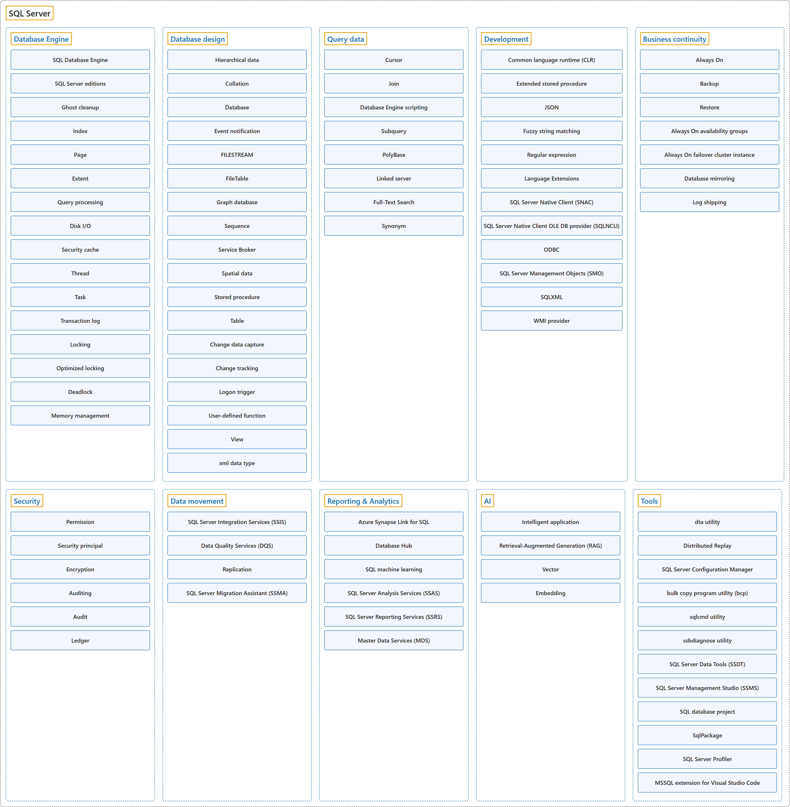

# SQL Server

## Classification

## Glossary

| Term | Definition | 中文翻译 | Source |
|---|---|---|---|
| **SQL Server** SQL Server | "Microsoft **SQL Server** is a **relational database management system (RDBMS)**." | Microsoft **SQL Server** 是一种**关系数据库管理系统（RDBMS）**。 | [Microsoft, 2026, para. 1](https://learn.microsoft.com/en-us/sql/sql-server/what-is-sql-server#:~:text=Microsoft%20SQL%20Server%20is%20a%20relational%20database%20management) |
| **[Business continuity](business-continuity/index.md)** 业务连续性 | "The goal is to **keep the business up and running with minimal or no interruption**. This concept is also known as *business continuity*." | 目标是让**业务在尽量少或没有中断的情况下持续运转**。这个概念也称为业务连续性。 | [Microsoft, 2025, para. 2](https://learn.microsoft.com/en-us/sql/database-engine/sql-server-business-continuity-dr#:~:text=The%20goal%20is%20to%20keep%20the%20business%20up) |

## References

- Microsoft. (2025, December 11). *Business continuity and database recovery - SQL Server*. Microsoft Learn. https://learn.microsoft.com/en-us/sql/database-engine/sql-server-business-continuity-dr
- Microsoft. (2026, March 9). *What is SQL Server?* Microsoft Learn. https://learn.microsoft.com/en-us/sql/sql-server/what-is-sql-server
