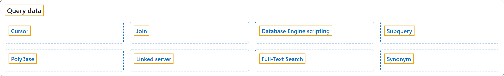

# 3. Query data

## Classification

## Glossary

| Term | Definition | 中文翻译 | Source |
|---|---|---|---|
| **[Cursor](cursor.md)** 游标 | "These applications need a mechanism to work with one row or a small block of rows at a time. **Cursors** are **an extension to result sets** that provide that mechanism." | 这些应用程序需要一种一次处理一行或一小块行的机制。**游标**是**结果集的扩展**，提供了这种机制。 | [Microsoft, 2023, para. 1](https://learn.microsoft.com/en-us/sql/relational-databases/cursors#:~:text=These%20applications%20need%20a%20mechanism%20to%20work%20with) |
| **[Join](join.md)** 联接 | "SQL Server uses **joins** to **retrieve data from multiple tables** based on logical relationships between them." | SQL Server 使用**联接**，基于多个表之间的逻辑关系**从这些表中检索数据**。 | [Microsoft, 2025b, para. 1](https://learn.microsoft.com/en-us/sql/relational-databases/performance/joins#:~:text=SQL%20Server%20uses%20joins%20to%20retrieve%20data%20from) |
| **[Database Engine scripting](database-engine-scripting.md)** 数据库引擎脚本 | "The SQL Server Database Engine **supports the Microsoft PowerShell scripting environment** to manage instances of the Database Engine and the objects in the instances." | SQL Server 数据库引擎**支持 Microsoft PowerShell 脚本环境**，用来管理数据库引擎的实例以及实例中的对象。 | [Microsoft, 2025a, para. 1](https://learn.microsoft.com/en-us/sql/ssms/scripting/database-engine-scripting#:~:text=The%20SQL%20Server%20Database%20Engine%20supports%20the%20Microsoft) |
| **[Subquery](subquery.md)** 子查询 | "A **subquery** is **a query that is nested inside** a `SELECT`, `INSERT`, `UPDATE`, or `DELETE` statement, or inside another subquery." | **子查询**是**嵌套在** `SELECT`、`INSERT`、`UPDATE` 或 `DELETE` 语句内部，或嵌套在另一个子查询内部的**查询**。 | [Microsoft, 2025e, para. 1](https://learn.microsoft.com/en-us/sql/relational-databases/performance/subqueries#:~:text=A%20subquery%20is%20a%20query%20that%20is%20nested) |
| **[PolyBase](polybase.md)** PolyBase | "**PolyBase** enables **data virtualization** for SQL Server." | **PolyBase** 为 SQL Server 提供**数据虚拟化**能力。 | [Microsoft, 2025d, para. 1](https://learn.microsoft.com/en-us/sql/relational-databases/polybase/overview#:~:text=PolyBase%20enables%20data%20virtualization%20for%20SQL%20Server.) |
| **[Linked server](linked-server.md)** 链接服务器 | "**Linked servers** enable the SQL Server Database Engine and Azure SQL Managed Instance to **read data from remote data sources** and **execute commands against remote database servers** (for example, OLE DB data sources), outside of the instance of SQL Server." | **链接服务器**使 SQL Server 数据库引擎和 Azure SQL Managed Instance 能够在 SQL Server 实例之外**读取远程数据源中的数据**，并**对远程数据库服务器执行命令**（例如 OLE DB 数据源）。 | [Microsoft, 2025c, para. 1](https://learn.microsoft.com/en-us/sql/relational-databases/linked-servers/linked-servers-database-engine#:~:text=Linked%20servers%20enable%20the%20SQL%20Server%20Database%20Engine) |
| **[Full-Text Search](full-text-search.md)** 全文搜索 | "**Full-Text Search** in SQL Server and Azure SQL Database lets users and applications **run full-text queries against character-based data** in SQL Server tables." | SQL Server 和 Azure SQL Database 中的**全文搜索**让用户和应用程序能够对 SQL Server 表中**基于字符的数据运行全文查询**。 | [Microsoft, 2026, para. 1](https://learn.microsoft.com/en-us/sql/relational-databases/search/full-text-search#:~:text=Full-Text%20Search%20in%20SQL%20Server%20and%20Azure%20SQL) |
| **[Synonym](synonym.md)** 同义词 | "A **synonym** is a **database object** that serves the following purposes:" | **同义词**是一种**数据库对象**，用于以下目的： | [Microsoft, 2017, para. 1, item 1 (lead-in sentence and list item 1 joined)](https://learn.microsoft.com/en-us/sql/relational-databases/synonyms/synonyms-database-engine#:~:text=A%20synonym%20is%20a%20database%20object%20that%20serves) |

## References

- Microsoft. (2017, March 3). *Synonyms (Database Engine)*. Microsoft Learn. https://learn.microsoft.com/en-us/sql/relational-databases/synonyms/synonyms-database-engine
- Microsoft. (2023, December 7). *Cursors (SQL Server)*. Microsoft Learn. https://learn.microsoft.com/en-us/sql/relational-databases/cursors
- Microsoft. (2025a, August 15). *Database Engine scripting*. Microsoft Learn. https://learn.microsoft.com/en-us/sql/ssms/scripting/database-engine-scripting
- Microsoft. (2025b, August 21). *Joins (SQL Server)*. Microsoft Learn. https://learn.microsoft.com/en-us/sql/relational-databases/performance/joins
- Microsoft. (2025c, December 5). *Linked servers (Database Engine)*. Microsoft Learn. https://learn.microsoft.com/en-us/sql/relational-databases/linked-servers/linked-servers-database-engine
- Microsoft. (2025d, November 18). *PolyBase overview*. Microsoft Learn. https://learn.microsoft.com/en-us/sql/relational-databases/polybase/overview
- Microsoft. (2025e, August 21). *Subqueries (SQL Server)*. Microsoft Learn. https://learn.microsoft.com/en-us/sql/relational-databases/performance/subqueries
- Microsoft. (2026, July 20). *Full-Text Search*. Microsoft Learn. https://learn.microsoft.com/en-us/sql/relational-databases/search/full-text-search
