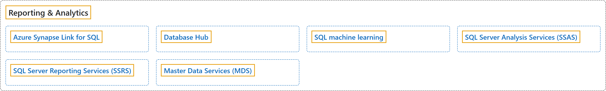

# 8. Reporting & Analytics

## Classification

## Glossary

| Term | Definition | 中文翻译 | Source |
|---|---|---|---|
| **[Azure Synapse Link for SQL](azure-synapse-link-for-sql.md)** Azure Synapse Link for SQL | (context) "You can use the **Azure Synapse Link for SQL** functionality to **replicate your operational data into an Azure Synapse Analytics dedicated SQL pool** from SQL Server 2022." | （语境）你可以使用 **Azure Synapse Link for SQL** 功能，从 SQL Server 2022 **把业务数据复制到 Azure Synapse Analytics 专用 SQL 池**。 | [Microsoft, 2025a, para. 1](https://learn.microsoft.com/en-us/azure/synapse-analytics/synapse-link/sql-server-2022-synapse-link#:~:text=You%20can%20use%20the%20Azure%20Synapse%20Link%20for) |
| **[Database Hub](database-hub.md)** 数据库中心 | "**Database Hub in Microsoft Fabric** gives database teams **one place to detect, investigate, act on, and automate responses to issues and opportunities** across their database estate." | **Microsoft Fabric 中的数据库中心**为数据库团队提供**一个统一的位置，用来发现、调查、处理并自动响应问题和机会**，范围覆盖整个数据库资产。 | [Microsoft, 2026b, para. 1](https://learn.microsoft.com/en-us/fabric/database/hub/#:~:text=Database%20Hub%20in%20Microsoft%20Fabric%20gives%20database%20teams) |
| **[SQL machine learning](sql-machine-learning.md)** SQL 机器学习 | (context) "Learn how to use **machine learning on SQL** to **run Python and R on relational data**, both on-premises and in the cloud." | （语境）了解如何在本地和云中使用 **SQL 上的机器学习**，以便**在关系数据上运行 Python 和 R**。 | [Microsoft, 2022, para 1](https://learn.microsoft.com/en-us/sql/machine-learning#:~:text=Learn%20how%20to%20use%20machine%20learning%20on%20SQL) |
| **[SQL Server Analysis Services (SSAS)](sql-server-analysis-services-ssas.md)** SQL Server Analysis Services (SSAS) | "**Analysis Services** is an **analytical data engine (VertiPaq)** used in **decision support and business analytics**." | **Analysis Services** 是一种**分析数据引擎（VertiPaq）**，用于**决策支持和业务分析**。 | [Microsoft, 2025b, para. 1](https://learn.microsoft.com/en-us/analysis-services/analysis-services-overview#:~:text=Analysis%20Services%20is%20an%20analytical%20data%20engine%20%28VertiPaq%29) |
| **[SQL Server Reporting Services (SSRS)](sql-server-reporting-services-ssrs.md)** SQL Server Reporting Services (SSRS) | "**SQL Server Reporting Services (SSRS)** provides a **set of on-premises tools and services** to **create, deploy, and manage paginated reports**." | **SQL Server Reporting Services (SSRS)** 提供一**组本地工具和服务**，用于**创建、部署和管理分页报表**。 | [Microsoft, 2025c, para 2 (the Note before it is para 1)](https://learn.microsoft.com/en-us/sql/reporting-services/create-deploy-and-manage-mobile-and-paginated-reports#:~:text=SQL%20Server%20Reporting%20Services%20%28SSRS%29%20provides%20a%20set) |
| **[Master Data Services (MDS)](master-data-services-mds.md)** 主数据服务 (MDS) | "**Master Data Services** enables you to **manage a master set of your organization's data**. You can organize the data into models, create rules for updating the data, and control who updates the data." | **主数据服务**使你能够**管理组织数据的主数据集**。你可以将数据组织成模型、创建更新数据的规则，并控制谁可以更新数据。 | [Microsoft, 2026a, para 3 (the Important note is para 1, "This topic describes..." is para 2)](https://learn.microsoft.com/en-us/sql/master-data-services/master-data-services-overview-mds#:~:text=Master%20Data%20Services%20enables%20you%20to%20manage%20a) |

## References

- Microsoft. (2022, May 24). *SQL machine learning documentation*. Microsoft Learn. https://learn.microsoft.com/en-us/sql/machine-learning
- Microsoft. (2025a, October 31). *Azure Synapse Link for SQL Server 2022*. Microsoft Learn. https://learn.microsoft.com/en-us/azure/synapse-analytics/synapse-link/sql-server-2022-synapse-link
- Microsoft. (2025b, April 29). *What is Analysis Services?* Microsoft Learn. https://learn.microsoft.com/en-us/analysis-services/analysis-services-overview
- Microsoft. (2025c, June 16). *What is SQL Server Reporting Services (SSRS)?* Microsoft Learn. https://learn.microsoft.com/en-us/sql/reporting-services/create-deploy-and-manage-mobile-and-paginated-reports
- Microsoft. (2026a, March 5). *Master Data Services Overview (MDS)*. Microsoft Learn. https://learn.microsoft.com/en-us/sql/master-data-services/master-data-services-overview-mds
- Microsoft. (2026b, October 5). *What is the Database Hub?* Microsoft Learn. https://learn.microsoft.com/en-us/fabric/database/hub/
