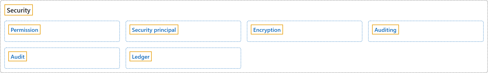

# 6. Security

## Classification

## Glossary

| Term | Definition | 中文翻译 | Source |
|---|---|---|---|
| **[Permission](permission.md)** 权限 | (context) "**Permissions** in the Database Engine are **managed at the *server level* through logins and server roles**, and **at the *database level* through database users and database roles**." | （语境）Database Engine 中的**权限**在*服务器级别*通过**登录名和服务器角色进行管理**，在*数据库级别*通过**数据库用户和数据库角色进行管理**。 | [Microsoft, 2025a, para. 1](https://learn.microsoft.com/en-us/sql/relational-databases/security/authentication-access/getting-started-with-database-engine-permissions#:~:text=Permissions%20in%20the%20Database%20Engine%20are%20managed%20at) |
| **[Security principal](security-principal.md)** 安全主体 | "A *security principal* is the **identity that SQL Server uses**, which can be **assigned permission to take actions**." | *安全主体*是 **SQL Server 使用的标识**，可以被**授予执行操作的权限**。 | [Microsoft, 2025a, "Security principals" section, para. 1](https://learn.microsoft.com/en-us/sql/relational-databases/security/authentication-access/getting-started-with-database-engine-permissions#:~:text=A%20security%20principal%20is%20the%20identity%20that%20SQL) |
| **[Encryption](encryption.md)** 加密 | "**Encryption** is the **process of obfuscating data by the use of a key or password**. This process can make the data useless without the corresponding decryption key or password." | **加密**是**使用密钥或密码对数据进行混淆的过程**。这一过程可使数据在没有对应解密密钥或密码时毫无用处。 | [Microsoft, 2024, para. 1](https://learn.microsoft.com/en-us/sql/relational-databases/security/encryption/sql-server-encryption#:~:text=Encryption%20is%20the%20process%20of%20obfuscating%20data%20by) |
| **[Auditing](auditing.md)** 审核 | "*Auditing* an instance of the SQL Server Database Engine or an individual database involves **tracking and logging events that occur on the Database Engine**." | 对 SQL Server Database Engine 实例或单个数据库进行*审核*，涉及**跟踪并记录 Database Engine 上发生的事件**。 | [Microsoft, 2026, para. 1](https://learn.microsoft.com/en-us/sql/relational-databases/security/auditing/sql-server-audit-database-engine#:~:text=Auditing%20an%20instance%20of%20the%20SQL%20Server%20Database) |
| **[Audit](audit.md)** 审核（审计对象） | "An *audit* is the **combination of several elements into a single package** for a **specific group of server actions or database actions**." | *审核*是**将多个元素组合成的单个包**，针对**特定的一组服务器操作或数据库操作**。 | [Microsoft, 2026, "SQL Server Audit components" section, para. 1](https://learn.microsoft.com/en-us/sql/relational-databases/security/auditing/sql-server-audit-database-engine#:~:text=An%20audit%20is%20the%20combination%20of%20several%20elements) |
| **[Ledger](ledger.md)** 账本 | "The **ledger feature** provides **tamper-evidence capabilities** in your database." | **账本功能**在数据库中提供**防篡改证明能力**。 | [Microsoft, 2025b, para. 1](https://learn.microsoft.com/en-us/sql/relational-databases/security/ledger/ledger-overview#:~:text=The%20ledger%20feature%20provides%20tamper-evidence%20capabilities%20in%20your) |

## References

- Microsoft. (2024, September 16). *SQL Server encryption*. Microsoft Learn. https://learn.microsoft.com/en-us/sql/relational-databases/security/encryption/sql-server-encryption
- Microsoft. (2025a, February 28). *Get started with Database Engine permissions*. Microsoft Learn. https://learn.microsoft.com/en-us/sql/relational-databases/security/authentication-access/getting-started-with-database-engine-permissions
- Microsoft. (2025b, August 7). *Ledger overview*. Microsoft Learn. https://learn.microsoft.com/en-us/sql/relational-databases/security/ledger/ledger-overview
- Microsoft. (2026, April 15). *SQL Server Audit (Database Engine)*. Microsoft Learn. https://learn.microsoft.com/en-us/sql/relational-databases/security/auditing/sql-server-audit-database-engine
