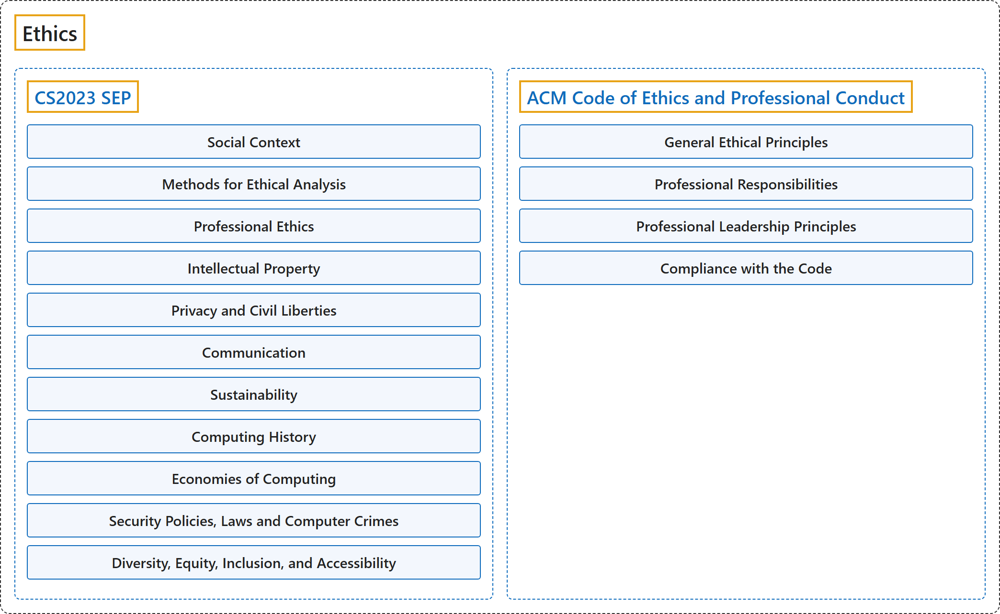

# Ethics

## Classification

## Glossary

| Term | Definition | 中文翻译 | Source |
|---|---|---|---|
| **Ethics** 伦理 | "Computing professionals' actions **change the world**. To act responsibly, they should reflect upon the **wider impacts of their work**, consistently supporting the **public good**." | 计算专业人员的行为**改变着世界**。为了负责任地行事，他们应当反思**其工作的更广泛影响**，始终支持**公共利益**。 | [Association for Computing Machinery, 2018, "Preamble" section, para. 1](https://www.acm.org/code-of-ethics#:~:text=Computing%20professionals%27%20actions%20change%20the%20world) |
| **[CS2023 SEP](cs2023/index.md)** CS2023 SEP | "It is more evident today than ever that students must also be exposed to the **larger societal context of computing** to develop an understanding of the critical and relevant **social, ethical, legal, and professional issues and responsibilities** at hand." | 如今比以往任何时候都更明显：学生还必须接触**计算的更大社会背景**，从而理解当前关键且相关的**社会、伦理、法律和职业问题与责任**。 | [Joint Task Force on Computing Curricula, 2024, SEP "Preamble" section, para. 2](https://csed.acm.org/wp-content/uploads/2024/04/3.1-Body-of-Knowledge-1.pdf#page=207) |
| **[ACM Code of Ethics and Professional Conduct](acm-code-of-ethics/index.md)** ACM 职业道德与职业行为准则 | "The Code is designed to **inspire and guide the ethical conduct** of **all computing professionals**, including current and aspiring practitioners, instructors, students, influencers, and anyone who uses computing technology in an impactful way." | 本准则旨在**激励和指导道德行为**，对象是**所有计算专业人员**，包括现任和有志的从业者、教师、学生、有影响力的人，以及任何以有影响的方式使用计算技术的人。 | [Association for Computing Machinery, 2018, "Preamble" section, para. 2](https://www.acm.org/code-of-ethics#:~:text=The%20Code%20is%20designed%20to%20inspire%20and%20guide) |

## References

Association for Computing Machinery. (2018). *ACM Code of Ethics and Professional Conduct*. <https://www.acm.org/code-of-ethics>

Joint Task Force on Computing Curricula. (2024). *Computer science curricula 2023*. Association for Computing Machinery. <https://doi.org/10.1145/3664191>
