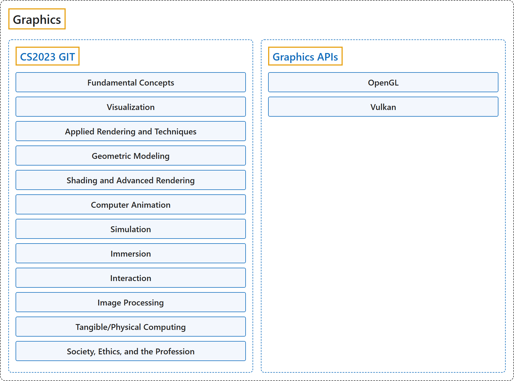

# Graphics

## Classification

## Glossary

| Term | Definition | 中文翻译 | Source |
|---|---|---|---|
| **Graphics** 图形学 | "Computer graphics is the term used to describe the **computer generation and manipulation of images** and can be viewed as the **science of enabling visual communication** through computation." | 计算机图形学这个术语指**用计算机生成和处理图像**，也可以看作**实现视觉交流的科学**，通过计算来实现。 | [Joint Task Force on Computing Curricula, 2024, GIT "Preamble" section, para. 1](https://csed.acm.org/wp-content/uploads/2024/04/3.1-Body-of-Knowledge-1.pdf#page=89) |
| **[CS2023 GIT](cs2023/index.md)** CS2023 GIT | "Traditionally, graphics at the undergraduate level focused on **rendering, linear algebra, physics, the graphics pipeline, interaction**, and phenomenological approaches. Today’s graphics courses increasingly include **data science, physical computing, animation, and haptics**." | 传统上，本科阶段的图形学侧重于**渲染、线性代数、物理、图形管线、交互**以及现象学方法。如今的图形学课程越来越多地包含**数据科学、物理计算、动画和触觉**。 | [Joint Task Force on Computing Curricula, 2024, GIT "Preamble" section, para. 1](https://csed.acm.org/wp-content/uploads/2024/04/3.1-Body-of-Knowledge-1.pdf#page=89) |
| **Graphics APIs** 图形 API | "Vulkan is a **new generation graphics and compute API** that provides **high-efficiency, cross-platform access to modern GPUs** used in a wide variety of devices from PCs and consoles to mobile phones and embedded platforms." | Vulkan 是一种**新一代图形与计算 API**，提供对**现代 GPU 的高效、跨平台访问**，适用于从 PC、游戏机到手机和嵌入式平台的各种设备。 | [The Khronos Group, n.d.-c, "What is Vulkan?" page, para. 1](https://docs.vulkan.org/guide/latest/what_is_vulkan.html#:~:text=Vulkan%20is%20a%20new%20generation%20graphics%20and%20compute%20API) |

## References

Joint Task Force on Computing Curricula. (2024). *Computer science curricula 2023*. Association for Computing Machinery. <https://doi.org/10.1145/3664191>

The Khronos Group. (n.d.-a). *Khronos OpenGL Registry*. Retrieved October 24, 2026, from <https://registry.khronos.org/OpenGL/index_gl.php>

The Khronos Group. (n.d.-b). *Khronos Vulkan Registry*. Retrieved October 24, 2026, from <https://registry.khronos.org/vulkan/>

The Khronos Group. (n.d.-c). *What is Vulkan?* Vulkan Guide. Retrieved October 25, 2026, from <https://docs.vulkan.org/guide/latest/what_is_vulkan.html>
