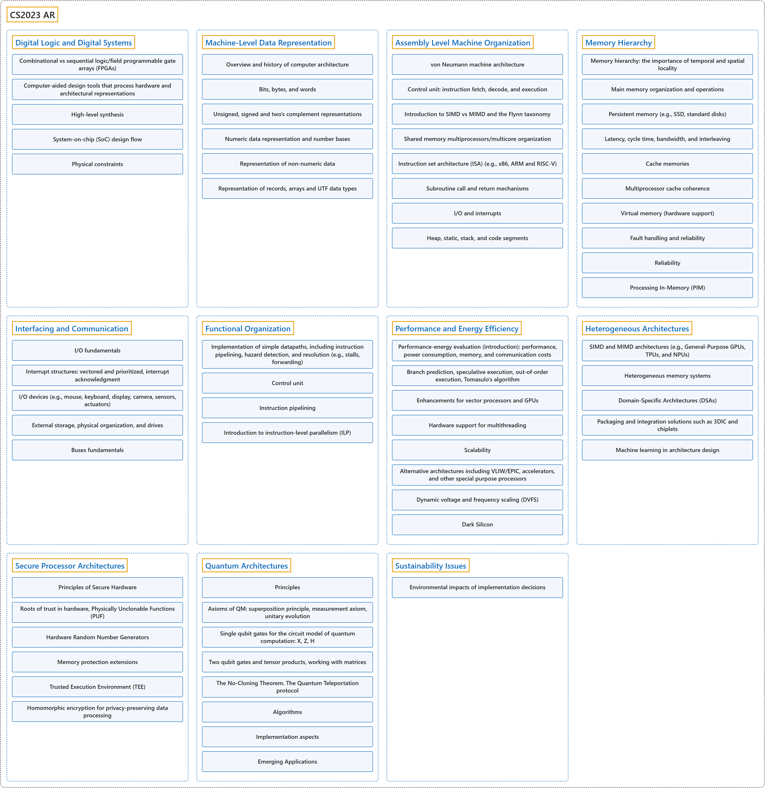

# CS2023 AR

## Classification

## Glossary

| Term | Definition | 中文翻译 | Source |
|---|---|---|---|
| **CS2023 AR** CS2023 AR | "The Architecture and Organization (AR) knowledge area aims to develop a **deeper understanding of the hardware environments upon which almost all computing is based**, and the **relevant interfaces provided to higher software layers**." | 体系结构与组成（AR）知识领域旨在加深对**几乎所有计算赖以运行的硬件环境**的理解，以及对**向上层软件提供的相关接口**的理解。 | [Joint Task Force on Computing Curricula, 2024, AR "Preamble" section, para. 2](https://csed.acm.org/wp-content/uploads/2024/04/3.1-Body-of-Knowledge-1.pdf#page=39) |
| **[Digital Logic and Digital Systems](digital-logic-and-digital-systems/index.md)** 数字逻辑与数字系统 | (context) "Discuss the **progression of computer technology components** from vacuum tubes to VLSI, from mainframe computer architectures to the organization of warehouse-scale computers." | （语境）讨论**计算机技术部件的演进**：从真空管到超大规模集成电路（VLSI），从大型机体系结构到仓库级计算机的组织。 | [Joint Task Force on Computing Curricula, 2024, AR-Logic "Illustrative Learning Outcomes", 1](https://csed.acm.org/wp-content/uploads/2024/04/3.1-Body-of-Knowledge-1.pdf#page=41) |
| **[Machine-Level Data Representation](machine-level-data-representation/index.md)** 机器级数据表示 | (context) "Discuss why **everything in computers are data, including instructions**." | （语境）讨论为什么**计算机里的一切都是数据，包括指令**。 | [Joint Task Force on Computing Curricula, 2024, AR-Representation "Illustrative Learning Outcomes", 1](https://csed.acm.org/wp-content/uploads/2024/04/3.1-Body-of-Knowledge-1.pdf#page=41) |
| **[Assembly Level Machine Organization](assembly-level-machine-organization/index.md)** 汇编级机器组织 | (context) "Discuss how the **classical von Neumann functional units** are implemented in embedded systems, particularly on-chip and off-chip memory." | （语境）讨论**经典冯·诺依曼功能部件**在嵌入式系统中如何实现，尤其是片上和片外存储器。 | [Joint Task Force on Computing Curricula, 2024, AR-Assembly "Illustrative Learning Outcomes", 1](https://csed.acm.org/wp-content/uploads/2024/04/3.1-Body-of-Knowledge-1.pdf#page=42) |
| **[Memory Hierarchy](memory-hierarchy/index.md)** 存储层次结构 | (context) "Using a memory system diagram, identify the **main types of memory technology** (e.g., SRAM, DRAM) and their **relative cost and performance**." | （语境）借助存储系统图，识别**主要的存储技术类型**（例如 SRAM、DRAM）及其**相对成本和性能**。 | [Joint Task Force on Computing Curricula, 2024, AR-Memory "Illustrative Learning Outcomes", 1](https://csed.acm.org/wp-content/uploads/2024/04/3.1-Body-of-Knowledge-1.pdf#page=43) |
| **[Interfacing and Communication](interfacing-and-communication/index.md)** 接口与通信 | (context) "Analyze an interrupt control diagram to comment on how **interrupts are used to implement I/O control and data transfers**." | （语境）分析中断控制图，说明**如何用中断实现 I/O 控制和数据传输**。 | [Joint Task Force on Computing Curricula, 2024, AR-IO "Illustrative Learning Outcomes", 1](https://csed.acm.org/wp-content/uploads/2024/04/3.1-Body-of-Knowledge-1.pdf#page=43) |
| **[Functional Organization](functional-organization/index.md)** 功能组织 | (context) "Compare **alternative implementation of datapaths** in modern computer architectures." | （语境）比较现代计算机体系结构中**数据通路的不同实现**。 | [Joint Task Force on Computing Curricula, 2024, AR-Organization "Illustrative Learning Outcomes", 1](https://csed.acm.org/wp-content/uploads/2024/04/3.1-Body-of-Knowledge-1.pdf#page=44) |
| **[Performance and Energy Efficiency](performance-and-energy-efficiency/index.md)** 性能与能效 | (context) "Discuss **performance and energy efficiency evaluation metrics**." | （语境）讨论**性能和能效的评估指标**。 | [Joint Task Force on Computing Curricula, 2024, AR-Performance-Energy "Illustrative Learning Outcomes", 1](https://csed.acm.org/wp-content/uploads/2024/04/3.1-Body-of-Knowledge-1.pdf#page=44) |
| **[Heterogeneous Architectures](heterogeneous-architectures/index.md)** 异构体系结构 | (context) "Analyze a system diagram with **alternative parallel architectures, e.g., SIMD and MIMD**, and identify the key differences." | （语境）分析一张含有**不同并行体系结构**（例如 SIMD 和 MIMD）的系统图，并找出关键区别。 | [Joint Task Force on Computing Curricula, 2024, AR-Heterogeneity "Illustrative Learning Outcomes", 1](https://csed.acm.org/wp-content/uploads/2024/04/3.1-Body-of-Knowledge-1.pdf#page=45) |
| **[Secure Processor Architectures](secure-processor-architectures/index.md)** 安全处理器体系结构 | (context) "Discuss **principles of secure hardware**, exploring a framework for **risk analysis and asset protection**." | （语境）讨论**安全硬件的原理**，探讨**风险分析和资产保护**的框架。 | [Joint Task Force on Computing Curricula, 2024, AR-Security "Illustrative Learning Outcomes", 1](https://csed.acm.org/wp-content/uploads/2024/04/3.1-Body-of-Knowledge-1.pdf#page=46) |
| **[Quantum Architectures](quantum-architectures/index.md)** 量子体系结构 | (context) "Discuss how a **quantum object produced as a particle propagates like a wave** and is detected as a particle with a probability distribution corresponding to the wave." | （语境）讨论**作为粒子产生的量子对象如何像波一样传播**，又如何以与该波对应的概率分布被作为粒子探测到。 | [Joint Task Force on Computing Curricula, 2024, AR-Quantum "Illustrative Learning Outcomes", 1](https://csed.acm.org/wp-content/uploads/2024/04/3.1-Body-of-Knowledge-1.pdf#page=47) |
| **[Sustainability Issues](sustainability-issues/index.md)** 可持续性问题 | (context) "Assess the **environmental impacts of a given project’s deployment** (e.g., the energy consumption of CPUs and GPUs, contribution to e-waste, and effect of hardware virtualization in data centers)." | （语境）评估**某个项目部署对环境的影响**（例如 CPU 和 GPU 的能耗、对电子垃圾的贡献，以及数据中心硬件虚拟化的影响）。 | [Joint Task Force on Computing Curricula, 2024, AR-SEP "Illustrative Learning Outcomes", 1](https://csed.acm.org/wp-content/uploads/2024/04/3.1-Body-of-Knowledge-1.pdf#page=47) |

## References

Joint Task Force on Computing Curricula. (2024). *Computer science curricula 2023*. Association for Computing Machinery. <https://doi.org/10.1145/3664191>
