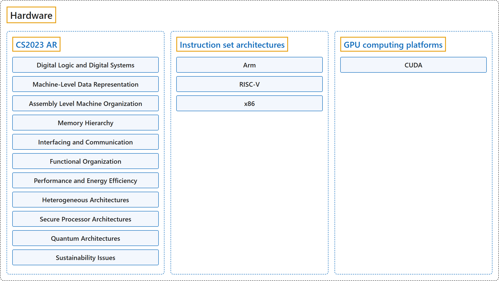

# Hardware

## Classification

## Glossary

| Term | Definition | 中文翻译 | Source |
|---|---|---|---|
| **Hardware** 硬件 | "The **material physical components** of an information system." | 信息系统的**有形物理组件**。 | [National Institute of Standards and Technology, n.d., "hardware" entry, definition 1](https://csrc.nist.gov/glossary/term/hardware#:~:text=The%20material%20physical%20components%20of%20an%20information%20system) |
| **[CS2023 AR](cs2023/index.md)** CS2023 AR | "The Architecture and Organization (AR) knowledge area aims to develop a **deeper understanding** of the **hardware environments** upon which almost all computing is based, and the relevant **interfaces** provided to higher software layers." | 计算机体系结构与组成（AR）知识领域旨在**加深理解**两方面：几乎所有计算赖以进行的**硬件环境**，以及为更高软件层提供的相关**接口**。 | [Joint Task Force on Computing Curricula, 2024, AR "Preamble" section, para. 2](https://csed.acm.org/wp-content/uploads/2024/04/3.1-Body-of-Knowledge-1.pdf#page=39) |
| **Instruction set architectures** 指令集架构 | "An **instruction set architecture (ISA)** is the **abstract interface** between a processor’s **hardware** and the **software** it runs. It defines the supported instructions, data types, registers, memory access models, and I/O handling, enabling **software compatibility** across different implementations of a processor family." | **指令集架构（ISA）** 是一种**抽象接口**，位于处理器的**硬件**与其运行的**软件**之间。它定义所支持的指令、数据类型、寄存器、内存访问模型和 I/O 处理方式，从而实现**软件兼容**，跨越同一处理器系列的不同实现。 | [Arm, n.d.-b, "What is Instruction Set Architecture (ISA)?" section, para. 1](https://www.arm.com/glossary/isa#:~:text=An%20instruction%20set%20architecture%20%28ISA%29%20is%20the%20abstract%20interface) |
| **GPU computing platforms** GPU 计算平台 | "In 2006, NVIDIA introduced the *Compute Unified Device Architecture* (**CUDA**) to enable **any computational workload** to use the **throughput capability of GPUs** independent of **graphics APIs**." | 2006 年，NVIDIA 推出了统一计算设备架构（**CUDA**），使**任何计算工作负载**都能利用 **GPU 的吞吐能力**，而不依赖于**图形 API**。 | [NVIDIA, n.d., "1.1.1. The Graphics Processing Unit" section, para. 2](https://docs.nvidia.com/cuda/cuda-programming-guide/01-introduction/introduction.html#the-graphics-processing-unit) |

## References

Arm. (n.d.-a). *Arm Architecture Reference Manual for A-profile architecture*. Retrieved October 24, 2026, from <https://developer.arm.com/documentation/ddi0487/latest>

Arm. (n.d.-b). *What is instruction set architecture (ISA)?* Arm Glossary. Retrieved October 25, 2026, from <https://www.arm.com/glossary/isa>

Intel. (n.d.). *Intel 64 and IA-32 Architectures Software Developer Manuals*. Retrieved October 24, 2026, from <https://www.intel.com/content/www/us/en/developer/articles/technical/intel-sdm.html>

Joint Task Force on Computing Curricula. (2024). *Computer science curricula 2023*. Association for Computing Machinery. <https://doi.org/10.1145/3664191>

National Institute of Standards and Technology. (n.d.). Hardware. In *CSRC glossary*. Retrieved October 25, 2026, from <https://csrc.nist.gov/glossary/term/hardware>

NVIDIA. (n.d.). *CUDA programming guide*. Retrieved October 25, 2026, from <https://docs.nvidia.com/cuda/cuda-programming-guide/>

RISC-V International. (n.d.). *The RISC-V instruction set manual*. Retrieved October 25, 2026, from <https://docs.riscv.org/reference/isa/>
