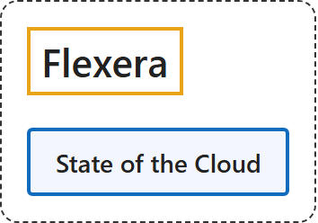

# 1. Flexera

## Classification

## Glossary

| Term | Definition | 中文翻译 | Source |
|---|---|---|---|
| **Flexera** Flexera | "We are the **industry leader in hybrid IT asset management (ITAM) and FinOps**, with the numbers to back it up." | 我们是**混合 IT 资产管理（ITAM）和 FinOps 领域的行业领导者**，并有数据作证。 | [Flexera, n.d., "The intelligence to make better decisions, the data to bring teams together" section, para. 1](https://www.flexera.com/about-us#:~:text=We%20are%20the%20industry%20leader%20in%20hybrid%20IT) |
| **State of the Cloud** 云现状报告 | "The fifteenth annual Flexera 2026 State of the Cloud Report sheds light on the **cloud computing trends**, the **pressures facing IT professionals** and the **strategic initiatives** they're utilizing to remain competitive in today's dynamic and evolving landscape." | 第十五期年度 Flexera 2026 云现状报告揭示了**云计算趋势**、**IT 专业人士面临的压力**，以及他们为保持竞争力而采用的**战略举措**。 | [Flexera, 2026a, "Overview" section, para. 1](https://info.flexera.com/CM-REPORT-State-of-the-Cloud#:~:text=The%20fifteenth%20annual%20Flexera%202026%20State%20of%20the) |

## Timeline

| Date | Report | Scope | Key figures | Source |
|---|---|---|---|---|
| 2024-03-12 | State of the Cloud, 2024 (13th edition) | "The survey tapped **753 IT professionals and executive leaders** worldwide, representing a broad cross-section of industries and context areas, in the winter of 2023." | "This year marks the **second year** in which **managing cloud spending is the top challenge** facing organizations." / "Respondents saw a slight increase in **multi-cloud usage**, up from 87% last year to **89%** this year." / "**Sixty-one percent** of large enterprises use **multi-cloud security**, and **57%** use **multi-cloud FinOps** (cost optimization) tools." | [Flexera, 2024, "Among the highlights" list and closing methodology para.](https://www.flexera.com/about-us/press-center/flexera-2024-state-of-the-cloud-managing-spending-top-challenge) |
| 2025-03-19 | State of the Cloud, 2025 (14th edition) | "polled **more than 750 technical professionals and executive leaders** worldwide who were involved in the use of cloud" | "**84%** of respondents believe that **managing cloud spend is the top cloud challenge** for organizations today." / "With cloud spend expected to **increase by 28%** in the coming year" / "nearly one-third (**33%**) of organizations are spending **more than $12 million annually** on the public cloud alone." / "**72%** of organizations reportedly **using the technology** either extensively or sparingly, as compared to 47% in 2024." | [Flexera, 2025, paras. 1, 2 and 4](https://www.flexera.com/about-us/press-center/new-flexera-report-finds-84-percent-of-organizations-struggle-to-manage-cloud-spend) |
| 2026-03-18 | State of the Cloud, 2026 (15th edition) | "The Flexera 2026 State of the Cloud survey tapped **753 technical professionals and executive leaders** worldwide in the winter of 2025." | "Estimated **wasted cloud spend ticked up to 29%**, reversing a five-year downward trend." / "Adoption of **CCOEs rose to 71%**, and **FinOps team prevalence climbed to 63%**." / "**Forty-five percent** of respondents say they're **using GenAI extensively**, up from 36% last year." / press release: "**81%** of respondents stating they are **using generative AI**, compared to 72% last year and 47% in 2024." | [Flexera, 2026a, "Methodology" and "Key findings" sections](https://info.flexera.com/CM-REPORT-State-of-the-Cloud#key-findings); [Flexera, 2026b, press release, paras. 1 and 3](https://www.flexera.com/about-us/press-center/flexera-finds-cloud-value-is-rising-while-ai-waste-grows) |

## References

Flexera. (2024, March 12). *Flexera 2024 State of the Cloud: Managing cloud spending is the top challenge of cloud computing, while AI, FinOps, security and sustainability demand attention* [Press release]. <https://www.flexera.com/about-us/press-center/flexera-2024-state-of-the-cloud-managing-spending-top-challenge>

Flexera. (2025, March 19). *New Flexera report finds that 84% of organizations struggle to manage cloud spend* [Press release]. <https://www.flexera.com/about-us/press-center/new-flexera-report-finds-84-percent-of-organizations-struggle-to-manage-cloud-spend>

Flexera. (2026a). *2026 State of the Cloud report*. <https://info.flexera.com/CM-REPORT-State-of-the-Cloud>

Flexera. (2026b, March 18). *Flexera finds cloud value is rising while AI waste grows* [Press release]. <https://www.flexera.com/about-us/press-center/flexera-finds-cloud-value-is-rising-while-ai-waste-grows>

Flexera. (n.d.). *About us*. Retrieved November 3, 2026, from <https://www.flexera.com/about-us>
