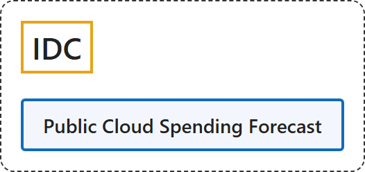

# 3. IDC

## Classification

## Glossary

| Term | Definition | 中文翻译 | Source |
|---|---|---|---|
| **IDC** 国际数据公司 | "Building a world where the **most trusted technology intelligence** makes **everyone better at what they do**." | 建设一个让**最值得信赖的技术情报**使**每个人都更擅长自己工作**的世界。 | [IDC, n.d., "We are the tech intelligence layer of the AI economy" section, para. 1](https://www.idc.com/about/#:~:text=Building%20a%20world%20where%20the%20most%20trusted%20technology) |
| **Public Cloud Spending Forecast** 公有云支出预测 | "Global spending on public cloud services is forecast to **surpass $1 trillion in 2026**" | 全球公有云服务支出预计**在 2026 年突破 1 万亿美元** | [IDC, 2026, para. 1](https://www.idc.com/resource-center/press-releases/publiccloudspend2026/#:~:text=Global%20spending%20on%20public%20cloud%20services%20is%20forecast) |

## Timeline

| Date | Report | Scope | Key figures | Source |
|---|---|---|---|---|
| 2026-03-04 | Public Cloud Spending Forecast for 2026 | Global spending on public cloud services | "Global spending on public cloud services is forecast to **surpass $1 trillion in 2026**", growing **over 21%**, expected to **double by 2029** / "**SaaS** will remain the largest public cloud deployment category in 2026, accounting for **more than half** of global spending." / "**PaaS** will be the fastest-growing deployment model, expanding **over 37%** year-over-year in 2026." | [IDC, 2026, "Global Public Cloud Market at a Glance", "SaaS Anchors Market Scale" and "PaaS Fuels Growth Momentum" sections](https://www.idc.com/resource-center/press-releases/publiccloudspend2026/) |

## References

IDC. (2026, March 4). *Global public cloud spending to surpass $1 trillion in 2026, driven by PaaS and AI platform adoption* [Press release]. <https://www.idc.com/resource-center/press-releases/publiccloudspend2026/>

IDC. (n.d.). *About IDC*. Retrieved November 3, 2026, from <https://www.idc.com/about/>
