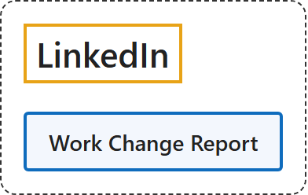

# 4. LinkedIn

## Classification

## Glossary

| Term | Definition | 中文翻译 | Source |
|---|---|---|---|
| **LinkedIn** 领英 | "Welcome to LinkedIn, the **world's largest professional network** with **more than 1 billion members**" | 欢迎来到 LinkedIn，**全球最大的职业社交网络**，拥有**超过 10 亿会员**。 | [LinkedIn, n.d., "About LinkedIn" section, para. 1](https://about.linkedin.com/#:~:text=Welcome%20to%20LinkedIn%2C%20the%20world%27s%20largest%20professional%20network) |
| **Work Change Report** 工作变革报告 | "Using insights gained from **more than one billion professionals and 69 million companies** across LinkedIn" | 利用来自 LinkedIn 上**超过十亿专业人士和 6,900 万家公司**的洞察 | [LinkedIn Economic Graph, 2025, "These changes are starting to be felt in the workplace" section](https://pulse.linkedin.com/research-and-trends/publications/work-change-report#:~:text=Using%20insights%20gained%20from%20more%20than%20one%20billion) |

## Timeline

| Date | Report | Scope | Key figures | Source |
|---|---|---|---|---|
| 2025-01 | Work Change Report: AI is coming to work | "Using insights gained from **more than one billion professionals and 69 million companies** across LinkedIn" | "By 2030, **70% of the skills used in most jobs will change**, with AI emerging as a catalyst." / "Since 2022, the rate at which LinkedIn members **add new skills** to their profiles has **increased by 140%**." | [LinkedIn Economic Graph, 2025, "These changes are starting to be felt in the workplace" section](https://pulse.linkedin.com/research-and-trends/publications/work-change-report) |

## References

LinkedIn Economic Graph. (2025, January). *Work Change Report: AI is coming to work*. <https://pulse.linkedin.com/research-and-trends/publications/work-change-report>

LinkedIn. (n.d.). *About LinkedIn*. Retrieved November 3, 2026, from <https://about.linkedin.com/>
