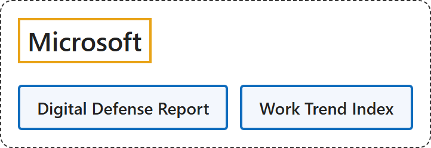

# 5. Microsoft

## Classification

## Glossary

| Term | Definition | 中文翻译 | Source |
|---|---|---|---|
| **Microsoft** 微软 | "Microsoft's mission is to **empower every person and every organization** on the planet to **achieve more**." | 微软的使命是**予力全球每一人、每一组织**，**成就不凡**。 | [Microsoft, n.d., para. 1](https://www.microsoft.com/en-us/about#:~:text=Microsoft%27s%20mission%20is%20to%20empower%20every%20person%20and) |
| **Digital Defense Report** 数字防御报告 | "This report helps organizations decode what is needed to **secure AI and build resilience** across the interconnected systems they depend on." | 这份报告帮助组织理解在相互关联的系统中**保护 AI 并建立韧性**需要什么。 | [Microsoft, 2026b, intro, para. 1](https://www.microsoft.com/en-us/corporate-responsibility/topics/cybersecurity/reports/microsoft-digital-defense-report/#:~:text=This%20report%20helps%20organizations%20decode%20what%20is%20needed) |
| **Work Trend Index** 工作趋势指数 | "The Work Trend Index survey was conducted by an **independent research firm**, Edelman Data x Intelligence, among **20,000** full-time employed or self-employed **knowledge workers** who use AI at work across **10 markets** between February 18, 2026, and April 7, 2026." | 工作趋势指数调查由**独立研究公司** Edelman Data x Intelligence 实施，于 2026 年 2 月 18 日至 4 月 7 日在 **10 个市场**调查了 **20,000 名**在工作中使用 AI 的全职或自雇**知识工作者**。 | [Microsoft, 2026a, "Work Trend Index Survey" section, para. 1](https://www.microsoft.com/en-us/worklab/work-trend-index/agents-human-agency-and-the-opportunity-for-every-organization#:~:text=The%20Work%20Trend%20Index%20survey%20was%20conducted%20by) |

## Timeline

| Date | Report | Scope | Key figures | Source |
|---|---|---|---|---|
| 2024-10-15 | Digital Defense Report 2024 | "**78 trillion** security signals per day inform our insights" | "our customers face **more than 600 million** cybercriminal and nation-state attacks every day" / "Microsoft Threat Intelligence now tracks **more than 1,500 unique threat groups**" / "Microsoft observed a **2.75x year-over-year increase** in human-operated **ransomware**-linked encounters" / "**password-based attacks** make up **over 99%** of the 600 million daily identity attacks." | [Microsoft, 2024, "Overview", "Microsoft's unique vantage point", "Ransomware" and "Identity and social engineering" sections](https://www.microsoft.com/en-us/security/security-insider/threat-landscape/microsoft-digital-defense-report-2024#Ransomware) |
| 2025-04-23 | Work Trend Index 2025: The year the Frontier Firm is born | "among **31,000** full-time employed or self-employed knowledge workers across **31 markets**" "between February 6, 2025 and March 24, 2025" | "Nearly half of leaders (**46%**) say their companies are **using agents to fully automate workflows** or processes" / "**28% of managers** are considering **hiring AI workforce managers** to lead hybrid teams of people and agents" / "**67% of leaders** are familiar or extremely familiar with agents, compared to just **40% of employees**." | [Microsoft, 2025a, sections 2 and 3, "The race to be an agent boss" and "Survey Methodology"](https://www.microsoft.com/en-us/worklab/work-trend-index/2025-the-year-the-frontier-firm-is-born) |
| 2025-10-16 | Digital Defense Report 2025 | Trends from July 2024 through June 2025 | "Adversaries are increasingly **attacking the cloud**, with **destructive campaigns up 87%**." / "**AI-driven phishing** is now **three times more effective** than traditional campaigns, and over 40% of ransomware attacks have a hybrid component." / "**28%** of breaches were initiated through **phishing or social engineering**, 18% were via unpatched web assets, and 12% leveraged exposed remote services." | [Microsoft, 2025b, "Key themes" and "Diversity in initial access" sections](https://www.microsoft.com/en-us/security/security-insider/threat-landscape/microsoft-digital-defense-report-2025#Key-themes) |
| 2026-05-05 | Work Trend Index 2026: Agents, human agency, and the opportunity for every organization | "among **20,000** full-time employed or self-employed knowledge workers who use AI at work across **10 markets**" "between February 18, 2026, and April 7, 2026." | "The number of **active agents** in the Microsoft 365 ecosystem has **grown 15x year over year**" / "In software and technology, adoption is broad, accounting for **nearly one in five of all firms using agents**." | [Microsoft, 2026a, Section III "Redesigning systems and processes", "AI scales differently by industry" and "Work Trend Index Survey"](https://www.microsoft.com/en-us/worklab/work-trend-index/agents-human-agency-and-the-opportunity-for-every-organization) |
| 2026-10-01 | Digital Defense Report 2026 | "**165+ trillion**" "Security signals processed daily"; data from July 1, 2025 to June 30, 2026 | "**63%**" "Of intrusions involved **data theft**" / "**5.3 hours**" "Average time before **exposed cloud workloads were attacked**" / "**15.8%**" "Increase year-on-year in **ransom detonations** against enterprises." / "**78%**" "Of observed attack techniques against critical infrastructure used **cloud identity abuse**." | [Microsoft, 2026b, "Key figures from the report", "Cybercrime" and "Resilience" sections](https://www.microsoft.com/en-us/corporate-responsibility/topics/cybersecurity/reports/microsoft-digital-defense-report/#section-cybercrime) |

## References

Microsoft. (2024, October 15). *Microsoft Digital Defense Report 2024*. Microsoft Security Insider. <https://www.microsoft.com/en-us/security/security-insider/threat-landscape/microsoft-digital-defense-report-2024>

Microsoft. (2025a, April 23). *2025: The year the Frontier Firm is born* (Work Trend Index Annual Report). Microsoft WorkLab. <https://www.microsoft.com/en-us/worklab/work-trend-index/2025-the-year-the-frontier-firm-is-born>

Microsoft. (2025b, October 16). *Microsoft Digital Defense Report 2025*. Microsoft Security Insider. <https://www.microsoft.com/en-us/security/security-insider/threat-landscape/microsoft-digital-defense-report-2025>

Microsoft. (2026a, May 5). *Agents, human agency, and the opportunity for every organization* (Work Trend Index Annual Report). Microsoft WorkLab. <https://www.microsoft.com/en-us/worklab/work-trend-index/agents-human-agency-and-the-opportunity-for-every-organization>

Microsoft. (2026b, October 1). *Microsoft Digital Defense Report 2026*. <https://www.microsoft.com/en-us/corporate-responsibility/topics/cybersecurity/reports/microsoft-digital-defense-report/>

Microsoft. (n.d.). *About Microsoft*. Retrieved November 3, 2026, from <https://www.microsoft.com/en-us/about>
