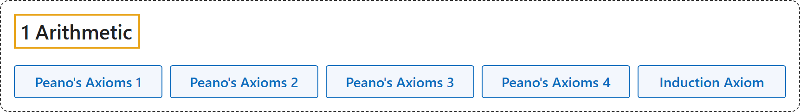

# 1 Arithmetic

## Classification

## Glossary

| Term | Definition | 中文翻译 | Source |
|---|---|---|---|
| **[1 Arithmetic](1-arithmetic.md)** 算术 | "Peano's axioms **characterize the natural numbers** as follows." | 皮亚诺公理**这样刻画自然数**： | [Weisstein, n.d., "Peano's axioms" entry](https://mathworld.wolfram.com/PeanosAxioms.html) |
| **Peano's Axioms 1** 皮亚诺公理 1 | "Zero is a number." | 0 是一个数。 | [Weisstein, n.d., "Peano's axioms" entry](https://mathworld.wolfram.com/PeanosAxioms.html) |
| **Peano's Axioms 2** 皮亚诺公理 2 | "If a is a number, the successor of a is a number." | 若 a 是一个数，则 a 的后继也是一个数。 | [Weisstein, n.d., "Peano's axioms" entry](https://mathworld.wolfram.com/PeanosAxioms.html) |
| **Peano's Axioms 3** 皮亚诺公理 3 | "Zero is not the successor of a number." | 0 不是任何数的后继。 | [Weisstein, n.d., "Peano's axioms" entry](https://mathworld.wolfram.com/PeanosAxioms.html) |
| **Peano's Axioms 4** 皮亚诺公理 4 | "Two numbers of which the successors are equal are themselves equal." | 后继相等的两个数本身相等。 | [Weisstein, n.d., "Peano's axioms" entry](https://mathworld.wolfram.com/PeanosAxioms.html) |
| **Induction Axiom** 归纳公理（皮亚诺公理 5） | "If a set S of numbers contains zero and also the successor of every number in S, then every number is in S." | 若一个数集 S 包含 0，并且包含 S 中每个数的后继，则所有数都在 S 中。 | [Weisstein, n.d., "Peano's axioms" entry](https://mathworld.wolfram.com/PeanosAxioms.html) |

## References

Megill, N. (2026). *Metamath Proof Explorer home page* (last updated January 19, 2026). Metamath. Retrieved October 29, 2026, from <https://us.metamath.org/mpeuni/mmset.html>

Weisstein, E. W. (n.d.). *Peano's axioms*. MathWorld. Retrieved October 29, 2026, from <https://mathworld.wolfram.com/PeanosAxioms.html>
