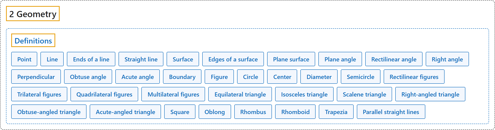

# Definitions

## Classification

## Glossary

| Term | Definition | 中文翻译 | Source |
|---|---|---|---|
| **[2 Geometry](index.md)** 几何 | (No definition) | （无定义） | [Euclid, ca. 300 B.C.E./1996, Book I, "Definitions"](https://mathcs.clarku.edu/~djoyce/elements/bookI/bookI.html#defs) |
| **[Definitions](0-definitions.md)** 定义 | (No definition) | （无定义） | [Euclid, ca. 300 B.C.E./1996, Book I, "Definitions"](https://mathcs.clarku.edu/~djoyce/elements/bookI/bookI.html#defs) |
| **Point** 点 | "A **point** is that which has no part." | **点**是没有部分的东西。 | [Euclid, ca. 300 B.C.E./1996, Book I, Definition 1](https://mathcs.clarku.edu/~djoyce/elements/bookI/defI1.html) |
| **Line** 线 | "A **line** is breadthless length." | **线**是没有宽度的长度。 | [Euclid, ca. 300 B.C.E./1996, Book I, Definition 2](https://mathcs.clarku.edu/~djoyce/elements/bookI/defI2.html) |
| **Ends of a line** 线的端点 | "**The ends of a line** are points." | **线的两端**是点。 | [Euclid, ca. 300 B.C.E./1996, Book I, Definition 3](https://mathcs.clarku.edu/~djoyce/elements/bookI/defI3.html) |
| **Straight line** 直线 | "A **straight line** is a line which lies evenly with the points on itself." | **直线**是与其上的点平齐地放置的线。 | [Euclid, ca. 300 B.C.E./1996, Book I, Definition 4](https://mathcs.clarku.edu/~djoyce/elements/bookI/defI4.html) |
| **Surface** 面 | "A **surface** is that which has length and breadth only." | **面**是只有长度和宽度的东西。 | [Euclid, ca. 300 B.C.E./1996, Book I, Definition 5](https://mathcs.clarku.edu/~djoyce/elements/bookI/defI5.html) |
| **Edges of a surface** 面的边 | "**The edges of a surface** are lines." | **面的边**是线。 | [Euclid, ca. 300 B.C.E./1996, Book I, Definition 6](https://mathcs.clarku.edu/~djoyce/elements/bookI/defI6.html) |
| **Plane surface** 平面 | "A **plane surface** is a surface which lies evenly with the straight lines on itself." | **平面**是与其上的直线平齐地放置的面。 | [Euclid, ca. 300 B.C.E./1996, Book I, Definition 7](https://mathcs.clarku.edu/~djoyce/elements/bookI/defI7.html) |
| **Plane angle** 平面角 | "A **plane angle** is the inclination to one another of two lines in a plane which meet one another and do not lie in a straight line." | **平面角**是平面上相交而不在一条直线上的两条线彼此的倾斜度。 | [Euclid, ca. 300 B.C.E./1996, Book I, Definition 8](https://mathcs.clarku.edu/~djoyce/elements/bookI/defI8.html) |
| **Rectilinear angle** 直线角 | "And when the lines containing the angle are straight, the angle is called **rectilinear**." | 当夹成角的线是直线时，这个角称为**直线角**。 | [Euclid, ca. 300 B.C.E./1996, Book I, Definition 9](https://mathcs.clarku.edu/~djoyce/elements/bookI/defI9.html) |
| **Right angle** 直角 | "When a straight line standing on a straight line makes the adjacent angles equal to one another, each of the equal angles is **right**" | 一条直线立在另一条直线上，使相邻两角彼此相等时，相等的每个角都是**直角** | [Euclid, ca. 300 B.C.E./1996, Book I, Definition 10](https://mathcs.clarku.edu/~djoyce/elements/bookI/defI10.html) |
| **Perpendicular** 垂线 | "the straight line standing on the other is called a **perpendicular** to that on which it stands." | 立在另一条直线上的那条直线称为它所立直线的**垂线**。 | [Euclid, ca. 300 B.C.E./1996, Book I, Definition 10](https://mathcs.clarku.edu/~djoyce/elements/bookI/defI10.html) |
| **Obtuse angle** 钝角 | "An **obtuse angle** is an angle greater than a right angle." | **钝角**是大于直角的角。 | [Euclid, ca. 300 B.C.E./1996, Book I, Definition 11](https://mathcs.clarku.edu/~djoyce/elements/bookI/defI11.html) |
| **Acute angle** 锐角 | "An **acute angle** is an angle less than a right angle." | **锐角**是小于直角的角。 | [Euclid, ca. 300 B.C.E./1996, Book I, Definition 12](https://mathcs.clarku.edu/~djoyce/elements/bookI/defI11.html) |
| **Boundary** 边界 | "A **boundary** is that which is an extremity of anything." | **边界**是任何东西的端部。 | [Euclid, ca. 300 B.C.E./1996, Book I, Definition 13](https://mathcs.clarku.edu/~djoyce/elements/bookI/defI13.html) |
| **Figure** 图形 | "A **figure** is that which is contained by any boundary or boundaries." | **图形**是由一条或几条边界围成的东西。 | [Euclid, ca. 300 B.C.E./1996, Book I, Definition 14](https://mathcs.clarku.edu/~djoyce/elements/bookI/defI13.html) |
| **Circle** 圆 | "A **circle** is a plane figure contained by one line such that all the straight lines falling upon it from one point among those lying within the figure equal one another." | **圆**是由一条线围成的平面图形，从图形内某一点到这条线的所有直线都彼此相等。 | [Euclid, ca. 300 B.C.E./1996, Book I, Definition 15](https://mathcs.clarku.edu/~djoyce/elements/bookI/defI15.html) |
| **Center** 圆心 | "And the point is called the **center** of the circle." | 这个点称为圆的**圆心**。 | [Euclid, ca. 300 B.C.E./1996, Book I, Definition 16](https://mathcs.clarku.edu/~djoyce/elements/bookI/defI15.html) |
| **Diameter** 直径 | "A **diameter** of the circle is any straight line drawn through the center and terminated in both directions by the circumference of the circle, and such a straight line also bisects the circle." | 圆的**直径**是经过圆心、两端都终止于圆周的任何直线，这样的直线也把圆平分。 | [Euclid, ca. 300 B.C.E./1996, Book I, Definition 17](https://mathcs.clarku.edu/~djoyce/elements/bookI/defI15.html) |
| **Semicircle** 半圆 | "A **semicircle** is the figure contained by the diameter and the circumference cut off by it." | **半圆**是由直径和被它截下的圆周围成的图形。 | [Euclid, ca. 300 B.C.E./1996, Book I, Definition 18](https://mathcs.clarku.edu/~djoyce/elements/bookI/defI15.html) |
| **Rectilinear figures** 直线形 | "**Rectilinear figures** are those which are contained by straight lines" | **直线形**是由直线围成的图形 | [Euclid, ca. 300 B.C.E./1996, Book I, Definition 19](https://mathcs.clarku.edu/~djoyce/elements/bookI/defI19.html) |
| **Trilateral figures** 三边形 | "**trilateral** figures being those contained by three" | **三边形**是由三条直线围成的图形 | [Euclid, ca. 300 B.C.E./1996, Book I, Definition 19](https://mathcs.clarku.edu/~djoyce/elements/bookI/defI19.html) |
| **Quadrilateral figures** 四边形 | "**quadrilateral** those contained by four" | **四边形**是由四条直线围成的图形 | [Euclid, ca. 300 B.C.E./1996, Book I, Definition 19](https://mathcs.clarku.edu/~djoyce/elements/bookI/defI19.html) |
| **Multilateral figures** 多边形 | "**multilateral** those contained by more than four straight lines." | **多边形**是由四条以上直线围成的图形。 | [Euclid, ca. 300 B.C.E./1996, Book I, Definition 19](https://mathcs.clarku.edu/~djoyce/elements/bookI/defI19.html) |
| **Equilateral triangle** 等边三角形 | "Of trilateral figures, an **equilateral triangle** is that which has its three sides equal" | 三边形中，**等边三角形**是三条边都相等的三角形 | [Euclid, ca. 300 B.C.E./1996, Book I, Definition 20](https://mathcs.clarku.edu/~djoyce/elements/bookI/defI20.html) |
| **Isosceles triangle** 等腰三角形 | "an **isosceles triangle** that which has two of its sides alone equal" | **等腰三角形**是只有两条边相等的三角形 | [Euclid, ca. 300 B.C.E./1996, Book I, Definition 20](https://mathcs.clarku.edu/~djoyce/elements/bookI/defI20.html) |
| **Scalene triangle** 不等边三角形 | "a **scalene triangle** that which has its three sides unequal." | **不等边三角形**是三条边都不相等的三角形。 | [Euclid, ca. 300 B.C.E./1996, Book I, Definition 20](https://mathcs.clarku.edu/~djoyce/elements/bookI/defI20.html) |
| **Right-angled triangle** 直角三角形 | "Further, of trilateral figures, a **right-angled triangle** is that which has a right angle" | 此外，三边形中，**直角三角形**是有一个直角的三角形 | [Euclid, ca. 300 B.C.E./1996, Book I, Definition 21](https://mathcs.clarku.edu/~djoyce/elements/bookI/defI20.html) |
| **Obtuse-angled triangle** 钝角三角形 | "an **obtuse-angled triangle** that which has an obtuse angle" | **钝角三角形**是有一个钝角的三角形 | [Euclid, ca. 300 B.C.E./1996, Book I, Definition 21](https://mathcs.clarku.edu/~djoyce/elements/bookI/defI20.html) |
| **Acute-angled triangle** 锐角三角形 | "an **acute-angled triangle** that which has its three angles acute." | **锐角三角形**是三个角都是锐角的三角形。 | [Euclid, ca. 300 B.C.E./1996, Book I, Definition 21](https://mathcs.clarku.edu/~djoyce/elements/bookI/defI20.html) |
| **Square** 正方形 | "Of quadrilateral figures, a **square** is that which is both equilateral and right-angled" | 四边形中，**正方形**是四边相等且四角都是直角的四边形 | [Euclid, ca. 300 B.C.E./1996, Book I, Definition 22](https://mathcs.clarku.edu/~djoyce/elements/bookI/defI22.html) |
| **Oblong** 长方形 | "an **oblong** that which is right-angled but not equilateral" | **长方形**是四角都是直角但四边不都相等的四边形 | [Euclid, ca. 300 B.C.E./1996, Book I, Definition 22](https://mathcs.clarku.edu/~djoyce/elements/bookI/defI22.html) |
| **Rhombus** 菱形 | "a **rhombus** that which is equilateral but not right-angled" | **菱形**是四边相等但角不是直角的四边形 | [Euclid, ca. 300 B.C.E./1996, Book I, Definition 22](https://mathcs.clarku.edu/~djoyce/elements/bookI/defI22.html) |
| **Rhomboid** 长斜方形 | "a **rhomboid** that which has its opposite sides and angles equal to one another but is neither equilateral nor right-angled." | **长斜方形**是对边、对角分别相等，但四边不都相等、角也不是直角的四边形。 | [Euclid, ca. 300 B.C.E./1996, Book I, Definition 22](https://mathcs.clarku.edu/~djoyce/elements/bookI/defI22.html) |
| **Trapezia** 不规则四边形 | "And let quadrilaterals other than these be called **trapezia**." | 其余的四边形称为**不规则四边形**。 | [Euclid, ca. 300 B.C.E./1996, Book I, Definition 22](https://mathcs.clarku.edu/~djoyce/elements/bookI/defI22.html) |
| **Parallel straight lines** 平行线 | "**Parallel** straight lines are straight lines which, being in the same plane and being produced indefinitely in both directions, do not meet one another in either direction." | **平行**直线是在同一平面内、向两个方向无限延长后在两个方向都不相交的直线。 | [Euclid, ca. 300 B.C.E./1996, Book I, Definition 23](https://mathcs.clarku.edu/~djoyce/elements/bookI/defI23.html) |

## References

Euclid. (1996). *Euclid's Elements* (D. E. Joyce, Ed.; T. L. Heath, Trans.). Clark University. (Original work published ca. 300 B.C.E.) Retrieved October 29, 2026, from <https://mathcs.clarku.edu/~djoyce/elements/bookI/bookI.html>

Hilbert, D. (1902). *The foundations of geometry* (E. J. Townsend, Trans.). Open Court. Project Gutenberg. <https://www.gutenberg.org/ebooks/17384>

Megill, N. (2026). *Metamath Proof Explorer home page* (last updated January 19, 2026). Metamath. Retrieved October 29, 2026, from <https://us.metamath.org/mpeuni/mmset.html>
