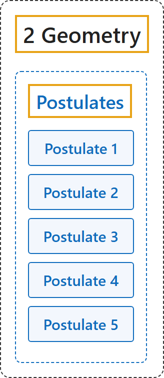

# Postulates

## Classification

## Glossary

| Term | Definition | 中文翻译 | Source |
|---|---|---|---|
| **[2 Geometry](index.md)** 几何 | (No definition) | （无定义） | [Euclid, ca. 300 B.C.E./1996, Book I, "Postulates"](https://mathcs.clarku.edu/~djoyce/elements/bookI/bookI.html#posts) |
| **[Postulates](1-postulates.md)** 公设 | (No definition) | （无定义） | [Euclid, ca. 300 B.C.E./1996, Book I, "Postulates"](https://mathcs.clarku.edu/~djoyce/elements/bookI/bookI.html#posts) |
| **Postulate 1** 公设 1 | "To draw a straight line from any point to any point." | 从任一点到任一点可以作一条直线。 | [Euclid, ca. 300 B.C.E./1996, Book I, "Postulates"](https://mathcs.clarku.edu/~djoyce/elements/bookI/bookI.html#posts) |
| **Postulate 2** 公设 2 | "To produce a finite straight line continuously in a straight line." | 有限直线可以沿直线连续延长。 | [Euclid, ca. 300 B.C.E./1996, Book I, "Postulates"](https://mathcs.clarku.edu/~djoyce/elements/bookI/bookI.html#posts) |
| **Postulate 3** 公设 3 | "To describe a circle with any center and radius." | 以任一点为圆心、任意长为半径可以作圆。 | [Euclid, ca. 300 B.C.E./1996, Book I, "Postulates"](https://mathcs.clarku.edu/~djoyce/elements/bookI/bookI.html#posts) |
| **Postulate 4** 公设 4 | "That all right angles equal one another." | 所有直角都相等。 | [Euclid, ca. 300 B.C.E./1996, Book I, "Postulates"](https://mathcs.clarku.edu/~djoyce/elements/bookI/bookI.html#posts) |
| **Postulate 5** 公设 5 | "That, if a straight line falling on two straight lines makes the interior angles on the same side less than two right angles, the two straight lines, if produced indefinitely, meet on that side on which are the angles less than the two right angles." | 一条直线与两条直线相交，若同侧两个内角之和小于两直角，则这两条直线无限延长后，在内角和小于两直角的一侧相交（平行公设）。 | [Euclid, ca. 300 B.C.E./1996, Book I, "Postulates"](https://mathcs.clarku.edu/~djoyce/elements/bookI/bookI.html#posts) |

## References

Euclid. (1996). *Euclid's Elements* (D. E. Joyce, Ed.; T. L. Heath, Trans.). Clark University. (Original work published ca. 300 B.C.E.) Retrieved October 29, 2026, from <https://mathcs.clarku.edu/~djoyce/elements/bookI/bookI.html>

Hilbert, D. (1902). *The foundations of geometry* (E. J. Townsend, Trans.). Open Court. Project Gutenberg. <https://www.gutenberg.org/ebooks/17384>

Megill, N. (2026). *Metamath Proof Explorer home page* (last updated January 19, 2026). Metamath. Retrieved October 29, 2026, from <https://us.metamath.org/mpeuni/mmset.html>
