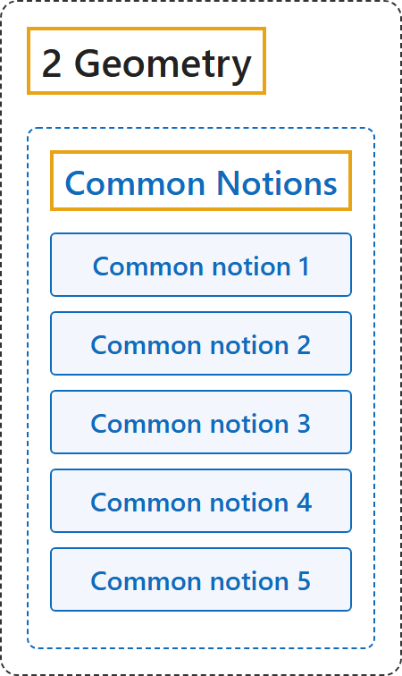

# Common Notions

## Classification

## Glossary

| Term | Definition | 中文翻译 | Source |
|---|---|---|---|
| **[2 Geometry](index.md)** 几何 | (No definition) | （无定义） | [Euclid, ca. 300 B.C.E./1996, Book I, "Postulates"](https://mathcs.clarku.edu/~djoyce/elements/bookI/bookI.html#posts) |
| **[Common Notions](2-common-notions.md)** 公理（一般概念） | (No definition) | （无定义） | [Euclid, ca. 300 B.C.E./1996, Book I, "Common Notions"](https://mathcs.clarku.edu/~djoyce/elements/bookI/bookI.html#cns) |
| **Common notion 1** 公理 1 | "Things which equal the same thing also equal one another." | 等于同一个量的量彼此相等。 | [Euclid, ca. 300 B.C.E./1996, Book I, "Common Notions"](https://mathcs.clarku.edu/~djoyce/elements/bookI/bookI.html#cns) |
| **Common notion 2** 公理 2 | "If equals are added to equals, then the wholes are equal." | 等量加等量，和相等。 | [Euclid, ca. 300 B.C.E./1996, Book I, "Common Notions"](https://mathcs.clarku.edu/~djoyce/elements/bookI/bookI.html#cns) |
| **Common notion 3** 公理 3 | "If equals are subtracted from equals, then the remainders are equal." | 等量减等量，差相等。 | [Euclid, ca. 300 B.C.E./1996, Book I, "Common Notions"](https://mathcs.clarku.edu/~djoyce/elements/bookI/bookI.html#cns) |
| **Common notion 4** 公理 4 | "Things which coincide with one another equal one another." | 彼此重合的东西相等。 | [Euclid, ca. 300 B.C.E./1996, Book I, "Common Notions"](https://mathcs.clarku.edu/~djoyce/elements/bookI/bookI.html#cns) |
| **Common notion 5** 公理 5 | "The whole is greater than the part." | 整体大于部分。 | [Euclid, ca. 300 B.C.E./1996, Book I, "Common Notions"](https://mathcs.clarku.edu/~djoyce/elements/bookI/bookI.html#cns) |

## References

Euclid. (1996). *Euclid's Elements* (D. E. Joyce, Ed.; T. L. Heath, Trans.). Clark University. (Original work published ca. 300 B.C.E.) Retrieved October 29, 2026, from <https://mathcs.clarku.edu/~djoyce/elements/bookI/bookI.html>

Hilbert, D. (1902). *The foundations of geometry* (E. J. Townsend, Trans.). Open Court. Project Gutenberg. <https://www.gutenberg.org/ebooks/17384>

Megill, N. (2026). *Metamath Proof Explorer home page* (last updated January 19, 2026). Metamath. Retrieved October 29, 2026, from <https://us.metamath.org/mpeuni/mmset.html>
