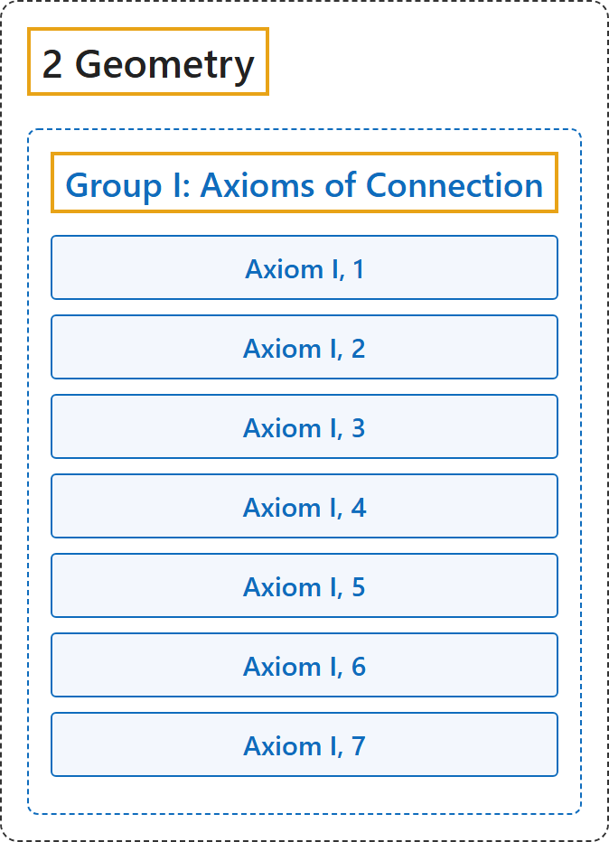

# Group I: Axioms of Connection

## Classification

## Glossary

| Term | Definition | 中文翻译 | Source |
|---|---|---|---|
| **[2 Geometry](index.md)** 几何 | (No definition) | （无定义） | [Euclid, ca. 300 B.C.E./1996, Book I, "Postulates"](https://mathcs.clarku.edu/~djoyce/elements/bookI/bookI.html#posts) |
| **[Group I: Axioms of Connection](3-group-i-axioms-of-connection.md)** 第一组：关联公理 | "The axioms of this group **establish a connection between the concepts** indicated above; namely, **points, straight lines, and planes**." | 这一组公理**在前面所说的概念之间建立联系**，即**点、直线和平面**。 | [Hilbert, 1902, § 2](https://www.gutenberg.org/ebooks/17384) |
| **Axiom I, 1** 公理 I, 1 | "Two distinct points A and B always completely determine a straight line a. We write AB = a or BA = a." | 两个不同的点 A、B 总能完全确定一条直线 a，记作 AB = a 或 BA = a。 | [Hilbert, 1902, § 2](https://www.gutenberg.org/ebooks/17384) |
| **Axiom I, 2** 公理 I, 2 | "Any two distinct points of a straight line completely determine that line; that is, if AB = a and AC = a, where B ≠ C, then is also BC = a." | 直线上任意两个不同的点完全确定这条直线：若 AB = a、AC = a 且 B ≠ C，则 BC = a。 | [Hilbert, 1902, § 2](https://www.gutenberg.org/ebooks/17384) |
| **Axiom I, 3** 公理 I, 3 | "Three points A, B, C not situated in the same straight line always completely determine a plane α. We write ABC = α." | 不在同一直线上的三点 A、B、C 总能完全确定一个平面 α，记作 ABC = α。 | [Hilbert, 1902, § 2](https://www.gutenberg.org/ebooks/17384) |
| **Axiom I, 4** 公理 I, 4 | "Any three points A, B, C of a plane α, which do not lie in the same straight line, completely determine that plane." | 平面 α 上不在同一直线上的任意三点 A、B、C 完全确定这个平面。 | [Hilbert, 1902, § 2](https://www.gutenberg.org/ebooks/17384) |
| **Axiom I, 5** 公理 I, 5 | "If two points A, B of a straight line a lie in a plane α, then every point of a lies in a." | 若直线 a 上的两点 A、B 在平面 α 内，则 a 上的每一点都在 α 内（原文末尾的 a 应为 α）。 | [Hilbert, 1902, § 2](https://www.gutenberg.org/ebooks/17384) |
| **Axiom I, 6** 公理 I, 6 | "If two planes α, β have a point A in common, then they have at least a second point B in common." | 若两个平面 α、β 有一个公共点 A，则它们至少还有第二个公共点 B。 | [Hilbert, 1902, § 2](https://www.gutenberg.org/ebooks/17384) |
| **Axiom I, 7** 公理 I, 7 | "Upon every straight line there exist at least two points, in every plane at least three points not lying in the same straight line, and in space there exist at least four points not lying in a plane." | 每条直线上至少有两点；每个平面上至少有三点不在同一直线上；空间中至少有四点不在同一平面上。 | [Hilbert, 1902, § 2](https://www.gutenberg.org/ebooks/17384) |

## References

Euclid. (1996). *Euclid's Elements* (D. E. Joyce, Ed.; T. L. Heath, Trans.). Clark University. (Original work published ca. 300 B.C.E.) Retrieved October 29, 2026, from <https://mathcs.clarku.edu/~djoyce/elements/bookI/bookI.html>

Hilbert, D. (1902). *The foundations of geometry* (E. J. Townsend, Trans.). Open Court. Project Gutenberg. <https://www.gutenberg.org/ebooks/17384>

Megill, N. (2026). *Metamath Proof Explorer home page* (last updated January 19, 2026). Metamath. Retrieved October 29, 2026, from <https://us.metamath.org/mpeuni/mmset.html>
