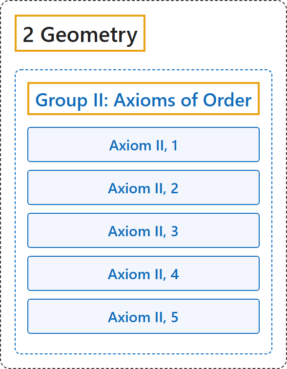

# Group II: Axioms of Order

## Classification

## Glossary

| Term | Definition | 中文翻译 | Source |
|---|---|---|---|
| **[2 Geometry](index.md)** 几何 | (No definition) | （无定义） | [Euclid, ca. 300 B.C.E./1996, Book I, "Postulates"](https://mathcs.clarku.edu/~djoyce/elements/bookI/bookI.html#posts) |
| **[Group II: Axioms of Order](4-group-ii-axioms-of-order.md)** 第二组：顺序公理 | "The axioms of this group **define the idea expressed by the word "between,"** and make possible, upon the basis of this idea, **an order of sequence of the points** upon a straight line, in a plane, and in space." | 这一组公理**定义“在……之间”这个词所表达的概念**，并在此基础上，使直线上、平面上和空间中的**点有先后顺序**。 | [Hilbert, 1902, § 3](https://www.gutenberg.org/ebooks/17384) |
| **Axiom II, 1** 公理 II, 1 | "If A, B, C are points of a straight line and B lies between A and C, then B lies also between C and A." | 若 A、B、C 是一条直线上的点，且 B 在 A 与 C 之间，则 B 也在 C 与 A 之间。 | [Hilbert, 1902, § 3](https://www.gutenberg.org/ebooks/17384) |
| **Axiom II, 2** 公理 II, 2 | "If A and C are two points of a straight line, then there exists at least one point B lying between A and C and at least one point D so situated that C lies between A and D." | 若 A、C 是直线上的两点，则至少有一点 B 在 A 与 C 之间，并且至少有一点 D 使 C 在 A 与 D 之间。 | [Hilbert, 1902, § 3](https://www.gutenberg.org/ebooks/17384) |
| **Axiom II, 3** 公理 II, 3 | "Of any three points situated on a straight line, there is always one and only one which lies between the other two." | 直线上任意三点中，有且只有一点在另两点之间。 | [Hilbert, 1902, § 3](https://www.gutenberg.org/ebooks/17384) |
| **Axiom II, 4** 公理 II, 4 | "Any four points A, B, C, D of a straight line can always be so arranged that B shall lie between A and C and also between A and D, and, furthermore, that C shall lie between A and D and also between B and D." | 直线上任意四点 A、B、C、D 总能这样排列：B 在 A 与 C 之间、也在 A 与 D 之间，C 在 A 与 D 之间、也在 B 与 D 之间。 | [Hilbert, 1902, § 3](https://www.gutenberg.org/ebooks/17384) |
| **Axiom II, 5** 公理 II, 5（帕施公理） | "Let A, B, C be three points not lying in the same straight line and let a be a straight line lying in the plane ABC and not passing through any of the points A, B, C. Then, if the straight line a passes through a point of the segment AB, it will also pass through either a point of the segment BC or a point of the segment AC." | 设 A、B、C 不共线，直线 a 在平面 ABC 内且不经过 A、B、C。若 a 经过线段 AB 上的一点，则它也经过线段 BC 或线段 AC 上的一点。 | [Hilbert, 1902, § 3](https://www.gutenberg.org/ebooks/17384) |

## References

Euclid. (1996). *Euclid's Elements* (D. E. Joyce, Ed.; T. L. Heath, Trans.). Clark University. (Original work published ca. 300 B.C.E.) Retrieved October 29, 2026, from <https://mathcs.clarku.edu/~djoyce/elements/bookI/bookI.html>

Hilbert, D. (1902). *The foundations of geometry* (E. J. Townsend, Trans.). Open Court. Project Gutenberg. <https://www.gutenberg.org/ebooks/17384>

Megill, N. (2026). *Metamath Proof Explorer home page* (last updated January 19, 2026). Metamath. Retrieved October 29, 2026, from <https://us.metamath.org/mpeuni/mmset.html>
