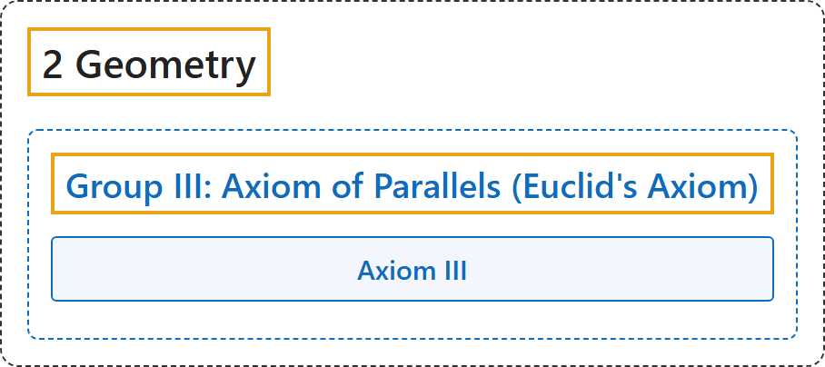

# Group III: Axiom of Parallels (Euclid's Axiom)

## Classification

## Glossary

| Term | Definition | 中文翻译 | Source |
|---|---|---|---|
| **[2 Geometry](index.md)** 几何 | (No definition) | （无定义） | [Euclid, ca. 300 B.C.E./1996, Book I, "Postulates"](https://mathcs.clarku.edu/~djoyce/elements/bookI/bookI.html#posts) |
| **[Group III: Axiom of Parallels (Euclid's Axiom)](5-group-iii-axiom-of-parallels-euclid-s-axiom.md)** 第三组：平行公理（欧几里得公理） | "The introduction of this axiom **simplifies greatly the fundamental principles of geometry** and facilitates in no small degree its development." | 引入这条公理**大大简化了几何的基本原理**，并在很大程度上便利了几何的发展。 | [Hilbert, 1902, § 5](https://www.gutenberg.org/ebooks/17384) |
| **Axiom III** 公理 III（平行公理） | "In a plane α there can be drawn through any point A, lying outside of a straight line a, one and only one straight line which does not intersect the line a. This straight line is called the parallel to a through the given point A." | 在平面 α 内，过直线 a 外的任一点 A，有且只有一条直线不与 a 相交，这条直线叫作过点 A 的 a 的平行线。 | [Hilbert, 1902, § 5](https://www.gutenberg.org/ebooks/17384) |

## References

Euclid. (1996). *Euclid's Elements* (D. E. Joyce, Ed.; T. L. Heath, Trans.). Clark University. (Original work published ca. 300 B.C.E.) Retrieved October 29, 2026, from <https://mathcs.clarku.edu/~djoyce/elements/bookI/bookI.html>

Hilbert, D. (1902). *The foundations of geometry* (E. J. Townsend, Trans.). Open Court. Project Gutenberg. <https://www.gutenberg.org/ebooks/17384>

Megill, N. (2026). *Metamath Proof Explorer home page* (last updated January 19, 2026). Metamath. Retrieved October 29, 2026, from <https://us.metamath.org/mpeuni/mmset.html>
