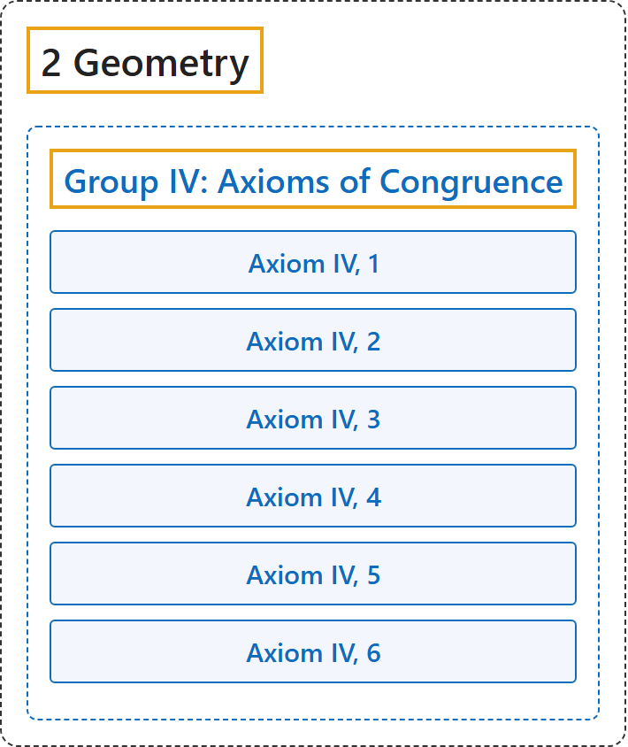

# Group IV: Axioms of Congruence

## Classification

## Glossary

| Term | Definition | 中文翻译 | Source |
|---|---|---|---|
| **[2 Geometry](index.md)** 几何 | (No definition) | （无定义） | [Euclid, ca. 300 B.C.E./1996, Book I, "Postulates"](https://mathcs.clarku.edu/~djoyce/elements/bookI/bookI.html#posts) |
| **[Group IV: Axioms of Congruence](6-group-iv-axioms-of-congruence.md)** 第四组：合同公理 | "The axioms of this group **define the idea of congruence or displacement**." | 这一组公理**定义合同（全等）或移动的概念**。 | [Hilbert, 1902, § 6](https://www.gutenberg.org/ebooks/17384) |
| **Axiom IV, 1** 公理 IV, 1 | "If A, B are two points on a straight line a, and if A′ is a point upon the same or another straight line a′, then, upon a given side of A′ on the straight line a′, we can always find one and only one point B′ so that the segment AB (or BA) is congruent to the segment A′B′. We indicate this relation by writing AB ≡ A′B′. Every segment is congruent to itself; that is, we always have AB ≡ AB." | 在直线 a′ 上点 A′ 的给定一侧，总能找到唯一的点 B′，使线段 AB 与 A′B′ 合同，记作 AB ≡ A′B′；每条线段都与自身合同。 | [Hilbert, 1902, § 6](https://www.gutenberg.org/ebooks/17384) |
| **Axiom IV, 2** 公理 IV, 2 | "If a segment AB is congruent to the segment A′B′ and also to the segment A″B″, then the segment A′B′ is congruent to the segment A″B″; that is, if AB ≡ A′B and AB ≡ A″B″, then A′B′ ≡ A″B″." | 若线段 AB 与 A′B′ 合同，也与 A″B″ 合同，则 A′B′ 与 A″B″ 合同（原文 “A′B” 应为 A′B′）。 | [Hilbert, 1902, § 6](https://www.gutenberg.org/ebooks/17384) |
| **Axiom IV, 3** 公理 IV, 3 | "Let AB and BC be two segments of a straight line a which have no points in common aside from the point B, and, furthermore, let A′B′ and B′C′ be two segments of the same or of another straight line a′ having, likewise, no point other than B′ in common. Then, if AB ≡ A′B′ and BC ≡ B′C′, we have AC ≡ A′C′." | 两条线段首尾相接、除公共端点外没有公共点；若对应的两段分别合同，则拼起来的整段也合同。 | [Hilbert, 1902, § 6](https://www.gutenberg.org/ebooks/17384) |
| **Axiom IV, 4** 公理 IV, 4 | "Let an angle (h,k) be given in the plane α and let a straight line a′ be given in a plane α′. Suppose also that, in the plane α′, a definite side of the straight line a′ be assigned. Denote by h′ a half-ray of the straight line a′ emanating from a point O′ of this line. Then in the plane α′ there is one and only one half-ray k′ such that the angle (h,k), or (k,h), is congruent to the angle (h′,k′) and at the same time all interior points of the angle (h′,k′) lie upon the given side of a′." | 在给定半射线的给定一侧，有且只有一种方法作出与已知角合同的角；每个角都与自身合同。 | [Hilbert, 1902, § 6](https://www.gutenberg.org/ebooks/17384) |
| **Axiom IV, 5** 公理 IV, 5 | "If the angle (h,k) is congruent to the angle (h′,k′) and to the angle (h″,k″), then the angle (h′,k′) is congruent to the angle (h″,k″)." | 若一个角与另外两个角都合同，则这两个角彼此合同。 | [Hilbert, 1902, § 6](https://www.gutenberg.org/ebooks/17384) |
| **Axiom IV, 6** 公理 IV, 6 | "If, in the two triangles ABC and A′B′C′ the congruences AB ≡ A′B′, AC ≡ A′C′, ∠BAC ≡ ∠B′A′C′ hold, then the congruences ∠ABC ≡ ∠A′B′C′ and ∠ACB ≡ ∠A′C′B′ also hold." | 两个三角形若两边及其夹角对应合同，则其余两角也对应合同（全等判定 SAS 的核心）。 | [Hilbert, 1902, § 6](https://www.gutenberg.org/ebooks/17384) |

## References

Euclid. (1996). *Euclid's Elements* (D. E. Joyce, Ed.; T. L. Heath, Trans.). Clark University. (Original work published ca. 300 B.C.E.) Retrieved October 29, 2026, from <https://mathcs.clarku.edu/~djoyce/elements/bookI/bookI.html>

Hilbert, D. (1902). *The foundations of geometry* (E. J. Townsend, Trans.). Open Court. Project Gutenberg. <https://www.gutenberg.org/ebooks/17384>

Megill, N. (2026). *Metamath Proof Explorer home page* (last updated January 19, 2026). Metamath. Retrieved October 29, 2026, from <https://us.metamath.org/mpeuni/mmset.html>
