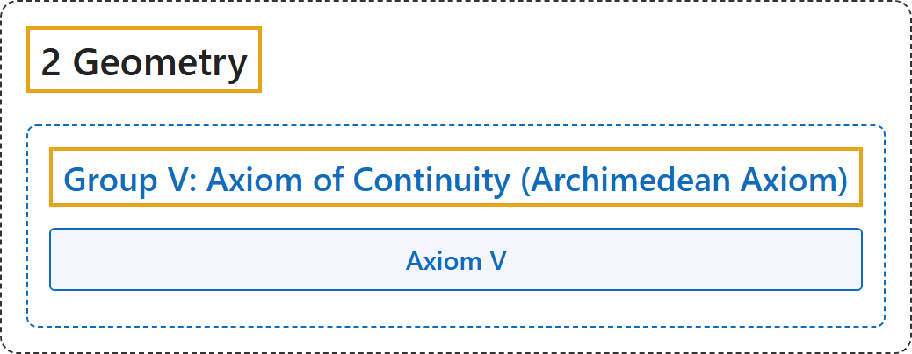

# Group V: Axiom of Continuity (Archimedean Axiom)

## Classification

## Glossary

| Term | Definition | 中文翻译 | Source |
|---|---|---|---|
| **[2 Geometry](index.md)** 几何 | (No definition) | （无定义） | [Euclid, ca. 300 B.C.E./1996, Book I, "Postulates"](https://mathcs.clarku.edu/~djoyce/elements/bookI/bookI.html#posts) |
| **[Group V: Axiom of Continuity (Archimedean Axiom)](7-group-v-axiom-of-continuity-archimedean-axiom.md)** 第五组：连续公理（阿基米德公理） | "This axiom **makes possible the introduction into geometry of the idea of continuity**." | 这条公理**使连续性的概念得以引入几何**。 | [Hilbert, 1902, § 8](https://www.gutenberg.org/ebooks/17384) |
| **Axiom V** 公理 V（阿基米德公理） | "Let A₁ be any point upon a straight line between the arbitrarily chosen points A and B. Take the points A₂, A₃, A₄, … so that A₁ lies between A and A₂, A₂ between A₁ and A₃, A₃ between A₂ and A₄ etc. Moreover, let the segments AA₁, A₁A₂, A₂A₃, A₃A₄, … be equal to one another. Then, among this series of points, there always exists a certain point Aₙ such that B lies between A and Aₙ." | 从 A 出发，沿直线一段接一段地截取等长线段，总有一个点 Aₙ 越过 B：再短的线段，重复足够多次，也能超过任何给定长度。 | [Hilbert, 1902, § 8](https://www.gutenberg.org/ebooks/17384) |

## References

Euclid. (1996). *Euclid's Elements* (D. E. Joyce, Ed.; T. L. Heath, Trans.). Clark University. (Original work published ca. 300 B.C.E.) Retrieved October 29, 2026, from <https://mathcs.clarku.edu/~djoyce/elements/bookI/bookI.html>

Hilbert, D. (1902). *The foundations of geometry* (E. J. Townsend, Trans.). Open Court. Project Gutenberg. <https://www.gutenberg.org/ebooks/17384>

Megill, N. (2026). *Metamath Proof Explorer home page* (last updated January 19, 2026). Metamath. Retrieved October 29, 2026, from <https://us.metamath.org/mpeuni/mmset.html>
