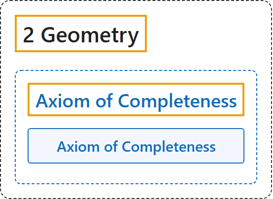

# Axiom of Completeness

## Classification

## Glossary

| Term | Definition | 中文翻译 | Source |
|---|---|---|---|
| **[2 Geometry](index.md)** 几何 | (No definition) | （无定义） | [Euclid, ca. 300 B.C.E./1996, Book I, "Postulates"](https://mathcs.clarku.edu/~djoyce/elements/bookI/bookI.html#posts) |
| **[Axiom of Completeness](8-axiom-of-completeness.md)** 完备公理 | "To the preceeding five groups of axioms, we may add the following one, which, although **not of a purely geometrical nature**, merits particular attention from a theoretical point of view." | 在前面五组公理之外，还可以加上下面这一条，它虽然**不纯粹是几何性质的**，但从理论上看值得特别注意。 | [Hilbert, 1902, § 8](https://www.gutenberg.org/ebooks/17384) |
| **Axiom of Completeness** 完备公理 | "To a system of points, straight lines, and planes, it is impossible to add other elements in such a manner that the system thus generalized shall form a new geometry obeying all of the five groups of axioms." | 不可能在点、直线、平面的系统中再添加其他元素，使扩充后的系统仍满足全部五组公理：几何的元素已经“满了”。 | [Hilbert, 1902, § 8](https://www.gutenberg.org/ebooks/17384) |

## References

Euclid. (1996). *Euclid's Elements* (D. E. Joyce, Ed.; T. L. Heath, Trans.). Clark University. (Original work published ca. 300 B.C.E.) Retrieved October 29, 2026, from <https://mathcs.clarku.edu/~djoyce/elements/bookI/bookI.html>

Hilbert, D. (1902). *The foundations of geometry* (E. J. Townsend, Trans.). Open Court. Project Gutenberg. <https://www.gutenberg.org/ebooks/17384>

Megill, N. (2026). *Metamath Proof Explorer home page* (last updated January 19, 2026). Metamath. Retrieved October 29, 2026, from <https://us.metamath.org/mpeuni/mmset.html>
